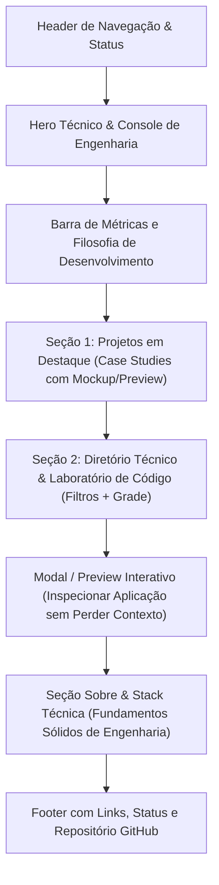

# 📋 Plano de Especificação e Escopo: Redesign do Portfólio de Sandro
**Conceito:** Engenheiro de Software & Showcase Interativo  
**Documento:** `docs/01-plano.md`  
**Autor:** Project Planner & Product Manager (Agência Autônoma)  
**Status:** Aprovado para Execução  
**Ambiente de Produção:** GitHub Pages (`https://sanjrhoff.github.io/portifolio/`)

---

## 1. Visão Geral e Propósito

O objetivo deste projeto é reformular completamente o portfólio web de **Sandro**, estudante e desenvolvedor de tecnologia, transformando uma interface genérica de "template de IA" em uma plataforma de apresentação profissional de alto impacto para **Engenharia de Software**.

O portfólio não será apenas uma lista passiva de links, mas um **Showcase Interativo e Vivo**, demonstrando domínio real de:
- Arquitetura de software frontend em JavaScript Puro (Vanilla JS).
- Manipulação avançada do DOM e gerenciamento de estado complexo.
- Integração de Web APIs modernas (Document Picture-in-Picture, LocalStorage, Web Audio, History/URL State).
- Criação de interfaces responsivas, acessíveis e com estética contemporânea inspirada em ferramentas profissionais de engenharia (Linear, Vercel, Raycast, GitHub).

---

## 2. Diagnóstico Crítico da Versão Atual

| Elemento Atual | Diagnóstico de Problema | Solução no Redesign |
| :--- | :--- | :--- |
| **Hero Centralizado Vazio** | Texto institucional robótico, sem personalidade técnica nem proposta de valor clara. | **Hero Técnico & Assertivo:** Apresentação focada em competências de engenharia, métricas de código (7 apps funcionais, 0 dependências pesadas) e terminal/badge interativo de status. |
| **Paleta de Cores Clichê** | Roxo saturado `#490cf0` com fundo claro `#f8fafc`, típico de prompts padrão de IA. | **Dark Mode de Alta Precisão:** Paleta Dark Grafite/Zinco (`#09090b`, `#18181b`, `#27272a`), com acentos técnicos em esmeralda (`#10b981`), ciano (`#06b6d4`) e âmbar (`#f59e0b`). |
| **Cards Idênticos ("Clones")** | Grid monótona de 6 cards de mesma dimensão, sem imagens, screenshots ou previews visuais. | **Hierarquia Editorial Dupla:** Divisão clara entre **Projetos em Destaque (Case Studies)** com mockups/preview visual rico e **Diretório Técnico / Laboratório** em grid/tabela condensada. |
| **Projeto Ausente** | `p_weather` existe no repositório mas não está exposto na landing page. | Inclusão de **todos os 7 projetos**, com destaque para a arquitetura de backend proxy seguro em `p_weather`. |
| **Links e Ações** | Botões funcionais, porém sem hierarquia de interação intuitiva. | Preservação mandatória dos botões **"Ver Aplicação"** e **"Ver Código"**, adicionando preview interativo/modal de detalhes sem fricção. |

---

## 3. Diretrizes de Design & Identidade Visual

### 3.1. Design Tokens & Paleta de Cores
A paleta adota a sofisticação dos temas escuros modernos baseados na escala Zinc/Neutral:
- **Background Principal (`--bg-canvas`):** `#09090b` (Zinco ultra profundo)
- **Superfície Secundária (`--bg-surface`):** `#121215` (Cards elevados e seções)
- **Superfície Hover (`--bg-surface-hover`):** `#18181b`
- **Bordas Sutis (`--border-subtle`):** `#27272a` (Delimitação geométrica limpa)
- **Bordas de Destaque (`--border-focus`):** `#3f3f46`
- **Texto Primário (`--text-primary`):** `#f4f4f5` (Contraste máximo, alta legibilidade)
- **Texto Secundário (`--text-secondary`):** `#a1a1aa` (Metadados e descrições)
- **Texto Mudo (`--text-muted`):** `#71717a` (Tags técnicas e carimbos)
- **Acentos Funcionais:**
  - *Accent Cyan (`--accent-cyan`):* `#06b6d4` / `#22d3ee` (Ações primárias e destaques técnicos)
  - *Accent Emerald (`--accent-emerald`):* `#10b981` (Status operacional "Online / Active")
  - *Accent Amber (`--accent-amber`):* `#f59e0b` (Métricas e badges experimentais)

### 3.2. Tipografia
- **Família Principal:** `Inter`, -apple-system, BlinkMacSystemFont, "Segoe UI", Roboto, sans-serif (para títulos legíveis e corpo de texto).
- **Família Monospace Técnica:** `JetBrains Mono`, `Fira Code`, "SF Mono", Consolas, monospace (para badges de stack, comandos de terminal, métricas e trechos de código).

### 3.3. Estética de Componentes
- Linhas milimétricas (`1px solid var(--border-subtle)`).
- Gradientes radiais sutis sob cursor ou em pontos focais do hero (Glow / Spotlight effect sutil).
- Mockups estruturados via HTML/CSS simulando janelas de aplicação (Window controls em semáforo discreto, barra de status técnica).
- Zero dependência de frameworks pesados (Bootstrap, Tailwind CLI pré-compilado, etc.). CSS3 puro e modular com variáveis nativas.

---

## 4. Mapeamento Técnico Completo dos 7 Projetos

Todos os 7 projetos existentes no repositório foram inspecionados e categorizados:

| Projeto & Diretório | Categoria | Destaques Técnicos & Desafios de Engenharia | Ação Demo | Ação Repositório |
| :--- | :--- | :--- | :--- | :--- |
| **1. Pomodoro Timer Pro** `p_pomodoro/` | **Case Study (Destaque #1)** | • Integração nativa com a **Document Picture-in-Picture API** do navegador. • Máquina de estados finita (Foco -> Pausa Curta -> Pausa Longa). • Cálculos precisos de tempo com Objeto `Date` e Web Audio para alarmes sonoros. | `./p_pomodoro/index.html` | `https://github.com/sanjrhoff/portifolio/blob/main/p_pomodoro/index.html` |
| **2. Tavern's Memory RPG** `p_memory/` | **Case Study (Destaque #2)** | • Motor de jogo (Game Loop) assíncrono com prevenção de *race conditions* no match. • Algoritmo de embaralhamento aleatório Fisher-Yates. • Transformações 3D no CSS puro (`transform-style: preserve-3d`, `rotateY`). • Tracking de movimentos e cronômetro em tempo real. | `./p_memory/index.html` | `https://github.com/sanjrhoff/portifolio/blob/main/p_memory/index.html` |
| **3. Markdown Notes & Previewer Suite** `p_markdown/` & `p_notes/` | **Case Study (Destaque #3)** | • Pipeline cliente com compilação de GitHub Flavored Markdown em tempo real. • Sanitização de segurança contra XSS via **DOMPurify** e parsing via Marked.js. • CRUD com persistência no LocalStorage e download de arquivos `.md` via Blob URL. | `./p_markdown/index.html` | `https://github.com/sanjrhoff/portifolio/blob/main/p_markdown/index.html` |
| **4. Markdown Notes App** `p_notes/` | **Diretório Técnico** | • CRUD de anotações com timestamps automáticos e busca rápida. • Renderização dinâmica de Markdown no navegador sem backend. | `./p_notes/index.html` | `https://github.com/sanjrhoff/portifolio/blob/main/p_notes/index.html` |
| **5. Flashcards 3D Study** `p_flashcards/` | **Diretório Técnico** | • Sistema interativo de repetição espaçada para estudos. • Manipulação de perspectiva 3D no CSS e gestão de baralhos locais via LocalStorage. | `./p_flashcards/index.html` | `https://github.com/sanjrhoff/portifolio/blob/main/p_flashcards/index.html` |
| **6. Quiz Master Pro** `p_quiz/` | **Diretório Técnico** | • SPA em Vanilla JS com fluxo dinâmico baseado em IDs de tela. • Motor estatístico com cálculo de aprovação (threshold 60%) e tempo total. • Persistência de sessões simuladas e pontuações no LocalStorage. | `./p_quiz/index.html` | `https://github.com/sanjrhoff/portifolio/blob/main/p_quiz/index.html` |
| **7. Glass Weather App** `p_weather/` | **Diretório Técnico (Arquitetura Segura)** | • Conceito de API Proxy segura em PHP protegendo chaves de API com `.env`. • Interface Glassmorphism moderna com busca geocodificada. • **Tratamento para GitHub Pages:** Interface com dados dinâmicos/fallback transparente e aviso de modo de segurança para hospedagem puramente estática. | `./p_weather/index.html` | `https://github.com/sanjrhoff/portifolio/blob/main/p_weather/index.html` |

---

## 5. Arquitetura de Informação da Nova Landing Page

A nova interface do arquivo raiz (`index.html`) será dividida nas seguintes seções:

### 5.1. Detalhamento das Seções:
1. **Header Fixo (Glass Blur):**
   - Nome e marca pessoal (`sandro.dev` ou `Sandro // Dev`).
   - Badge ativo de status (`🟢 Disponível para oportunidades / Estudando ativamente`).
   - Navegação direta para: `#destaques`, `#diretorio`, `#sobre`, `#contato`.
   - Botão rápido para perfil no GitHub (`@sanjrhoff`).

2. **Hero Técnico (Console de Engenharia):**
   - Título impactante focado em engenharia e desenvolvimento web.
   - Subtítulo com posicionamento profissional: *"Desenvolvedor focado em fundamentos de JavaScript, arquitetura cliente pura e interfaces de alta performance."*
   - Mini terminal interativo / console de métricas mostrando dados ao vivo (ex: `7 projetos nativos`, `0 builds pesados`, `100% estático`).
   - Botões de chamada para ação rápida: "Explorar Projetos" e "Ver GitHub".

3. **Métricas Rápidas:**
   - 7 Aplicações Completas.
   - 100% Vanilla JS & Web APIs.
   - Zero dependências de build obrigatórias.
   - Arquitetura focada em performance e acessibilidade.

4. **Projetos em Destaque (Case Studies Visuais):**
   - Cards assimétricos com mockup de janela de aplicação (barra de título de sistema, botões de janela).
   - Mockups com preview visual interativo/renderizado (mock visual CSS fiel à aplicação real).
   - Abas ou seções para: "Desafio Técnico", "Solução Implementada" e "Tech Stack".
   - Links duplos destacados: **"Ver Aplicação"** (com ícone de preview) e **"Ver Código"** (com ícone do GitHub).

5. **Diretório Técnico / Laboratório de Projetos:**
   - Visualização rápida com tags filtráveis por categoria: *Todas*, *Web APIs & Produtividade*, *Jogos & Estado*, *Utilitários*.
   - Cards compactos ou tabela interativa técnica detalhando: Nome do Projeto, Descrição Técnica, APIs/Recursos Utilizados, Links diretos para Demo e Repositório.

6. **Modal / Gaveta de Preview Rápido (Quick View):**
   - Permite ao visitante abrir um modal com iframe da aplicação correspondente ou prévia detalhada com especificações completas sem ter que abandonar o portfólio, mantendo também o botão de abrir em nova aba.

7. **Sobre o Sandro & Stack Tecnológica:**
   - Breve histórico do Sandro, metodologia de estudo diário e foco em resolver problemas reais.
   - Categorização da stack: *Linguagens & Core* (HTML5 Semântico, CSS3 Moderno, JavaScript ES6+), *Web APIs* (LocalStorage, Picture-in-Picture, Web Audio, Fetch API), *Ferramentas & Workflow* (Git, GitHub, Markdown, VS Code).

8. **Footer Técnico:**
   - Informações de copyright, link do repositório no GitHub (`https://github.com/sanjrhoff/portifolio`) e carimbo de atualização contínua.

---

## 6. Requisitos Técnicos e Regras de Negócio

### 6.1. Requisitos Obrigatórios
1. **Compatibilidade Rígida com GitHub Pages:**
   - 100% estático no cliente. Todos os caminhos relativos devem funcionar perfeitamente em `https://sanjrhoff.github.io/portifolio/` e localmente.
   - Nenhuma dependência externa deve quebrar caso haja bloqueios de CDN; uso de fallbacks seguros.
2. **Preservação de Links:**
   - Todo projeto deve manter obrigatoriamente os links para:
     * **Ver Aplicação:** Apontando para `./p_<nome>/index.html`.
     * **Ver Código:** Apontando para o repositório GitHub do Sandro (`https://github.com/sanjrhoff/portifolio/tree/main/p_<nome>` ou blob específico).
3. **Responsividade Total (Mobile-First & Desktop):**
   - Excelente renderização em celulares (375px+), tablets (768px+) e telas desktop ultrawide (1440px+).
4. **Performance & Acessibilidade:**
   - Tempo de carregamento quase instantâneo (< 500ms).
   - Contraste WCAG AA compliant em todos os elementos de texto.
   - Tags semânticas adequadas (`<header>`, `<main>`, `<section>`, `<article>`, `<nav>`, `<footer>`).

---

## 7. Plano de Execução da Agência Autônoma

| Fase | Responsável | Atribuições | Entregável |
| :--- | :--- | :--- | :--- |
| **Fase 1: Planejamento & Escopo** | **Project Planner / PM** *(Concluída)* | Mapeamento dos 7 projetos, definição da arquitetura de informação, diretrizes visuais e escopo do redesign. | `docs/01-plano.md` |
| **Fase 2: Arquitetura & UI/UX Design** | **UI/UX Designer / Architect** | Especificação dos componentes visuais, tokens de estilo, wireframe da interface, layout dos mockups e interações de preview. | `docs/02-design-system.md` ou guia de layout |
| **Fase 3: Desenvolvimento Frontend** | **Frontend Developer** | Implementação de `index.html`, `styles.css` e `script.js` com tema Dark Mode refinado, mockups visuais, modal de preview e os 7 projetos integrados. | `index.html`, `styles.css`, `script.js` |
| **Fase 4: QA & Reality Checker** | **QA Reviewer / Reality Checker** | Validação de todos os links relativos, teste de compatibilidade com GitHub Pages, verificação de responsividade, contraste e ausência de bugs de console. | Relatório de testes e correções finais |

---

## 8. Critérios de Aceite para Entrega Final
- [x] O documento de planejamento técnico está devidamente registrado em `docs/01-plano.md`.
- [ ] O portfólio não possui vestígios de templates genéricos ou roxo saturado de IA.
- [ ] O design segue a estética Dark Mode profissional (zinco/grafite com acentos ciano/esmeralda).
- [ ] Os 7 projetos estão completamente integrados com botões "Ver Aplicação" e "Ver Código".
- [ ] Seção de Destaques (Case Studies) possui mockups visuais ricos e explicações técnicas aprofundadas.
- [ ] Diretório/Laboratório técnico permite busca ou visualização limpa de todos os projetos.
- [ ] A página é 100% estática, acessível e funcional no GitHub Pages.
