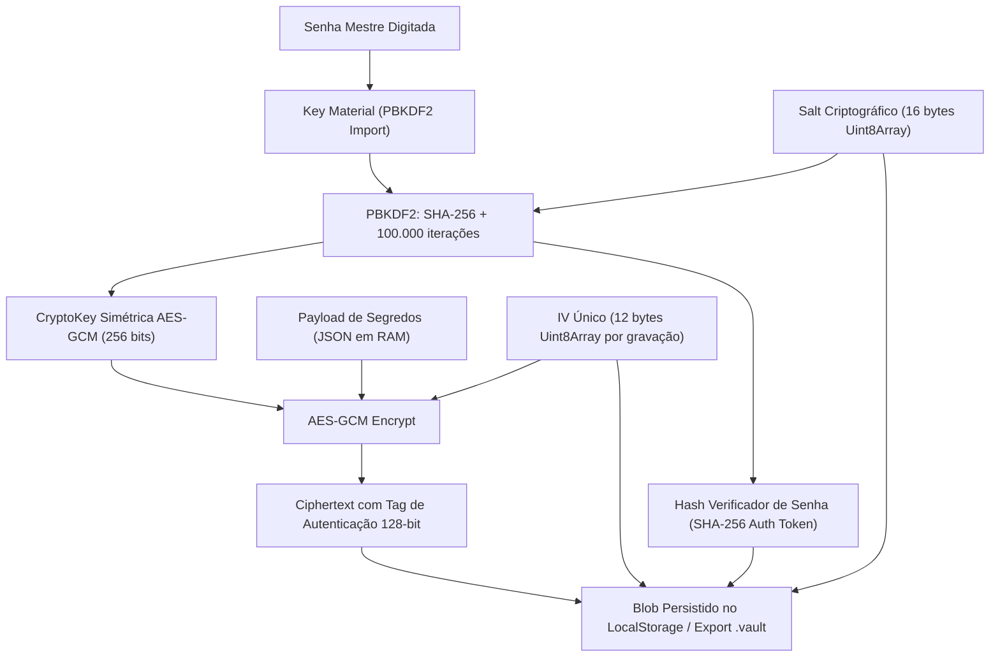
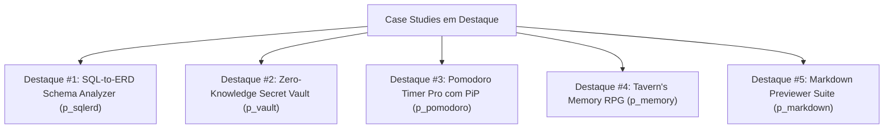

# 🚀 Plano Estratégico & Especificação de Engenharia: Novos Projetos de Alto Impacto
**Projetos:** `p_sqlerd` (SQL-to-ERD Schema Analyzer) & `p_vault` (Zero-Knowledge Secret Vault)  
**Integração:** Portfólio Principal (`index.html`) — Expansão de 7 para 9 Aplicações Vivas  
**Documento:** `docs/04-novos-projetos-plano.md`  
**Autor:** Project Planner & Product Manager (Agência Autônoma)  
**Status:** Aprovado para Execução Frontend & Integração  
**Ambiente de Produção:** GitHub Pages (`https://sanjrhoff.github.io/portifolio/`)

---

## 1. Visão Executiva e Posicionamento Profissional

A inclusão destes dois novos projetos eleva o portfólio de **Sandro** de uma coleção de aplicações utilitárias e jogos para um **ecossistema de engenharia de software sênior**. Eles cobrem diretamente duas das áreas mais valorizadas na engenharia moderna:

1. **Modelagem de Dados e Computação Gráfica na Web (`p_sqlerd`):**  
   Demonstra habilidade em processamento de linguagem de domínio (parsing de SQL DDL puro sem bibliotecas externas), construção de árvores sintáticas (AST simplificada), renderização de grafos em SVG vetorial interativo com cálculo trigonométrico de curvas Bézier e controle de viewport bidimensional (pan, zoom, drag-and-drop).
2. **Criptografia Aplicada e Segurança Zero-Knowledge (`p_vault`):**  
   Demonstra domínio absoluto da **Web Crypto API nativa (`window.crypto.subtle`)**, derivação criptográfica de chave de alta entropia (**PBKDF2 com 100.000 iterações**), cifragem simétrica de padrão militar (**AES-GCM 256 bits com IV único**), e arquitetura de memória volátil (*RAM-Only*), garantindo que dados confidenciais nunca sejam expostos em texto claro em disco ou storage.
3. **Evolução do Portfólio Principal (`index.html`):**  
   Expansão da telemetria de 7 para **9 aplicações vivas**, inserção dos 2 novos projetos no **topo dos Case Studies em Destaque** com janelas simuladas ricas, e atualização do Diretório Técnico e do sistema de Preview Interativo.

---

## 2. Projeto 1: `p_sqlerd` — SQL-to-ERD Visualizador e Analisador de Esquemas

### 2.1. Objetivos do Projeto
Criar uma Single Page Application (SPA) em Vanilla JavaScript de alta performance que transforma código SQL DDL bruto em um **Diagrama Entidade-Relacionamento (ERD) interativo, vetorial e estético**, executado 100% no navegador sem nenhum servidor ou backend.

### 2.2. Arquitetura Modular de Software
A aplicação será estruturada em módulos desacoplados no diretório `p_sqlerd/`:
```
p_sqlerd/
├── index.html              # Estrutura semântica da aplicação (Workspace IDE)
├── styles.css              # Design System Dark Craftsmanship + Canvas ERD
├── app.js                  # Orquestrador central e inicializador
├── js/
│   ├── sql-parser.js       # Lexer, Tokenizer e Parser DDL puro
│   ├── erd-layout.js       # Algoritmo de posicionamento e cálculo de âncoras
│   ├── erd-renderer.js     # Renderizador dinâmico de nós e conectores SVG
│   ├── canvas-controller.js# Pan, Zoom, Drag & Drop e Viewport State
│   ├── presets.js          # Schemas prontos (E-commerce, Streaming, Biblioteca, etc.)
│   └── export-engine.js    # Utilitário de exportação para SVG e PNG alta resolução
```

### 2.3. Especificação do Parser SQL DDL (`sql-parser.js`)
O parser operará em pipeline clássico de compilação:
1. **Limpeza e Normalização:** Remoção de comentários SQL (`-- linha` e `/* bloco */`), normalização de espaços e quebras de linha.
2. **Tokenização:** Identificação de palavras-chave: `CREATE`, `TABLE`, `PRIMARY`, `KEY`, `FOREIGN`, `REFERENCES`, `CONSTRAINT`, `NOT`, `NULL`, `UNIQUE`, `DEFAULT`, tipos de dados (`INT`, `BIGINT`, `VARCHAR`, `TEXT`, `BOOLEAN`, `TIMESTAMP`, `DECIMAL`, `UUID`, etc.).
3. **Extração de Entidades:**
   - Nome da tabela (suportando sintaxes como `CREATE TABLE users`, `CREATE TABLE IF NOT EXISTS "public"."orders"`).
   - Definições de colunas com tipos, comprimentos opcionais e sinalizadores (`isPk: boolean`, `isFk: boolean`, `isNullable: boolean`, `isUnique: boolean`).
   - Identificação de Primary Keys inline (`id INT PRIMARY KEY`) ou declaradas no nível de tabela (`PRIMARY KEY (user_id, team_id)`).
   - Identificação de Foreign Keys inline (`author_id INT REFERENCES users(id)`) ou em cláusulas de tabela (`FOREIGN KEY (customer_id) REFERENCES customers(id)` / `CONSTRAINT fk_order_user FOREIGN KEY ...`).
4. **Estrutura de Dados Normalizada (AST/Schema Model):**
```javascript
{
  tables: [
    {
      id: "users",
      name: "users",
      columns: [
        { name: "id", type: "BIGINT", isPk: true, isFk: false, isNullable: false },
        { name: "email", type: "VARCHAR(255)", isPk: false, isFk: false, isNullable: false },
        { name: "role", type: "VARCHAR(50)", isPk: false, isFk: false, isNullable: true }
      ]
    }
  ],
  relationships: [
    {
      id: "rel_orders_users",
      fromTable: "orders",
      fromColumn: "user_id",
      toTable: "users",
      toColumn: "id",
      cardinality: "1:N"
    }
  ],
  errors: []
}
```

### 2.4. Motor de Renderização de Grafo SVG (`erd-renderer.js` e `erd-layout.js`)
- **Nós de Tabela:** Cada tabela é renderizada como um componente visual flutuante contendo:
  - Cabeçalho estilizado com ícone de tabela e contagem de colunas.
  - Lista de colunas com identificação visual instantânea:
    - Ícone de Chave Dourada para `PRIMARY KEY`.
    - Ícone de Link Ciano para `FOREIGN KEY`.
    - Tag técnica com tipo de dado (`INT`, `VARCHAR`, etc.).
- **Conectores de Relacionamento (Dynamic SVG Links):**
  - Conexões desenhadas em um `<svg class="connections-layer">` global posicionado atrás dos nós.
  - Traçado calculado com **Curvas Cúbicas de Bézier**:
    $$B(t) = (1-t)^3 P_0 + 3(1-t)^2 t P_1 + 3(1-t) t^2 P_2 + t^3 P_3$$
  - Determinação inteligente de âncoras: identifica se a tabela de destino está à direita ou à esquerda para sair da borda mais próxima sem cruzar o interior do card.
  - Marcadores de ponta indicando cardinalidade (ponto terminal ou garfo "Crow's foot" simplificado).

### 2.5. Interatividade, Pan, Zoom e Drag & Drop (`canvas-controller.js`)
- **Drag & Drop Reativo:** Ao clicar e arrastar o cabeçalho de uma tabela, as coordenadas são atualizadas e os conectores SVG correspondentes são recalculados em tempo real via `requestAnimationFrame` a 60fps.
- **Pan & Zoom Infinito:**
  - Pan via arrasto do mouse na área livre do canvas.
  - Zoom gradual via `wheel` com ponto de ancoragem no cursor do mouse (fator de escala de 0.25x até 2.5x).
  - Controles de UI: "Fit to Screen" (enquadrar todas as tabelas na tela), "Reset Zoom" (100%), e Zoom In/Out manual.
- **Localizador de Entidades (Search):** Campo de busca rápido que filtra tabelas e colunas, destacando-as visualmente no canvas e centralizando o foco.

### 2.6. Presets Integrados de Demonstração (`presets.js`)
Quatro presets completos prontos para carregar com 1 clique:
1. **E-Commerce & Pagamentos:** `users`, `categories`, `products`, `orders`, `order_items`, `payments`.
2. **Plataforma de Streaming:** `users`, `subscriptions`, `content`, `genres`, `content_genres`, `watch_history`, `reviews`.
3. **Portal Educacional / LMS:** `students`, `instructors`, `courses`, `modules`, `lessons`, `enrollments`, `certifications`.
4. **Gestão de Tarefas Ágil:** `workspaces`, `projects`, `sprints`, `issues`, `comments`, `labels`.

### 2.7. Exportação Vetorial e Raster (`export-engine.js`)
- **Exportar SVG:** Empacota o `<svg>` das conexões e a representação vetorial das tabelas em um arquivo `.svg` puro para uso em documentações técnicas.
- **Exportar PNG:** Renderiza a cena completa em um `<canvas>` offscreen em alta densidade (escala 2x) e dispara o download automático de `schema-erd.png`.
- **Exportar JSON:** Exporta o modelo relacional normalizado para interoperabilidade.

---

## 3. Projeto 2: `p_vault` — Zero-Knowledge Secret Vault

### 3.1. Objetivos do Projeto
Desenvolver um cofre de credenciais e segredos operando sob o paradigma **Zero-Knowledge** (Conhecimento Zero), utilizando as primitivas criptográficas nativas da **Web Crypto API**. O sistema garante que dados sensíveis só existam descriptografados na memória volátil da aba aberta e que nem mesmo o host ou armazenamento local possuam acesso aos dados sem a senha mestre.

### 3.2. Arquitetura Modular de Software
A aplicação será estruturada em módulos desacoplados no diretório `p_vault/`:
```
p_vault/
├── index.html              # Interface do cofre (Setup, Lock Screen, Dashboard)
├── styles.css              # Design System Dark Cryptographic Security
├── app.js                  # Controlador central de ciclo de vida
├── js/
│   ├── crypto-engine.js    # Camada criptográfica Web Crypto API pura
│   ├── vault-store.js      # Gestão de estado volátil (RAM) e persistência cifrada
│   ├── password-generator.js# Gerador criptográfico e medidor de entropia
│   ├── clipboard-guard.js  # Cópia segura com limpeza automática (Auto-Clear)
│   ├── inactivity-timer.js # Detector de inatividade e bloqueio automático
│   └── backup-service.js   # Importação e exportação de backups `.vault`
```

### 3.3. Especificação Criptográfica Rigorosa (`crypto-engine.js`)
Toda a segurança baseia-se na especificação W3C da Web Crypto API (`window.crypto.subtle`):



#### Parâmetros Criptográficos:
1. **Derivação de Chave (KDF):**
   - Algoritmo: `PBKDF2`.
   - Hash: `SHA-256`.
   - Iterações: `100.000` (equilíbrio ideal entre resistência a ataques de força bruta/GPU e tempo de resposta no cliente < 300ms).
   - Salt: 16 bytes aleatórios criptográficos gerados com `crypto.getRandomValues(new Uint8Array(16))`.
   - Chave de Saída: Chave simétrica `AES-GCM` de `256 bits` com flag `extractable: false`.
2. **Cifragem e Autenticação de Segredos:**
   - Algoritmo: `AES-GCM` (Galois/Counter Mode).
   - Comprimento da Chave: `256 bits`.
   - Vetor de Inicialização (IV): 12 bytes (`96 bits`) criptograficamente aleatórios gerados exclusivamente para cada salvamento. **Nunca reutilizado**.
   - Integridade: Tag de autenticação de `128 bits` integrada ao AES-GCM, detectando imediatamente qualquer alteração acidental ou adulteração maliciosa do blob.
3. **Verificador de Senha Mestre (Verifier Token):**
   - Para verificar se a senha digitada está correta sem ter que processar e decodificar todos os registros (e sem salvar a senha em disco), a chave derivada é submetida a uma operação de hashing irreversível de verificação (`SHA-256("VAULT_AUTH_VERIFIER" + DerivedKey)`).
4. **Isolamento de Memória (RAM-Only):**
   - O array de credenciais em texto claro (`credentials[]`) e a instância da chave de criptografia residem estritamente em closure privada em JavaScript.
   - Nenhuma credencial decifrada é gravada em `localStorage`, `sessionStorage` ou `IndexedDB`.
   - Ao executar o lock ou fechar a aba, a variável de estado é sobrescrita e anulada (`zeroized`).

### 3.4. Gerador de Senhas Seguras & Medidor de Entropia (`password-generator.js`)
- **Geração Criptográfica:** Uso exclusivo de `crypto.getRandomValues()` para selecionar índices do pool de caracteres (eliminando o determinismo de `Math.random()`).
- **Configurações:** Comprimento de 8 a 64 caracteres, opções para Maiúsculas, Minúsculas, Números e Símbolos, além de modo "Evitar caracteres ambíguos" (`O, 0, l, 1, I`).
- **Cálculo Matemático de Entropia:**
  $$E = L \times \log_2(R)$$
  *Onde $L$ é o comprimento da senha e $R$ o tamanho do conjunto de caracteres selecionados.*
- **Classificação Visual de Força:**
  - $< 40$ bits: Muito Fraca (Risco Crítico)
  - $40 - 59$ bits: Fraca
  - $60 - 79$ bits: Boa / Moderada
  - $80 - 119$ bits: Muito Forte
  - $\ge 120$ bits: Nível Militar / Inquebrável por Força Bruta

### 3.5. Proteção de Clipboard e Auto-Lock (`clipboard-guard.js` & `inactivity-timer.js`)
- **Clipboard com Auto-Clear:** Ao copiar um segredo para a área de transferência, um timer visual de 15 segundos é iniciado. Ao expirar, a área de transferência é sobrescrita com valor vazio ou string nula via `navigator.clipboard.writeText('')`.
- **Temporizador de Inatividade:** Monitoramento de eventos de interação do usuário (`mousemove`, `mousedown`, `keydown`, `touchstart`). Caso o usuário fique inativo pelo período configurado (padrão: 5 minutos), o cofre é automaticamente trancado e os dados em RAM são descartados.

### 3.6. Gestão de Credenciais e Backup Criptografado (`backup-service.js`)
- **Categorização:** Suporte a 4 tipos de segredos:
  1. *Logins & Contas Web* (Serviço, Usuário/E-mail, Senha, URL).
  2. *Cartões & Finanças* (Titular, Número Cifrado, Validade, CVV, PIN).
  3. *Notas Confidenciais* (Anotações e chaves de recuperação em formato seguro).
  4. *Tokens de API & Chaves SSH* (Credenciais técnicas de desenvolvimento).
- **Exportação e Importação de Arquivo `.vault`:**
  - Exportação de arquivo estruturado contendo o salt, o IV e o payload encriptado em Base64.
  - Importação de backups em outros navegadores ou computadores mediante confirmação da senha mestre.

---

## 4. Plano de Integração no Portfólio Raiz (`index.html`)

### 4.1. Atualização da Telemetria de Métricas
No topo da landing page, a métrica de projetos deve ser atualizada para refletir o novo total:
- **De:** `APLICAÇÕES VIVAS: 7`
- **Para:** `APLICAÇÕES VIVAS: 9`
- Atualização do caption para: *"9 aplicações completas, 100% funcionais no cliente"*.

### 4.2. Inclusão no Topo dos Case Studies em Destaque
A seção de **Case Studies Arquiteturais** receberá os 2 novos projetos com prioridade máxima (Destaques #1 e #2), mantendo os anteriores na sequência:



#### Mockup da Janela 1: `p_sqlerd`
- **Janela Simulada:** `sql-to-erd.visualizer.app` com status `LIVE ENGINE`.
- **Conteúdo Visual do Mockup:**
  - Painel dividido com editor de código SQL estilizado à esquerda (`CREATE TABLE users...`).
  - Painel direito com representação vetorial do canvas relacional: tabelas em cards dark com badges PK/FK conectadas por linhas Bézier ciano brilhantes.
  - Barra de ferramentas com badges: `AST Parser`, `Dynamic SVG`, `Drag & Drop`.
- **Botões de Ação Obrigatórios:**
  - Botão Primário: `<a href="./p_sqlerd/index.html" target="_blank" class="btn btn-primary"><i class="fas fa-external-link-alt"></i> Ver Aplicação</a>`
  - Botão Secundário: `<a href="https://github.com/sanjrhoff/portifolio/blob/main/p_sqlerd/index.html" target="_blank" class="btn btn-secondary"><i class="fab fa-github"></i> Ver Código</a>`
  - Botão Preview: `<button class="btn btn-ghost preview-trigger-btn" data-app-url="./p_sqlerd/index.html" data-app-title="SQL-to-ERD Analyzer"><i class="fas fa-eye"></i> Preview Interativo</button>`

#### Mockup da Janela 2: `p_vault`
- **Janela Simulada:** `zero-knowledge-vault.shield.app` com status `ENCRYPTED RAM`.
- **Conteúdo Visual do Mockup:**
  - Interface do cofre com indicador de status de segurança: `PBKDF2 100k iterações | AES-GCM 256-bit`.
  - Grid de credenciais com senhas mascaradas (`••••••••••••`), medidor de entropia em tempo real (`128 bits - Nível Criptográfico`), e tags de categoria.
  - Indicador de auto-lock ativo com badge de proteção militar.
- **Botões de Ação Obrigatórios:**
  - Botão Primário: `<a href="./p_vault/index.html" target="_blank" class="btn btn-primary"><i class="fas fa-external-link-alt"></i> Ver Aplicação</a>`
  - Botão Secundário: `<a href="https://github.com/sanjrhoff/portifolio/blob/main/p_vault/index.html" target="_blank" class="btn btn-secondary"><i class="fab fa-github"></i> Ver Código</a>`
  - Botão Preview: `<button class="btn btn-ghost preview-trigger-btn" data-app-url="./p_vault/index.html" data-app-title="Zero-Knowledge Secret Vault"><i class="fas fa-eye"></i> Preview Interativo</button>`

### 4.3. Atualização do Diretório Técnico / Laboratório de Projetos
- **Atualização da Barra de Filtros:**
  - *Todos:* `(9)`
  - *Bancos de Dados & Criptografia:* `(2)` *(Nova Categoria Especializada)*
  - *Produtividade & Web APIs:* `(4)`
  - *Jogos & Estado:* `(2)`
  - *Utilitários & APIs:* `(1)`
- **Inclusão dos Dois Novos Cards de Catálogo:**
  - Card 1: `p_sqlerd` com specs de Parsing SQL, Canvas SVG, Presets e Exportação.
  - Card 2: `p_vault` com specs de Web Crypto API, AES-GCM 256, Auto-Lock e Backup `.vault`.
  - Ambos com a tríade de botões funcionais: **Ver Aplicação**, **Ver Código** e **Preview**.

---

## 5. Matriz de Requisitos Não-Funcionais e Restrições Técnicas

| Requisito | Especificação & Solução |
| :--- | :--- |
| **Hospedagem GitHub Pages** | 100% estático. Nenhum script de servidor, nenhum Node.js em tempo de execução, nenhuma rota dinâmica de backend. |
| **Zero Dependências** | Nenhum bundler obrigatório (Webpack/Vite/Rollup) para o usuário rodar; código escrito em ES6 Modules puros e Vanilla JS que executa nativamente em qualquer navegador moderno. |
| **Segurança e Sanitização** | Em `p_sqlerd`, nomes de tabelas e colunas são inseridos no DOM via `textContent` ou sanitizados para prevenir injeção HTML/XSS. Em `p_vault`, chaves criptográficas têm flag `extractable: false` sempre que aplicável e credenciais nunca são persistidas em texto claro. |
| **Acessibilidade e Usabilidade** | Suporte a navegação por teclado nos formulários, foco visível de alto contraste, contraste de cores em conformidade com WCAG AA sobre paleta Dark Zinc. |
| **Performance Visual** | Taxa de atualização a 60 FPS durante o arraste de nós e conexões através do uso de `requestAnimationFrame` e transformações CSS por hardware (`transform: translate3d`). |

---

## 6. Plano de Tarefas & Fases de Execução da Agência

### Fase 1: Arquitetura e Planejamento *(Concluída)*
- [x] Elaboração da especificação técnica completa em `docs/04-novos-projetos-plano.md`.
- [x] Mapeamento dos fluxos de dados, modelos criptográficos e de grafos.

### Fase 2: Construção da Aplicação `p_sqlerd`
- [ ] Criar diretório `p_sqlerd/` e subpasta `p_sqlerd/js/`.
- [ ] Implementar `js/sql-parser.js` com tokenização DDL completa e extração de PK/FK.
- [ ] Implementar `js/erd-layout.js` e `js/erd-renderer.js` com gerador SVG de conexões Bézier e nós drag-and-drop.
- [ ] Implementar `js/canvas-controller.js` com controle matricial de pan e zoom infinito.
- [ ] Implementar `js/presets.js` com 4 esquemas relacionais complexos prontos.
- [ ] Implementar `js/export-engine.js` para download de SVG e PNG.
- [ ] Criar interface refinada em `index.html` e `styles.css` compatível com o tema Dark Craftsmanship.

### Fase 3: Construção da Aplicação `p_vault`
- [ ] Criar diretório `p_vault/` e subpasta `p_vault/js/`.
- [ ] Implementar `js/crypto-engine.js` com PBKDF2 (100k iterações) e AES-GCM (256 bits).
- [ ] Implementar `js/vault-store.js` com isolamento estrito de memória volátil (RAM-only).
- [ ] Implementar `js/password-generator.js` com cálculo matemático de entropia em tempo real.
- [ ] Implementar `js/clipboard-guard.js` e `js/inactivity-timer.js` com auto-clear e lock automático.
- [ ] Implementar `js/backup-service.js` para download e upload de arquivos `.vault`.
- [ ] Criar interface premium em `index.html` e `styles.css` com telas de setup, lock screen e dashboard seguro.

### Fase 4: Integração no Portfólio Principal (`index.html`)
- [ ] Atualizar contador de telemetria de 7 para 9 aplicações vivas.
- [ ] Adicionar os 2 novos projetos no topo da seção de Case Studies em Destaque com janelas simuladas completas.
- [ ] Atualizar a barra de filtros e inserir os 2 novos cards no Diretório Técnico / Laboratório.
- [ ] Testar e validar a abertura via modal de Preview Interativo (`iframe`).

### Fase 5: QA, Validação e Entrega Final
- [ ] Executar bateria de testes manuais e de console nos 2 novos projetos.
- [ ] Verificar ausência de erros de sintaxe, warnings de CSP ou falhas de carregamento de assets.
- [ ] Validar compatibilidade no GitHub Pages.
- [ ] Gerar relatório final de validação em `docs/`.
