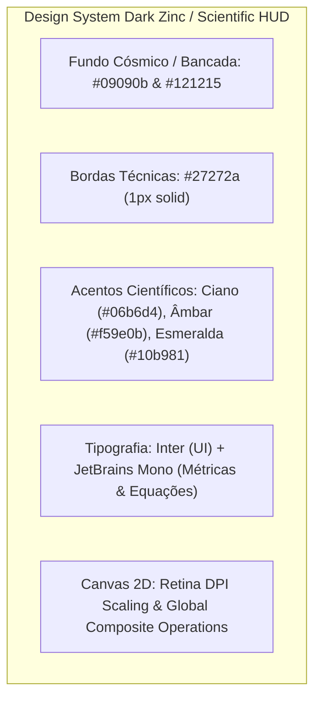
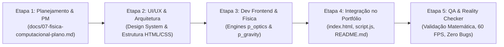

# 🔬 Plano Estratégico & Especificação de Engenharia: Física Computacional no Navegador
**Projetos:** `p_optics` (Simulador de Ótica Geométrica & Traçado de Raios) & `p_gravity` (Simulador Gravitacional de N-Corpos & Dinâmica Orbital)  
**Integração:** Portfólio Principal (`index.html`) — Expansão de 9 para 11 Aplicações Vivas  
**Documento:** `docs/07-fisica-computacional-plano.md`  
**Autor:** Project Planner & Product Manager (Agência Autônoma)  
**Status:** Aprovado para Arquitetura, Design e Implementação Frontend  
**Ambiente de Produção:** GitHub Pages (`https://sanjrhoff.github.io/portifolio/`)  

---

## 1. Visão Executiva e Posicionamento Profissional

### 1.1. O Diferencial Singular: Físico (UFES) & Engenheiro de Software
O mercado de tecnologia e engenharia de software valoriza cada vez mais profissionais com formação científica profunda em **Modelagem Matemática**, **Álgebra Linear**, **Cálculo Diferencial e Integral**, e **Algoritmos Numéricos**. 

A graduação em **Física pela Universidade Federal do Espírito Santo (UFES)** aliada ao domínio de **Engenharia de Software Frontend Moderna** posiciona **Sandro** em uma intersecção raríssima:
- Capacidade de traduzir leis fundamentais da natureza (Equações de Maxwell na ótica geométrica, Gravitação Universal de Newton, Termodinâmica e Mecânica Clássica) em código limpo, determinístico, performático e visualmente impressionante.
- Habilidade de implementar simuladores numéricos interativos a 60 FPS diretamente no cliente sem dependências de motores proprietários ou servidores pesados.
- Demonstração visual irrefutável de proficiência técnica para recrutadores técnicos, CTOs e líderes de engenharia: simulação de fenômenos complexos rodando em tempo real com renderização via HTML5 Canvas 2D.

### 1.2. Os Dois Projetos Selecionados
1. **`p_optics` — RayLens Lab (Ótica Geométrica & Traçado de Raios 2D):**
   - Simulação contínua e recursiva de raios luminosos interagindo com dioptros planos e esféricos, lentes convergentes/divergentes, espelhos côncavos/convexos e prismas dispersivos.
   - Aplicação rigorosa da **Lei de Snell-Descartes**, cálculo exato de **Ângulo Crítico** e **Reflexão Interna Total (TIR)**.
2. **`p_gravity` — OrbitN (Gravitação Universal de N-Corpos & Dinâmica Orbital):**
   - Simulação de sistemas gravitacionais com $N$ corpos celestes integrados numericamente via **Velocity Verlet** (integrador simplético com conservação estrita de energia mecânica).
   - Colisões perfeitamente inelásticas com conservação de momento linear ($\vec{p} = \sum m_i \vec{v}_i$), suavização gravitacional (*Plummer softening* $\epsilon$), cálculo de centro de massa e presets clássicos como o lendário **Problema dos Três Corpos Caótico** e a coreografia estável em **Figura de Oito**.

---

## 2. Arquitetura Compartilhada e Padrões de Engenharia

Ambos os projetos respeitarão rigorosamente as diretrizes arquiteturais do ecossistema do portfólio:

1. **Zero Dependências Externas (Zero-Dependency Vanilla ES6+):**  
   Nenhum framework ou biblioteca de física pré-fabricada (sem Matter.js, sem Three.js, sem Babylon.js, sem jQuery). Toda a física vetorial e renderização são codificadas do zero.
2. **Renderização de Alto Desempenho (HTML5 Canvas 2D / 60 FPS):**  
   Uso de loop de animação desacoplado via `requestAnimationFrame`, com buffer offscreen para rastros, manipulação direta de matrizes de transformação de coordenadas e suporte nativo a displays de alta densidade (Retina/DPI Scaling via `window.devicePixelRatio`).
3. **Design System Editorial Dark Zinc:**  
   Integração visual harmônica com a estética minimalista e técnica já estabelecida no portfólio (`#09090b`, `#121215`, `#27272a`, acentos ciano `#06b6d4`, esmeralda `#10b981`, âmbar `#f59e0b` e violeta `#8b5cf6`), fontes `Inter` e `JetBrains Mono`.
4. **Compatibilidade com GitHub Pages & Sandbox Modal:**  
   Ambos os projetos residirão em pastas autônomas (`p_optics/` e `p_gravity/`), com arquivo `index.html` autossuficiente, prontos para serem executados tanto isoladamente quanto dentro do iframe da sandbox modal do portfólio principal.

---

## 3. Projeto 1: `p_optics` — Simulador de Ótica Geométrica & Traçado de Raios

### 3.1. Fundamentação Física e Equações Matemáticas

#### A. Princípio de Fermat e Vetor de Propagação
A luz viaja pelo caminho de menor tempo ótico entre dois pontos. No modelo de raios 2D, um raio de luz é parametrizado como:
$$\vec{R}(t) = \vec{P}_0 + t \cdot \hat{d}, \quad t \ge 0$$
Onde $\vec{P}_0 = (x_0, y_0)$ é a origem do segmento de raio e $\hat{d} = (d_x, d_y)$ é o vetor unitário de direção ($\|\hat{d}\| = 1$).

#### B. Lei da Reflexão Especular
Quando um raio atinge uma interface reflexiva com vetor normal unitário $\hat{n}$ voltado para o meio incidente:
$$\hat{r} = \hat{d} - 2(\hat{d} \cdot \hat{n})\hat{n}$$
Onde $\theta_i = \theta_r$, com o ângulo de incidência e o ângulo de reflexão medidos em relação à normal.

#### C. Lei de Snell-Descartes da Refração
Para um raio incidente em uma interface entre o meio 1 (índice de refração $n_1$) e o meio 2 (índice $n_2$):
$$n_1 \sin\theta_1 = n_2 \sin\theta_2$$
Em notação vetorial 2D direta, a direção refratada unitária $\hat{t}$ é dada por:
$$\cos\theta_1 = -(\hat{n} \cdot \hat{d})$$
$$r = \frac{n_1}{n_2}$$
$$\Delta = 1 - r^2(1 - \cos^2\theta_1)$$

- **Se $\Delta < 0$:** Ocorre **Reflexão Interna Total (TIR)**. O raio não atravessa o dioptro e é totalmente refletido de acordo com a Lei da Reflexão. O ângulo crítico é dado por:
  $$\theta_c = \arcsin\left(\frac{n_2}{n_1}\right) \quad (\text{para } n_1 > n_2)$$
- **Se $\Delta \ge 0$:** Ocorre refração e a direção refratada é:
  $$\hat{t} = r \hat{d} + (r \cos\theta_1 - \sqrt{\Delta})\hat{n}$$

#### D. Dispersão Cromática (Equação de Cauchy Simplificada)
O índice de refração depende do comprimento de onda $\lambda$:
$$n(\lambda) = n_0 + \frac{B}{\lambda^2}$$
O que possibilita simular a dispersão da luz branca em um prisma triangular, separando as componentes espectrais do vermelho (~650nm) ao violeta (~400nm).

### 3.2. Arquitetura Modular de Software (`p_optics/`)
```
p_optics/
├── index.html              # Bancada ótica interativa, HUD de controles e canvas
├── styles.css              # Design System Dark Zinc com tema laboratório de física
├── app.js                  # Ponto de entrada, inicialização e binding de eventos
└── js/
    ├── vector2.js          # Biblioteca de vetores 2D (operações, dot, normalização, rotação)
    ├── ray.js              # Modelo de raio (origem, direção, comprimento de onda, intensidade)
    ├── tracer.js           # Motor de ray tracing recursivo com limite de profundidade
    ├── optics-engine.js    # Gerenciador de elementos na bancada ótica
    ├── elements/
    │   ├── emitter.js      # Fontes de luz (laser pontual, feixe paralelo colimado, fonte radial)
    │   ├── mirror.js       # Espelho plano e espelho curvo esférico côncavo/convexo
    │   ├── slab.js         # Bloco retangular de vidro / dioptro plano duplo
    │   ├── lens.js         # Lente esférica (convergente biconvexa e divergente bicôncava)
    │   └── prism.js        # Prisma triangular com dispersão opcional
    ├── presets.js          # Presets clássicos de física ótica
    └── bench-controls.js   # Pan, zoom, seleção, arrasto e rotação de elementos
```

### 3.3. Algoritmo de Ray Tracing Recursivo 2D
Para cada emissor na bancada ótica:
1. Gera-se o conjunto inicial de raios de acordo com o tipo da fonte (1 raio para laser pontual, $K$ raios paralelos para feixe colimado, $N$ raios distribuídos angularmente para fonte radial).
2. Cada raio é processado pela função recursiva `traceRay(ray, currentMediumIndex, depth)`:
   - Se `depth > MAX_DEPTH` (ex: 12 reflexões/refrações), encerra o ramo para prevenir loops infinitos e travamento do canvas.
   - Encontra a interseção mais próxima com qualquer elemento ótico do cenário ($t_{\min} > \text{EPSILON}$).
   - Se nenhuma interseção ocorrer, estende o raio até os limites do canvas e o renderiza.
   - Havendo interseção no ponto $\vec{P}_{\text{hit}}$ com normal $\hat{n}$:
     - Para **Espelho**: calcula o vetor de reflexão $\hat{r}$ e invoca `traceRay` recursivamente a partir de $\vec{P}_{\text{hit}} + \hat{r} \cdot \epsilon$.
     - Para **Dioptro / Lente / Bloco / Prisma**: identifica se o raio está entrando ou saindo do material ($n_1 \to n_2$), testa a condição de reflexão interna total $\Delta < 0$:
       - Se reflexão total: gera raio refletido internamente.
       - Se refração: gera raio transmitido $\hat{t}$ com atenuação e raio refletido parcial de Fresnel.
3. Renderiza os caminhos de luz acumulados com gradiente luminescente (*glow effect*) via Canvas 2D (`ctx.shadowBlur`, `ctx.strokeStyle`).

### 3.4. Catálogo de Elementos Óticos
1. **Fontes de Luz:**
   - **Laser Pontual Monocromático:** feixe único de alta intensidade com direção orientável.
   - **Feixe Paralelo Colimado:** $N$ raios equidistantes simulando feixe de raios solares ou colimador de laboratório.
   - **Fonte Radial Isotrópica:** emite raios uniformemente em $360^\circ$ a partir de uma lâmpada pontual.
2. **Espelhos:**
   - **Espelho Plano:** segmento de reta com reflexão especular perfeita em um dos lados ou em ambos.
   - **Espelho Côncavo / Convexo:** arco de círculo com raio de curvatura $R$ e distância focal $f = R/2$, permitindo demonstrar a convergência de feixes em um ponto focal real ou dispersão virtual.
3. **Meios Refretores:**
   - **Lente Convexa (Convergente):** duas superfícies esféricas convergentes que concentram feixes paralelos no foco $F$.
   - **Lente Côncava (Divergente):** superfícies esféricas que dispersam os raios.
   - **Bloco de Vidro Retangular:** demonstra o desvio lateral do raio sem alteração angular final ($\theta_1 = \theta_4$).
   - **Prisma Triangular:** refração dupla com desvio angular $\delta = (\theta_1 - \theta_2) + (\theta_4 - \theta_3)$ e separação cromática visível.

### 3.5. Interação na Bancada Ótica
- **Manipulação Direta:** clicar e arrastar qualquer elemento pela bancada.
- **Pivô de Rotação:** puxador rotacional na extremidade de cada elemento para giro livre em $360^\circ$ com snapping opcional a cada $15^\circ$ ao segurar `Shift`.
- **Painel de Propriedades:**
  - Slider de Índice de Refração ($n \in [1.00, 2.42]$): com marcadores para Ar ($1.00$), Água ($1.33$), Vidro Crown ($1.52$), Flint ($1.66$) e Diamante ($2.42$).
  - Seletor de Comprimento de Onda ($\lambda \in [380, 750]\text{ nm}$): alterando dinamicamente a cor do laser (RGB gerado via conversão precisa espectral de $\lambda$).
  - Toggle de Dispersão Cromática (decomposição de raio branco em espectro RGB).

### 3.6. Presets Didáticos
1. **Lente Focando Feixe Paralelo:** demonstração de aberração esférica e distância focal $f$.
2. **Prisma Triangular com Dispersão:** efeito clássico da capa do Pink Floyd (*The Dark Side of the Moon*), com refração e decomposição espectral.
3. **Fibra Ótica e Guia de Onda:** condução de raio laser em zigue-zague por meio de múltiplas reflexões internas totais ($n_{\text{núcleo}} > n_{\text{casca}}$).
4. **Telescópio de Newton com Espelho Côncavo:** espelho esférico refletindo e focando feixes paralelos em um espelho plano secundário a $45^\circ$.

---

## 4. Projeto 2: `p_gravity` — Simulador Gravitacional de N-Corpos & Dinâmica Orbital

### 4.1. Fundamentação Física e Equações Diferenciais

#### A. Lei da Gravitação Universal de Newton
Em um sistema com $N$ partículas pontuais, a força gravitacional resultante sobre a $i$-ésima partícula com massa $m_i$ na posição $\vec{r}_i$ exercida por todos os outros corpos $j \ne i$ é:
$$\vec{F}_i = \sum_{j \ne i}^N \vec{F}_{ij} = G \sum_{j \ne i}^N \frac{m_i m_j}{(r_{ij}^2 + \epsilon^2)^{3/2}} (\vec{r}_j - \vec{r}_i)$$
Onde:
- $G$ é a constante gravitacional configurável do simulador.
- $\vec{r}_{ij} = \vec{r}_j - \vec{r}_i$ é o vetor deslocamento de $i$ para $j$.
- $r_{ij} = \|\vec{r}_{ij}\|$ é a distância euclidiana entre as massas.
- $\epsilon > 0$ é o **fator de suavização gravitacional (*Plummer softening factor*)**, indispensável para prevenir singularidades numéricas ($\vec{F} \to \infty$) quando dois corpos passam infinitamente próximos.

A aceleração instantânea de cada corpo é:
$$\vec{a}_i = \frac{\vec{F}_i}{m_i} = G \sum_{j \ne i}^N \frac{m_j}{(r_{ij}^2 + \epsilon^2)^{3/2}} \vec{r}_{ij}$$

### 4.2. Por que o Integrador Velocity Verlet? (Superioridade Numérica)
Simuladores amadores utilizam frequentemente a **Integração de Euler Explícita**:
$$\vec{x}(t + \Delta t) = \vec{x}(t) + \vec{v}(t)\Delta t$$
$$\vec{v}(t + \Delta t) = \vec{v}(t) + \vec{a}(t)\Delta t$$
O método de Euler **não é simplético**: a energia mecânica do sistema não se conserva, sofrendo acúmulo contínuo de erro $O(\Delta t)$, fazendo com que planetas em órbitas elíparas espiralem para fora ou caiam no sol em poucos ciclos.

O **Velocity Verlet** é um integrador simplético de segunda ordem $O(\Delta t^2)$, reversível no tempo e com conservação estrita de energia mecânica média e momento angular:
1. **Passo 1 (Posição):**
   $$\vec{x}(t + \Delta t) = \vec{x}(t) + \vec{v}(t)\Delta t + \frac{1}{2}\vec{a}(t)\Delta t^2$$
2. **Passo 2 (Aceleração Intermediária):**
   Calcula $\vec{a}(t + \Delta t)$ recalculando todas as interações gravitacionais com base nas novas posições $\vec{x}(t + \Delta t)$.
3. **Passo 3 (Velocidade):**
   $$\vec{v}(t + \Delta t) = \vec{v}(t) + \frac{1}{2}\left[\vec{a}(t) + \vec{a}(t + \Delta t)\right]\Delta t$$

Esta escolha de engenharia demonstra erudição em computação científica e estabilidade orbital a longo prazo.

### 4.3. Arquitetura Modular de Software (`p_gravity/`)
```
p_gravity/
├── index.html              # Interface do simulador espacial, HUD de telemetria orbital
├── styles.css              # Design System Dark Zinc com estética cósmica e tipografia mono
├── app.js                  # Inicialização, Game Loop e orquestrador
└── js/
    ├── vector2.js          # Vetores 2D (adição, subtração, produto escalar, magnitude)
    ├── celestial-body.js   # Modelo de corpo (massa, raio, posição, velocidade, cor, histórico de rastro)
    ├── verlet-integrator.js# Motor numérico Velocity Verlet com softening factor
    ├── collision-engine.js # Detecção de sobreposição e fusão inelástica de massas
    ├── orbit-trail.js      # Buffer circular de rastro com interpolação de opacidade
    ├── presets.js          # Catálogo de sistemas orbitais estáveis e caóticos
    └── space-controls.js   # Lançamento de corpos, controle de tempo, zoom e pan
```

### 4.4. Colisão Inelástica e Fusão de Massas
Quando a distância entre dois corpos satisfaz $r_{ij} < (R_i + R_j)$, ocorre uma **colisão perfeitamente inelástica**:
- **Conservação de Massa:**
  $$M_{\text{novo}} = m_i + m_j$$
- **Conservação de Momento Linear:**
  $$\vec{v}_{\text{novo}} = \frac{m_i \vec{v}_i + m_j \vec{v}_j}{m_i + m_j}$$
- **Centro de Massa da Fusão:**
  $$\vec{x}_{\text{novo}} = \frac{m_i \vec{x}_i + m_j \vec{x}_j}{m_i + m_j}$$
- **Raio da Nova Esfera:** calculado a partir da densidade volumétrica constante:
  $$R_{\text{novo}} = \sqrt[3]{R_i^3 + R_j^3}$$
- **Efeito Visual de Flash/Explosão:** emissão de partículas transitórias de poeira estelar renderizadas em Canvas 2D.

### 4.5. Rastros Orbitais com Buffer Circular
Para evitar vazamentos de memória (*memory leaks*) em simulações contínuas:
- Cada corpo mantém um buffer circular de tamanho fixo (ex: 200 pontos passados).
- A cada frame, o ponto mais antigo é sobrescrito sem alocar novos arrays.
- Renderização com gradiente de opacidade decrescente (`alpha: 1.0 -> 0.0`), permitindo observar o rastro elíptico perfeito de Kepler e a precessão do periélio.

### 4.6. Interação e Controles do Simulador
- **Criação de Corpos por Arrastar:** clicar na tela fixa a posição inicial; arrastar define o vetor de velocidade inicial $\vec{v}_0$ desenhado como uma linha de mira elástica com indicador de magnitude.
- **Painel de Controle Temporal:**
  - Botão Pause / Play.
  - Seletor de Velocidade Temporal ($0.25\times, 0.5\times, 1\times, 2\times, 5\times$).
  - Slider da Constante $G$ ($0.1 \times G$ a $10 \times G$).
  - Slider do Fator de Suavização $\epsilon$.
- **Câmera:** Pan via arrasto com botão direito/meio ou espaço, zoom via scroll do mouse.
- **HUD Científico:**
  - Contagem de corpos vivos.
  - Energia mecânica total do sistema ($E = K + U = \sum \frac{1}{2}m v^2 - \sum_{i<j} \frac{G m_i m_j}{r_{ij}}$) com indicador de desvio percentual demonstrando a conservação de energia do Velocity Verlet.
  - Posição do Centro de Massa (Baricentro) do sistema.

### 4.7. Presets Clássicos da Mecânica Celeste
1. **Sistema Solar Interno Estável:** Sol massivo no baricentro, Mercúrio, Terra e Marte em órbitas elípticas quase-circulares de Kepler, com a Lua orbitando a Terra.
2. **O Problema dos Três Corpos Caótico:** Três massas idênticas em posições quase-equiláteras com velocidades iniciais que produzem trajetórias imprevisíveis e caóticas sensíveis às condições iniciais (Efeito Borboleta).
3. **Coreografia Estável da Figura de Oito (Figure-Eight 3-Body Solution):**  
   Solução matemática exata descoberta por Moore (1993) e Chenciner & Montgomery (2000), onde três corpos de massas idênticas perseguem-se perpetuamente ao longo de uma curva em forma de 8 no plano.
4. **Colisão de Duas Galáxias / Aglomerados Estelares:**  
   Dois buracos negros supermassivos com centenas de estrelas-teste em discos de acreção orbitando ao redor, colidindo e demonstrando a formação de braços de maré gravitacional (*tidal tails*).
5. **Sistema Estelar Binário com Planeta Circumbinário ("Tatooine"):**  
   Duas estrelas girando em torno de seu baricentro comum com um planeta menor orbitando ambas a uma distância estável.

---

## 5. Especificação de Design System & Experiência de Uso (Dark Zinc)

Tanto `p_optics` quanto `p_gravity` seguirão a linguagem visual refinada do portfólio:



### Paleta de Cores e Tokens CSS
- Fundo Workspace: `--bg-primary: #09090b;`
- Painéis Flutuantes HUD: `--bg-surface: rgba(18, 18, 21, 0.85);` com `backdrop-filter: blur(12px);`
- Borda Sutil: `--border-subtle: #27272a;`
- Borda Ativa/Foco: `--border-accent: #06b6d4;`
- Texto Principal: `--text-main: #f4f4f5;`
- Texto Secundário: `--text-muted: #a1a1aa;`
- Cores de Laser/Luz:
  - Vermelho: `#ef4444` (650 nm)
  - Verde: `#10b981` (532 nm)
  - Ciano: `#06b6d4` (488 nm)
  - Violeta: `#8b5cf6` (405 nm)
  - Branco/Espectral: `#ffffff`

---

## 6. Plano de Integração no Portfólio Principal

### 6.1. Atualização da Telemetria (Hero Section)
No arquivo `index.html`:
- Atualizar a métrica de projetos: **de 9 para 11 Aplicações Vivas**.
- Legenda correspondente: "100% funcionais, interativas e testadas".

### 6.2. Nova Categoria no Catálogo de Engenharia (Laboratório)
- Adicionar novo filtro com contagem:
  ```html
  <button type="button" class="filter-btn filter-pill" data-filter="physics" data-category="physics" role="tab" aria-selected="false">
    <i class="fas fa-atom"></i> Física Computacional &amp; Simulação <span class="filter-count">(2)</span>
  </button>
  ```
- Atualizar o contador do botão "Todos" de `(9)` para `(11)`.

### 6.3. Novos Cards de Case Study & Laboratório

#### A. Inclusão no Laboratório (`lab-grid`):
1. **Card 1: `p_optics` (RayLens Lab — Traçado de Raios & Ótica Geométrica)**
   - Categoria: `physics`
   - Badges: `FÍSICA COMPUTACIONAL`, `ÓTICA GEOMÉTRICA & CANVASES`
   - Destaques: Refração de Snell-Descartes, Reflexão Interna Total (TIR), Lentes biconvexas/bicôncavas, Espelhos parabólicos/côncavos, Prismas dispersivos e cálculo vetorial a 60 FPS.
   - Botões padronizados:
     - `Ver Aplicação` (`href="./p_optics/index.html" target="_blank"`)
     - `Ver Código` (`href="https://github.com/sanjrhoff/portifolio/blob/main/p_optics/index.html" target="_blank"`)
     - `Preview Interativo` (`data-app-url="./p_optics/index.html"` `data-app-title="RayLens Lab - Simulador de Ótica"`)

2. **Card 2: `p_gravity` (OrbitN — Simulador Gravitacional de N-Corpos)**
   - Categoria: `physics`
   - Badges: `FÍSICA COMPUTACIONAL`, `DINÂMICA ORBITAL & N-CORPOS`
   - Destaques: Integração simplética Velocity Verlet $O(\Delta t^2)$, conservação estrita de momento linear e energia mecânica, Plummer softening $\epsilon$, colisões inelásticas com fusão de corpos e presets dos Três Corpos e Figura de Oito.
   - Botões padronizados:
     - `Ver Aplicação` (`href="./p_gravity/index.html" target="_blank"`)
     - `Ver Código` (`href="https://github.com/sanjrhoff/portifolio/blob/main/p_gravity/index.html" target="_blank"`)
     - `Preview Interativo` (`data-app-url="./p_gravity/index.html"` `data-app-title="OrbitN - Simulador Gravitacional N-Corpos"`)

### 6.4. Atualização do `README.md`
- Atualização da tabela de vitrine para **11 Aplicações Vivas**.
- Inserção dos projetos `p_optics` e `p_gravity` com descrições ricas em fundamentação científica e badges de tecnologia.
- Atualização da árvore de diretórios e badges de cabeçalho.

---

## 7. Critérios de Aceitação e Checklist de QA

### 7.1. Critérios de Validação para `p_optics`
- [ ] O simulador inicia sem erros no console DevTools.
- [ ] O traçado de raios respeita o limite de profundidade recursiva (`MAX_DEPTH`), impedindo travamentos ou loops de memória.
- [ ] A reflexão interna total (TIR) ocorre com precisão quando o ângulo de incidência ultrapassa o ângulo crítico $\theta_c = \arcsin(n_2/n_1)$.
- [ ] O feixe paralelo colimado foca precisamente no ponto focal esperado ao atravessar a lente esférica biconvexa.
- [ ] O prisma triangular gera desvio angular e separação cromática visível quando o modo dispersivo está ativado.
- [ ] Os elementos podem ser arrastados livremente e rotacionados via alça circular de rotação.
- [ ] Todos os 4 presets carregam cenários funcionais instantaneamente.
- [ ] Responsividade e suporte a mouse e touch (em telas móveis/tablets).

### 7.2. Critérios de Validação para `p_gravity`
- [ ] A integração numérica via Velocity Verlet mantém a energia mecânica do sistema solar interno estável sem dispersão orbital ao longo de 5 minutos contínuos.
- [ ] O cálculo de colisão inelástica funde dois corpos conservando rigorosamente o momento linear $\vec{p} = m_1 \vec{v}_1 + m_2 \vec{v}_2$.
- [ ] Lançamento interativo de corpos via clique e arraste funciona intuitivamente com vetor de mira e feedback de velocidade.
- [ ] O preset de Figura de Oito mantém a coreografia orbital de 3 corpos estável.
- [ ] O buffer de histórico dos rastros não causa vazamento de memória (Memory Leak check em heap allocation).
- [ ] Os controles de tempo (Pause, 0.5x, 1x, 2x, 5x) alteram o $\Delta t$ sem desestabilizar a integração.

### 7.3. Critérios de Validação para o Portfólio Principal
- [ ] Contador de telemetria exibe `11` aplicações vivas.
- [ ] O filtro `Física Computacional & Simulação (2)` filtra exclusivamente os cards `p_optics` e `p_gravity`.
- [ ] Ambos os projetos abrem e executam com fluidez dentro da Sandbox Modal (`iframe`).
- [ ] Links externos e links de código funcionam sem quebra de âncora.

---

## 8. Cronograma e Fila de Execução dos Agentes Autônomos



1. **Etapa 1 (Concluída neste documento):** Definição da física, equações diferenciais, algoritmos de ray tracing e Velocity Verlet, arquitetura de software e plano de integração.
2. **Etapa 2 (Arquitetura e Design):** Construção dos layouts de alta fidelidade das bancadas de simulação e HUDs científicos em Dark Zinc.
3. **Etapa 3 (Desenvolvimento Frontend):** Implementação completa dos motores matemáticos em Vanilla JS ES6+, vetores 2D, ray tracer, integrador gravitacional e presets.
4. **Etapa 4 (Integração):** Atualização da vitrine do portfólio (`index.html`), telemetria, nova categoria de filtros e documentação no `README.md`.
5. **Etapa 5 (Garantia de Qualidade & Testes):** Testes de estresse de FPS, conservação de energia, precisão trigonométrica, responsividade mobile e conformidade com o GitHub Pages.
