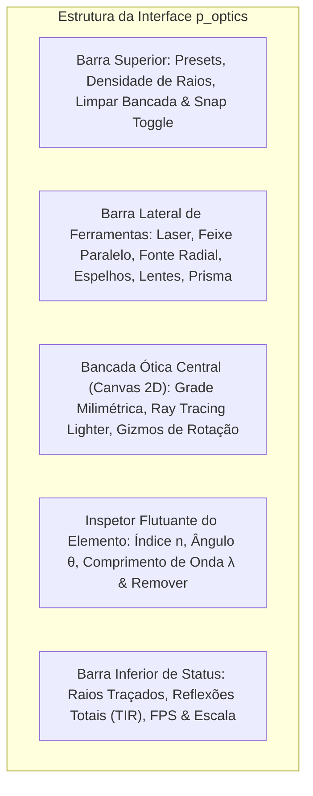
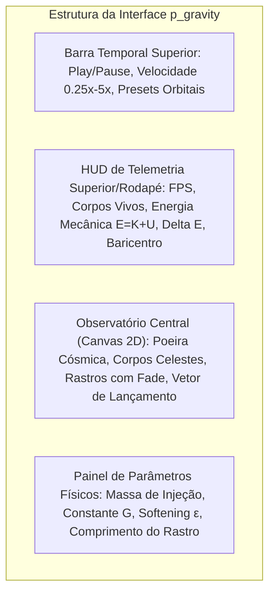

# 🎨 Especificação de UI/UX & Design System: Física Computacional no Navegador
**Projetos:** `p_optics` (RayLens Lab — Bancada Ótica & Traçado de Raios 2D) & `p_gravity` (OrbitN — Observatório Gravitacional de N-Corpos)  
**Integração:** Portfólio Principal (`index.html`, `styles.css` & `script.js`) — Expansão de 9 para 11 Aplicações Vivas  
**Documento:** `docs/08-fisica-computacional-design.md`  
**Autor:** Senior UI/UX Architect (Agência Autônoma)  
**Status:** Aprovado para Implementação Frontend  
**Referência Estratégica:** `docs/07-fisica-computacional-plano.md` e `docs/05-novos-projetos-design.md`  

---

## 1. Manifesto de Design: Erradicação da "Cara de IA" & Estética Científica Craftsmanship

A interface de simuladores científicos não pode parecer um protótipo genérico gerado por inteligência artificial. Simuladores amadores sofrem de padrões visuais cansativos e preguiçosos:
- **Banido:** O degradê roxo-azulado neon genérico (`#6366f1` / `#8b5cf6`) aplicado aleatoriamente em botões e fundos.
- **Banido:** Bento grids caóticos e decorativos sem propósito ergométrico.
- **Banido:** Textos robóticos e estéreis sem embasamento de laboratório ("Simule coisas incríveis com física!").
- **Banido:** Controles de brinquedo que não refletem instrumentos científicos reais (falta de unidades de medida, falta de valores exatos, ausência de feedback vetorial).

### Os 4 Pilares da Estética Dark / Tech Craftsmanship Científico:
1. **Estética de Bancada Experimental Dark (`#09090b` & `#050508`):**  
   Ambientes de trabalho escuros de alta imersão, simulando bancadas óticas com tratamento antirreflexo e observatórios astronômicos de céu profundo. Grade milimétrica técnica e sutil para ancoragem espacial sem ruído visual.
2. **Profundidade Ótica com Blend Mode Aditivo:**  
   Emissão luminosa que se comporta como luz real: raios que se cruzam somam suas intensidades luminosas através de `globalCompositeOperation = 'lighter'`, criando focos incandescentes reais com saturação luminosa no ponto focal.
3. **HUD de Telemetria Numérica & Conservação:**  
   Displays cirúrgicos em tipografia monospace (`JetBrains Mono`) com métricas físicas reais: energia total $E = K + U$, desvio de conservação $\Delta E / E_0$, comprimento de onda $\lambda$ em nanômetros com cor física fidedigna calculada e baricentro do sistema dinâmico.
4. **Ergonomia e Manipulação Direta:**  
   Interação tátil fluida a 60 FPS: alças polares de rotação nos componentes óticos, vetores elásticos de mira no lançamento gravitacional e controles flutuantes translúcidos com `backdrop-filter: blur(16px)` que não obscurecem o fenômeno simulado.

---

## 2. Design Tokens CSS Compartilhados (Scientific Theme)

Os dois novos projetos e a integração no portfólio compartilham um conjunto unificado de tokens que expressam precisão laboratorial:

```css
:root {
  /* ==========================================================================
     Superfícies & Fundos de Laboratório
     ========================================================================== */
  --bg-bench-dark: #09090b;             /* Bancada de laboratório ótico */
  --bg-space-void: #050508;             /* Vácuo do observatório orbital */
  --bg-hud-surface: rgba(14, 14, 18, 0.88); /* Painéis HUD com efeito vidro */
  --bg-hud-elevated: #16161c;           /* Menus contextuais e dropdowns */
  --bg-hud-hover: #1e1e26;              /* Hover em botões e ferramentas */
  --bg-hud-active: #272734;             /* Ferramenta ativa / selecionada */
  --bg-grid-line: rgba(255, 255, 255, 0.035); /* Grade milimétrica de bancada */

  /* ==========================================================================
     Bordas & Linhas de Referência
     ========================================================================== */
  --border-subtle: #23232b;             /* Borda padrão dos painéis (1px solid) */
  --border-focus: #38bdf8;              /* Foco de seleção ótica / ciano céu */
  --border-active: #06b6d4;             /* Elemento ótico / corpo selecionado */
  --border-solar: #f59e0b;              /* Linha de órbita / destaque de baricentro */

  /* ==========================================================================
     Tipografia Científica
     ========================================================================== */
  --font-ui: 'Inter', -apple-system, BlinkMacSystemFont, 'Segoe UI', Roboto, sans-serif;
  --font-telemetry: 'JetBrains Mono', 'Fira Code', Consolas, monospace;

  --text-bright: #fafafa;               /* Leituras principais e títulos */
  --text-dim: #a1a1aa;                  /* Labels, descrições e unidades */
  --text-muted: #52525b;                /* Valores inativos e atalhos de teclado */
  --text-inverse: #09090b;

  /* ==========================================================================
     Espectro Ótico Físico (Nanômetros -> Hex real)
     ========================================================================== */
  --laser-red: #ef4444;       /* 650 nm - Laser Hélio-Neônio clássico */
  --laser-amber: #f59e0b;     /* 589 nm - Linha D do Sódio */
  --laser-green: #10b981;     /* 532 nm - Laser verde Nd:YAG */
  --laser-cyan: #06b6d4;      /* 488 nm - Laser de Argônio */
  --laser-blue: #3b82f6;      /* 445 nm - Diodo de raio azul */
  --laser-violet: #8b5cf6;    /* 405 nm - Laser violeta */
  --laser-white: #f8fafc;     /* Feixe de luz branca para dispersão */

  /* ==========================================================================
     Dinâmica Orbital & Classes Cósmicas
     ========================================================================== */
  --star-core: #fbbf24;       /* Estrela amarela tipo Sol */
  --star-supergiant: #38bdf8; /* Estrela gigante azul */
  --star-dwarf: #f43f5e;      /* Anã vermelha */
  --planet-terrestrial: #34d399; /* Planeta rochoso tipo Terra */
  --planet-gas: #818cf8;      /* Gigante gasoso */
  --vector-aim: #22d3ee;      /* Vetor elástico de mira e velocidade */
  --barycenter-cross: #f59e0b;/* Cruz do centro de massa */

  /* ==========================================================================
     Efeitos de Glow Luminescente
     ========================================================================== */
  --glow-laser-cyan: 0 0 16px rgba(6, 182, 212, 0.6);
  --glow-laser-green: 0 0 16px rgba(16, 185, 129, 0.6);
  --glow-laser-red: 0 0 16px rgba(239, 68, 68, 0.6);
  --glow-star: 0 0 28px rgba(251, 191, 36, 0.55);
}
```

---

## 3. Especificação de UI/UX: `p_optics` (RayLens Lab — Bancada Ótica 2D)

O **RayLens Lab** é concebido como uma bancada ótica de precisão profissional, inspirada em mesas ópticas industriais com furos milimétricos e amortecimento pneumático.



### 3.1. Wireframe e Layout Espacial

```
+----------------------------------------------------------------------------------------------------+
| 🔬 RAYLENS LAB | Presets: [ Prisma de Newton v ] | Densidade: [======|--] 32 raios | [ Limpar ]    |
+----------------------------------------------------------------------------------------------------+
| [T] FERRAMENTAS |                                                                | [i] PROPRIEDADES|
|                 |                           .  .  .  .                           | Elemento: Lente |
| [•] Laser Mono  |                       .                .                       | Tipo: Biconvexa |
| [=] Feixe Colim |                    .                      .                    | ----------------|
| [*] Radial 360  |      ===========> (           Foco         ) ===========>      | Índice refração:|
|                 |                    .                      .                    | n = [ 1.52 ]    |
| [/] Espelho Pl  |                       .                .                       | [Vidro Crown]   |
| [)] Espelho Côn |                           .  .  .  .                           | Raio curvatura: |
|                 |                                                                | R = 180 px      |
| [ ] Bloco Vidro |               (Traçado de Raios com Blend Lighter)             | Ângulo: 0.0°    |
| (|) Lente Bicon |                                                                | [ Excluir Elemento ]
| [>] Prisma Tri  |                                                                |                 |
+----------------------------------------------------------------------------------------------------+
| Status: Pronto | Raios ativos: 128 | Reflexões TIR: 14 | Resolução: 1920x1080 @ 60 FPS | Zoom: 100%|
+----------------------------------------------------------------------------------------------------+
```

### 3.2. Barra Superior de Controle & Presets
Localizada no topo (`height: 54px`), com fundo translúcido e borda inferior sutil:
- **Identidade e Logotipo:** `RayLens Lab` com ícone de prisma refrator e tag `OPTICS 2D`.
- **Dropdown de Presets Didáticos:**
  1. *Prisma de Newton com Dispersão Espectral* (Feixe branco incidindo a $45^\circ$, dispersando vermelho a violeta).
  2. *Lente Biconvexa e Distância Focal* (Feixe colimado convergindo exatamente no foco $F$).
  3. *Fibra Ótica e Guia de Onda* (Demonstração de condução contínua por Reflexão Interna Total - TIR).
  4. *Telescópio Côncavo de Newton* (Espelho parabólico refletindo raios paralelos em espelho plano a $45^\circ$).
- **Controle de Densidade de Raios (Slider):** De 1 a 64 raios para feixes colimados e radiais, com indicador visual em tempo real.
- **Toggles Rápidos:**
  - `Grade (G)`: Ativa/desativa a grade milimétrica sutil no canvas.
  - `Normais (N)`: Exibe vetores normais $\hat{n}$ tracejados nos pontos de incidência.
  - `Limpar Bancada`: Botão com confirmação suave para zerar a bancada e retornar ao laser inicial.

### 3.3. Barra Lateral Flutuante de Ferramentas Óticas
Localizada à esquerda da bancada, flutuante (`left: 18px`, `top: 72px`), com visual de estojo de lentes de laboratório:
- **Fontes Emissoras:**
  - `Laser Monocromático`: Emissor de raio único altamente colimado com orientador vetorial.
  - `Feixe Colimado Paralelo`: Barra emissora com $N$ raios paralelos equidistantes.
  - `Fonte Radial Isotrópica`: Ponto luminoso emissor em $360^\circ$ com raios angulares.
- **Espelhos Reflexivos:**
  - `Espelho Plano`: Segmento com face reflexiva brilhante e face traseira hachurada.
  - `Espelho Côncavo / Convexo`: Arco curvo reflexivo que pode ser alternado entre convergente ou divergente.
- **Meios Refretores:**
  - `Bloco de Vidro Retangular`: Dioptro plano duplo para teste de deslocamento lateral da luz.
  - `Lente Esférica (Biconvexa / Bicôncava)`: Elemento com raios de curvatura ajustáveis e foco preciso.
  - `Prisma Triangular`: Triângulo equilátero com índice de dispersão cromática configurável.
- **Mecânica de Adição:** O usuário pode clicar na ferramenta para inseri-la no centro da visão ou arrastar o ícone diretamente para a bancada ótica.

### 3.4. Inspetor Flutuante de Parâmetros do Elemento Selecionado
Localizado à direita (`right: 18px`, `top: 72px`, `width: 280px`), surge com animação fluida quando um elemento na bancada é selecionado:
- **Cabeçalho:** Nome do elemento (ex: `Lente Biconvexa #02`), ícone e coordenadas $(X, Y)$ na bancada.
- **Slider de Índice de Refração ($n$):**
  - Range de $1.000$ a $2.420$ com precisão de 3 casas decimais.
  - Botões rápidos com marcadores de materiais ópticos:
    - `Ar (1.000)`
    - `Água (1.333)`
    - `Vidro Crown (1.520)`
    - `Flint Pesado (1.660)`
    - `Diamante (2.417)`
- **Controle de Rotação Angular ($\theta$):**
  - Campo numérico de $0^\circ$ a $360^\circ$ com anel circular interativo para giro rápido.
  - Snapping automático para múltiplos de $15^\circ$ ao segurar a tecla `Shift`.
- **Seletor de Comprimento de Onda ($\lambda$ - Para Emissores):**
  - Slider contínuo de $380\text{ nm}$ (violeta) a $750\text{ nm}$ (vermelho).
  - Preview dinâmico da cor espectral calculada fisicamente através de aproximação das funções de correspondência de cores CIE 1931.
  - Toggle de `Luz Branca Espectral`: Ativa a separação de 7 componentes cromáticos no ray tracing.
- **Ações de Remoção:** Botão de excluir elemento (`Delete` ou `Backspace`) e botão de clonar/duplicar.

### 3.5. Renderização Luminescente Canvas 2D & Estética dos Raios
- **Grade da Bancada:** Canvas padrão com células de $20\text{px} \times 20\text{px}$ desenhadas com linhas ultrafinas de `rgba(255, 255, 255, 0.025)` e marcações de cruz milimétrica a cada $100\text{px}$.
- **Traçado Aditivo (`globalCompositeOperation = 'lighter'`):**  
  Os caminhos de luz não são desenhados como linhas sólidas opacas. O motor utiliza o modo de mesclagem aditiva:
  1. *Passagem 1 (Núcleo do Feixe):* Linha central de 1.5px com cor monocromática intensa e opacidade de 85%.
  2. *Passagem 2 (Glow Luminescente):* Linha de 4px a 8px com `ctx.shadowBlur = 12` e cor correspondente, conferindo a sensação de incandescência laser no vácuo/fumaça de laboratório.
  3. *Passagem 3 (Pontos Focais):* Onde múltiplos raios cruzam a mesma coordenada (ex: foco de lente ou cáustica de prisma), a soma das energias satura o pixel para o branco incandescente natural da luz concentrada.
- **Superfícies de Vidro/Lentes:** Preenchimento semitransparente com gradiente de profundidade vítrea (`rgba(6, 182, 212, 0.08)` a `rgba(30, 41, 59, 0.15)`), bordas em ciano sutil e linha de vértice com brilho especular.

### 3.6. Manipulação Direta no Canvas & Gizmos
- **Cursor Dinâmico:** `crosshair` sobre o vazio, `grab`/`grabbing` sobre elementos móveis, `pointer` sobre as alças.
- **Gizmo de Rotação:** Ao clicar em um elemento, desenha-se uma borda de seleção delimitadora (*bounding box*) com uma haste e um puxador esférico de rotação a $35\text{px}$ da extremidade.
- **Highlight de Interseção:** Pequeno anel de luz no ponto exato onde o raio toca a superfície vítrea ou o espelho, evidenciando o ângulo $\theta_i = \theta_r$.

---

## 4. Especificação de UI/UX: `p_gravity` (OrbitN — Observatório de N-Corpos)

O **OrbitN** é concebido como o console de um observatório espacial de astrofísica computacional, unindo o vácuo cósmico com a instrumentação de telemetria orbital.



### 4.1. Wireframe e Layout Espacial

```
+----------------------------------------------------------------------------------------------------+
| 🌌 ORBITN | [ > Play ] [ || Pause ] [ Step ] | Vel: (0.25x) (0.5x) [ 1.0x ] (2x) (5x) | Presets: [v]   |
+----------------------------------------------------------------------------------------------------+
| [ HUD TELEMETRIA CIENTÍFICA ]                                                | [ PARÂMETROS ]      |
| FPS: 60.0 (Verlet 2ª ordem)                                                  | Injeção Celeste:    |
| Corpos Vivos: 4                                                              | Massa: [===|===] 100|
| Energia Total (E): -4.182 x 10⁵ J                                            | Tipo: Planeta       |
| Conservação ΔE: 0.002% (Estável)                                             | --------------------|
| Baricentro: (0.12, -0.45)                                                    | Constante G: 1.00   |
|                                                                              | Softening ε: 15.0 px|
|                               .---.                                          | Rastros: [Ativos]   |
|                              (  +  ) Sol Central                             | Histórico: 250 pts  |
|                               '---'                                          |                     |
|                      . ' ' ' '   |                                           | [ Limpar Espaço ]   |
|                  .               v Vetor Gravidade                           |                     |
|                .                  .                                          |                     |
|               (o) Terra            .                                         |                     |
|                 \                   (o) Marte                                |                     |
|                  \ Vetor Velocidade                                          |                     |
+----------------------------------------------------------------------------------------------------+
| Ação: Clique e arraste para injetar corpo em órbita | Pan: Botão Meio / Espaço | Zoom: Scroll        |
+----------------------------------------------------------------------------------------------------+
```

### 4.2. Barra Superior de Controle Temporal & Presets
Localizada no topo (`height: 54px`), com visual de console de observatório espacial:
- **Identidade:** `OrbitN` com ícone de elipse orbital e badge de engenharia `N-BODY VERLET`.
- **Botões de Controle de Fluxo Temporal:**
  - `Play / Pause` (Tecla `Espaço`): Congela o avanço do tempo sem perder os vetores de estado $\vec{x}$ e $\vec{v}$.
  - `Passo Único (Step)`: Avança um único ciclo $\Delta t$ para análise quadro a quadro de encontros hiperbólicos e colisões.
  - `Velocidade do Tempo`: Pílulas seletoras com estados bem definidos: `0.25x`, `0.5x`, `1.0x` (tempo real), `2.0x` e `5.0x` para aceleração secular de órbitas keplerianas.
- **Dropdown de Presets da Mecânica Celeste:**
  1. *Sistema Solar Interno*: Sol central massivo com Mercúrio, Terra e Marte em órbitas elípticas fechadas.
  2. *O Problema dos Três Corpos Caótico*: Três massas idênticas em configurações instáveis que demonstram o caos determinístico e sensibilidade às condições iniciais.
  3. *Coreografia Estável da Figura em 8*: Solução exata periódica de Moore-Chenciner onde os três corpos perseguem perpetuamente uma lemniscata no plano.
  4. *Colisão Galáctica & Braços de Maré*: Dois núcleos supermassivos com centenas de estrelas de disco sofrendo deformação por forças de maré.
  5. *Sistema Binário com Planeta Circumbinário*: Duas estrelas orbitando seu baricentro mútuo e um planeta externo em órbita estável.

### 4.3. Painel Flutuante de Parâmetros Físicos
Localizado no canto superior direito (`right: 18px`, `top: 72px`, `width: 280px`):
- **Parâmetros de Injeção Celeste:**
  - Seletor de Massa do Novo Corpo: Presets para *Satélite/Asteroide* ($M=1$), *Planeta Terrestre* ($M=10$), *Gigante Gasoso* ($M=50$) e *Estrela Central* ($M=1000$).
  - Slider contínuo de massa de $1$ a $2500$ unidades arbitrárias.
  - Cor automática gerada com base na massa e classe estelar/planetária.
- **Constantes Cosmológicas do Simulador:**
  - *Constante Gravitacional $G$*: Slider de $0.10$ a $5.00$ (padrão $1.00$).
  - *Fator de Suavização (Plummer Softening $\epsilon$)*: Slider de $2\text{ px}$ a $40\text{ px}$ (padrão $15\text{ px}$), permitindo ao usuário observar como a ausência de suavização cria ejetores hiperbólicos gravitacionais.
- **Rastros Orbitais (Trails):**
  - Toggle de ativação dos rastros.
  - Slider de extensão do buffer circular: de $50$ a $400$ posições históricas.

### 4.4. HUD de Telemetria Científica em Tempo Real
Localizado no canto superior esquerdo (`left: 18px`, `top: 72px`), renderizado em tipografia `JetBrains Mono` com leitura cirúrgica:
- **Taxa de Atualização e Desempenho:** `60.0 FPS` com indicador de tempo de frame em milissegundos ($< 16.6\text{ ms}$).
- **Censo Populacional:** `N Corpos Ativos` e contador de colisões/fusões acumuladas.
- **Diagnóstico da Energia Mecânica do Sistema:**
  - Exibição de $E_{\text{total}} = K + U = \sum \frac{1}{2}m v^2 - \sum_{i<j} \frac{G m_i m_j}{(r_{ij}^2 + \epsilon^2)^{1/2}}$.
  - **Indicador de Conservação $\Delta E / E_0$:** Exibe o desvio percentual em relação ao frame inicial. Graças ao integrador simplético **Velocity Verlet**, este valor permanece na faixa de $\pm 0.005\%$, evidenciado com um badge verde esmeralda `ENERGIA CONSERVADA`.
- **Baricentro do Sistema (Centro de Massa):**
  - Coordenadas $(\bar{X}, \bar{Y}) = \frac{\sum m_i \vec{x}_i}{\sum m_i}$.
  - Marcador gráfico na bancada cósmica desenhado como uma cruz amarela âmbar pontilhada indicando o centro de gravidade comum.

### 4.5. Lançamento Interativo de Corpos Celestes (Clique e Arraste)
O lançamento de novos corpos celestes é uma das interações mais prazerosas e intuitivas da física computacional:
1. **Pressionar o Botão Esquerdo do Mouse:**  
   Fixa a posição orbital inicial $\vec{x}_0$ e renderiza o corpo celeste pulsando suavemente na cor correspondente à massa selecionada.
2. **Arrastar o Mouse (Drag):**  
   Desenha uma linha vetorial elástica de mira conectando a posição do corpo ao cursor do mouse.
   - O comprimento da linha representa a velocidade vetorial inicial $\|\vec{v}_0\|$.
   - A direção é orientada no sentido oposto ao arraste (comportamento de estilingue gravitacional) ou na direção do vetor.
   - Um anel concêntrico ao redor do corpo cresce proporcionalmente à velocidade.
   - Uma leitura de HUD em miniatura ao lado do cursor exibe: `v = 4.25 km/s | θ = 135°`.
3. **Soltar o Botão do Mouse:**  
   O corpo é instantaneamente injetado na simulação com $\vec{x}_0$ e $\vec{v}_0$, entrando imediatamente nas iterações do integrador Velocity Verlet.

### 4.6. Renderização de Rastros & Efeitos de Colisão Cósmica
- **Fundo Cósmico (`#050508`):** Canvas com um campo estático de $150$ estrelas microscópicas de baixa opacidade geradas com semente pseudoaleatória, proporcionando referência de paralaxe ao movimentar a câmera.
- **Rastros Orbitais sem Vazamento de Memória:**  
  Cada corpo armazena posições passadas em uma estrutura de array circular pré-alocada (`Float32Array`). A renderização do rastro traça um caminho suave com gradiente decrescente de opacidade (`alpha: 0.8 -> 0.0`), permitindo apreciar claramente a elipse de Kepler, o periélio, afélio e as rosáceas de perturbação orbital.
- **Fusão Inelástica de Corpos:**  
  Quando dois corpos se tocam ($r_{ij} < R_i + R_j$), suas massas e momentos se fundem. A colisão produz um flash circular luminescente efêmero com decaimento exponencial de 300ms e uma rajada de 12 partículas gravitacionais que se dispersam no vácuo, sinalizando o impacto cataclísmico sem travar o loop de renderização.

---

## 5. Especificação de Integração no Portfólio Principal (`index.html`)

A integração dos dois novos simuladores de física computacional expande o portfólio de **9 para 11 aplicações vivas**, consolidando o perfil técnico e a formação científica de Sandro (Física - UFES).

### 5.1. Atualização do Módulo de Telemetria (Hero Section)

No arquivo `index.html`, o card de métricas do repositório deve ser atualizado:

```html
<!-- ANTES -->
<div class="telemetry-card">
  <div class="telemetry-header">
    <span class="telemetry-label">APLICAÇÕES VIVAS</span>
    <i class="fas fa-layer-group telemetry-icon"></i>
  </div>
  <div class="telemetry-value">9</div>
  <div class="telemetry-caption">100% funcionais e testadas</div>
</div>

<!-- DEPOIS (EXPANDIDO PARA 11) -->
<div class="telemetry-card">
  <div class="telemetry-header">
    <span class="telemetry-label">APLICAÇÕES VIVAS</span>
    <i class="fas fa-layer-group telemetry-icon"></i>
  </div>
  <div class="telemetry-value highlight-cyan">11</div>
  <div class="telemetry-caption">100% funcionais, científicas e testadas</div>
</div>
```

### 5.2. Nova Categoria de Filtro no Laboratório de Código

Na barra de filtros de categorias (`.filter-bar`), atualiza-se o total e adiciona-se o novo filtro de física computacional:

```html
<!-- Barra de Filtros Atualizada -->
<div class="filter-bar" role="toolbar" aria-label="Filtro de Categoria dos Projetos">
  <button type="button" class="filter-btn filter-pill active" data-filter="all" data-category="all" role="tab" aria-selected="true">
    <i class="fas fa-th-large"></i> Todos <span class="filter-count">(11)</span>
  </button>
  <button type="button" class="filter-btn filter-pill" data-filter="physics" data-category="physics" role="tab" aria-selected="false">
    <i class="fas fa-atom"></i> Física Computacional &amp; Simulação <span class="filter-count">(2)</span>
  </button>
  <button type="button" class="filter-btn filter-pill" data-filter="bancos" data-category="bancos" role="tab" aria-selected="false">
    <i class="fas fa-database"></i> Bancos &amp; Criptografia <span class="filter-count">(2)</span>
  </button>
  <button type="button" class="filter-btn filter-pill" data-filter="productivity" data-category="productivity" role="tab" aria-selected="false">
    <i class="fas fa-bolt"></i> Produtividade &amp; Web APIs <span class="filter-count">(4)</span>
  </button>
  <button type="button" class="filter-btn filter-pill" data-filter="games" data-category="games" role="tab" aria-selected="false">
    <i class="fas fa-gamepad"></i> Jogos &amp; Estado <span class="filter-count">(2)</span>
  </button>
  <button type="button" class="filter-btn filter-pill" data-filter="utils" data-category="utils" role="tab" aria-selected="false">
    <i class="fas fa-shield-alt"></i> Utilitários &amp; APIs <span class="filter-count">(1)</span>
  </button>
</div>
```

### 5.3. Especificação Estrutural dos Dois Novos Cards (`.lab-card`)

Os dois novos cards devem ser inseridos com proeminência no topo do grid do laboratório (`#lab-grid`), acompanhados da tríade de ações ("Ver Aplicação", "Ver Código" e "Preview Interativo"):

#### Card 1: `p_optics` — RayLens Lab
```html
<!-- RayLens Lab: Ótica Geométrica & Traçado de Raios 2D -->
<article class="lab-card" data-category="physics" data-project="p_optics">
  <div class="lab-card-header">
    <span class="lab-category-badge physics-badge">
      <i class="fas fa-atom"></i> FÍSICA COMPUTACIONAL
    </span>
    <span class="lab-status-badge"><span class="dot-online"></span> ONLINE</span>
  </div>
  <div class="lab-card-body">
    <div class="lab-title-row">
      <i class="fas fa-microscope lab-icon text-cyan"></i>
      <h3 class="lab-title">RayLens Lab</h3>
    </div>
    <p class="lab-desc">
      Bancada interativa de ótica geométrica com motor determinístico de ray tracing 2D a 60 FPS. Simula refração de Snell-Descartes, reflexão interna total (TIR), lentes biconvexas/bicôncavas, espelhos parabólicos e dispersão cromática em prismas com blend mode aditivo real.
    </p>
    <div class="lab-specs">
      <div class="spec-item"><i class="fas fa-check"></i> Traçado de raios recursivo com conservação de Fresnel e ângulo crítico</div>
      <div class="spec-item"><i class="fas fa-check"></i> Lentes convergentes/divergentes, espelhos esféricos e dispersão em prismas</div>
      <div class="spec-item"><i class="fas fa-check"></i> Renderização luminescente Canvas 2D com blend lighter e cálculo de λ real</div>
    </div>
    <div class="lab-stack">
      <span class="tag">Canvas 2D</span>
      <span class="tag">Ray Tracing</span>
      <span class="tag">Snell Law</span>
      <span class="tag">Fresnel</span>
      <span class="tag">Zero Dependencies</span>
    </div>
  </div>
  <div class="lab-card-footer">
    <a href="./p_optics/index.html" target="_blank" rel="noopener noreferrer" class="btn btn-sm btn-primary" title="Abrir RayLens Lab">
      <i class="fas fa-external-link-alt"></i> Ver Aplicação
    </a>
    <a href="https://github.com/sanjrhoff/portifolio/blob/main/p_optics/index.html" target="_blank" rel="noopener noreferrer" class="btn btn-sm btn-secondary" title="Ver código no GitHub">
      <i class="fab fa-github"></i> Ver Código
    </a>
    <button type="button" class="btn btn-sm btn-ghost preview-trigger-btn" data-app-url="./p_optics/index.html" data-app-title="RayLens Lab - Traçado de Raios Óticos" title="Visualização rápida">
      <i class="fas fa-eye"></i> Preview
    </button>
  </div>
</article>
```

#### Card 2: `p_gravity` — OrbitN
```html
<!-- OrbitN: Simulador Gravitacional de N-Corpos & Dinâmica Orbital -->
<article class="lab-card" data-category="physics" data-project="p_gravity">
  <div class="lab-card-header">
    <span class="lab-category-badge physics-badge">
      <i class="fas fa-atom"></i> FÍSICA COMPUTACIONAL
    </span>
    <span class="lab-status-badge"><span class="dot-online"></span> ONLINE</span>
  </div>
  <div class="lab-card-body">
    <div class="lab-title-row">
      <i class="fas fa-satellite lab-icon text-solar"></i>
      <h3 class="lab-title">OrbitN</h3>
    </div>
    <p class="lab-desc">
      Simulador astrofísico de dinâmica orbital e gravitação universal para sistemas de N-corpos. Integração numérica simplética de segunda ordem via Velocity Verlet com conservação estrita de energia mecânica, colisões perfeitamente inelásticas, suavização de Plummer e presets caóticos dos Três Corpos e Figura de Oito.
    </p>
    <div class="lab-specs">
      <div class="spec-item"><i class="fas fa-check"></i> Integrador simplético Velocity Verlet O(Δt²) com conservação de energia</div>
      <div class="spec-item"><i class="fas fa-check"></i> Fusão inelástica com conservação de momento linear e Plummer softening</div>
      <div class="spec-item"><i class="fas fa-check"></i> Rastros orbitais em buffer circular e injeção interativa via vetor de mira</div>
    </div>
    <div class="lab-stack">
      <span class="tag">Velocity Verlet</span>
      <span class="tag">N-Body Gravity</span>
      <span class="tag">Astrophysics</span>
      <span class="tag">Vector Math</span>
      <span class="tag">Zero Dependencies</span>
    </div>
  </div>
  <div class="lab-card-footer">
    <a href="./p_gravity/index.html" target="_blank" rel="noopener noreferrer" class="btn btn-sm btn-primary" title="Abrir OrbitN">
      <i class="fas fa-external-link-alt"></i> Ver Aplicação
    </a>
    <a href="https://github.com/sanjrhoff/portifolio/blob/main/p_gravity/index.html" target="_blank" rel="noopener noreferrer" class="btn btn-sm btn-secondary" title="Ver código no GitHub">
      <i class="fab fa-github"></i> Ver Código
    </a>
    <button type="button" class="btn btn-sm btn-ghost preview-trigger-btn" data-app-url="./p_gravity/index.html" data-app-title="OrbitN - Simulador Gravitacional de N-Corpos" title="Visualização rápida">
      <i class="fas fa-eye"></i> Preview
    </button>
  </div>
</article>
```

### 5.4. Regras de CSS no Arquivo do Portfólio (`styles.css`)

Para dar suporte ao tema científico e aos badges da nova categoria:

```css
/* Badge Especialista: Física Computacional */
.physics-badge {
  background: rgba(6, 182, 212, 0.12);
  color: #38bdf8;
  border: 1px solid rgba(56, 189, 248, 0.28);
}

.lab-icon.text-cyan {
  color: #38bdf8;
  background: rgba(56, 189, 248, 0.1);
  padding: 8px;
  border-radius: 8px;
}

.lab-icon.text-solar {
  color: #fbbf24;
  background: rgba(251, 191, 36, 0.1);
  padding: 8px;
  border-radius: 8px;
}
```

---

## 6. Acessibilidade, Ergonomia e Atalhos de Teclado (Hotkeys)

Ambas as aplicações foram desenhadas para uso profissional, suportando operadores que utilizam atalhos de teclado para velocidade de experimentação:

### 6.1. Mapa de Atalhos para `p_optics`:
| Tecla / Atalho | Ação Executada | Feedback de Interface |
|---|---|---|
| `Espaço` | Ativa/Desativa o traçado de raios (Freeze) | Badge HUD altera para `PAUSADO` |
| `G` | Alterna visibilidade da grade milimétrica | Mensagem toast suave `Grade: Ligada/Desligada` |
| `N` | Alterna vetores normais $\hat{n}$ nos dioptros | Linhas pontilhadas com setas surgem nas faces |
| `R` | Reseta a posição do laser para o centro | Laser reorientado em $0^\circ$ |
| `Delete` / `Backspace` | Exclui o elemento ótico atualmente selecionado | Elemento desvanecido e removido da bancada |
| `Shift` (Segurar ao girar) | Snapping do ângulo em passos de $15^\circ$ | Puxador encaixa em marcações radiais visíveis |
| `1`, `2`, `3`, `4` | Carrega os presets 1 a 4 instantaneamente | Troca fluida do cenário da bancada |

### 6.2. Mapa de Atalhos para `p_gravity`:
| Tecla / Atalho | Ação Executada | Feedback de Interface |
|---|---|---|
| `Espaço` | Alterna Play / Pause no tempo do simulador | Botão temporal alterna entre ícone de Play e Pause |
| `S` | Passo Unitário de Tempo (Step) no modo pausado | Avança exatamente um ciclo $\Delta t$ de Verlet |
| `T` | Alterna visibilidade dos rastros orbitais | Rastros atenuam com fade suave |
| `C` | Limpa todos os corpos celestes ativos | Confirmação rápida e tela limpa |
| `R` | Restaura o preset orbital atual | Recarrega as condições iniciais exatas |
| `1` a `5` | Define velocidade temporal ($0.25\times$ a $5\times$) | Pílula de velocidade ativa selecionada |
| `Scroll do Mouse` | Zoom in / Zoom out contínuo em relação ao cursor | Escala do observatório ajustada suavemente |

### 6.3. Critérios de Acessibilidade (WCAG 2.1 AA)
- **Contraste de Cores:** Todos os textos do HUD mantêm relação de contraste superior a $7:1$ contra os fundos `#09090b` e `#050508`.
- **Foco e Teclado:** Todos os botões, sliders e dropdowns possuem indicadores de foco de alto contraste (`outline: 2px solid #38bdf8`, `outline-offset: 2px`).
- **Live Regions (ARIA):** Leitura de alterações críticas (ex: preset carregado, estado pausado) comunicadas a tecnologias assistivas via `<div aria-live="polite" class="sr-only">`.

---

## 7. Diretrizes Técnicas para o Agente Frontend Dev

Ao implementar os arquivos funcionais em `p_optics/` e `p_gravity/`, o Desenvolvedor Frontend deve seguir estas especificações visuais à risca:
1. **Isolamento de Estilos:** Ambos os projetos devem possuir seus próprios arquivos `styles.css` completos e independentes, garantindo que rodem com perfeição tanto no GitHub Pages autônomo quanto no iframe do modal de preview.
2. **Alta Resolução (Retina DPI):** Sempre redimensionar o canvas considerando `window.devicePixelRatio` para garantir nitidez cristalina em telas Retina e displays 4K/QHD.
3. **Sem Frameworks:** Zero importação de Tailwind, Bootstrap ou React. CSS moderno nativo com variáveis, flexbox, grid e `backdrop-filter`.
4. **Respeito aos Tokens:** Seguir com precisão a nomenclatura dos tokens CSS definida na Seção 2 deste documento.
