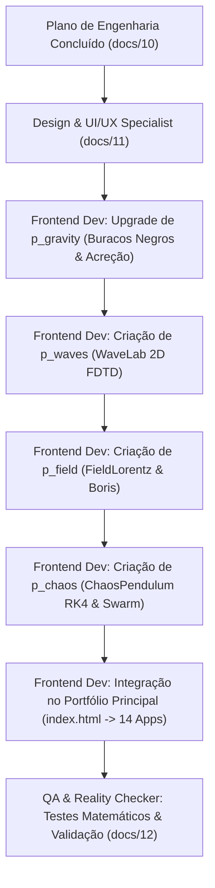

# 🌌 Suite Avançada de Física Computacional: Especificação de Engenharia & Plano de Produto
**Projetos:** Upgrade Relativístico de `p_gravity` + `p_waves` (WaveLab 2D) + `p_field` (FieldLorentz) + `p_chaos` (ChaosPendulum)  
**Integração:** Portfólio Principal (`index.html`) — Expansão de 11 para **14 Aplicações Vivas**  
**Documento:** `docs/10-suite-fisica-avancada-plano.md`  
**Autor:** Project Planner & Product Manager (Agência Autônoma)  
**Status:** Aprovado para Arquitetura, Design e Implementação Frontend  
**Ambiente de Produção:** GitHub Pages (`https://sanjrhoff.github.io/portifolio/`)  

---

## 1. Visão Executiva & Fundamentação Estratégica

### 1.1. O Posicionamento Estratégico: O Engenheiro com Alma de Físico (UFES)
O ecossistema global de tecnologia e engenharia de software valoriza cada vez mais profissionais capazes de transitar entre **abstrações matemáticas rigorosas** e **código de produção escalável e performático**.

A formação de **Sandro em Física pela Universidade Federal do Espírito Santo (UFES)** combinada à sua sólida experiência em **Engenharia de Software Frontend Moderna** cria um diferencial competitivo singular no mercado internacional:
- **Modelagem Numérica Sem Dependências:** Habilidade de derivar e codificar algoritmos de integração simplética (Verlet), métodos de Runge-Kutta de 4ª Ordem (RK4), métodos de Diferenças Finitas no Domínio do Tempo (FDTD) e dinâmica relativística diretamente em Vanilla ES6+, sem caixas-pretas de terceiros.
- **Renderização Gráfica em Tempo Real:** Domínio do HTML5 Canvas 2D e manipulação de arrays tipados (`Float64Array`, `Uint8ClampedArray` para shaders de software) executando a 60 FPS contínuos, com suporte a monitores Retina/HiDPI e baixo consumo de CPU/GPU.
- **Narrativa de Produto Irrefutável:** Para CTOs, diretores de engenharia e recrutadores de elite, simuladores de relatividade geral, eletromagnetismo e teoria do caos fornecem uma prova viva de profundidade intelectual, capacidade analítica e perfeccionismo na experiência do usuário.

### 1.2. O Escopo da Expansão: De 11 para 14 Aplicações Vivas
O laboratório do portfólio já conta com 11 aplicações funcionais (incluindo `p_optics` e a versão newtoniana de `p_gravity`). Esta expansão adicionará três novos simuladores autônomos e promoverá um upgrade profundo em `p_gravity`, consolidando uma **Suite de Física Computacional com 5 Projetos de Nível Científico**:

| Projeto | Nome de Produto | Disciplina Física | Núcleo Numérico / Algoritmo | Complexidade |
| :--- | :--- | :--- | :--- | :--- |
| **`p_gravity` (Upgrade)** | **OrbitN Relativistic & Black Holes** | Relatividade Geral / Mecânica Celeste | Velocity Verlet + Correção de Schwarzschild + Limite de Roche + Acreção | Avançada (O(N²)) |
| **`p_waves` (Novo)** | **WaveLab 2D** | Mecânica Ondulatória & Ótica Física | Equação de Onda 2D FDTD + Amortecimento + Difração de Young | Alta (O(W×H)) |
| **`p_field` (Novo)** | **FieldLorentz** | Eletromagnetismo & Dinâmica de Cargas | Integração RK4 para Linhas de Campo + Força de Lorentz + Algoritmo de Boris | Alta (O(M×Passos) + O(P)) |
| **`p_chaos` (Novo)** | **ChaosPendulum** | Mecânica Analítica & Dinâmica Não Linear | Equações de Euler-Lagrange + RK4 + Expoente de Lyapunov + Butterfly Swarm | Alta (O(N_pêndulos)) |

---

## 2. Padrões Técnicos e Diretrizes Arquiteturais

Todas as aplicações da suite respeitam os pilares inegociáveis de engenharia de software estabelecidos no portfólio:

1. **Zero Dependências Externas (Zero-Dependency Vanilla JavaScript ES6+):**  
   Nenhum framework ou biblioteca de física pré-fabricada (sem Three.js, sem Matter.js, sem Math.js, sem p5.js). Toda a matemática matricial, vetorial e numérica é implementada em código puro.
2. **Arquitetura 100% Estática (GitHub Pages Ready):**  
   Execução imediata sem servidores backend, compatível com a hospedagem estática do GitHub Pages. Cada simulador reside em seu próprio diretório autônomo com `index.html`, `styles.css` e `script.js`.
3. **Renderização de Alto Desempenho (Canvas 2D / 60 FPS):**  
   Loop de renderização desacoplado (`requestAnimationFrame`), tratamento rigoroso de delta time (`dt` limitado contra oscilações de frame rate), subpassos numéricos (sub-stepping) para conservação de energia e manipulação direta de pixels via `ImageData` quando necessário.
4. **Design System Editorial Dark Zinc:**  
   Consistência estética rigorosa com o portfólio principal:
   - Fundo base: `#09090b` (Zinc 950) com elevações `#121215` (Zinc 900) e `#1c1c22` (Zinc 800).
   - Tipografia: `Inter` para interface e `JetBrains Mono` para telemetria, equações e valores numéricos.
   - Cores de Acento Científico: Ciano quântico (`#06b6d4`), Âmbar estelar (`#f59e0b`), Esmeralda conservativa (`#10b981`), Violeta caótico (`#8b5cf6`), Vermelho choque (`#ef4444`).
5. **Acessibilidade, Responsividade e Suporte à Sandbox Modal:**  
   Painéis de controle colapsáveis, suporte a gestos touch/arrasto, zoom/pan suave na viewport e compatibilidade com o modal de sandbox iframe do `index.html`.

---

## 3. Especificação do Módulo I: Upgrade de `p_gravity` (Buracos Negros & Relatividade Geral)

### 3.1. Fundamentação Física & Formulações Matemáticas

#### A. Métrica de Schwarzschild e Raio do Horizonte de Eventos
Em relatividade geral, para um corpo esfericamente simétrico e estático com massa $M$, o elemento de linha da métrica de Schwarzschild prevê uma superfície nula onde a velocidade de escape se iguala à velocidade da luz $c$:
$$r_s = \frac{2GM}{c^2}$$
Na escala do simulador, parametrizamos a constante gravitacional $G = 1$ e a velocidade da luz $c = c_{\text{sim}}$ (configurável, ex: $c_{\text{sim}} \approx 25\text{ a }40\text{ unidades/s}$). O raio de Schwarzschild $r_s$ é computado dinamicamente para qualquer singularidade.

#### B. Esfera de Fótons (*Photon Sphere*)
Em $r = r_{ph}$, fótons e partículas ultra-relativísticas orbitam o buraco negro em trajetórias circulares instáveis:
$$r_{ph} = \frac{3GM}{c^2} = 1.5 \, r_s$$
Na interface visual, a esfera de fótons deve ser demarcada por um anel pulsante e brilhante em azul/violeta ciano, com distorção de brilho.

#### C. Força de Maré e Limite de Roche Relativístico
Quando um corpo celeste extenso de raio $R$ e massa $m$ se aproxima do buraco negro de massa $M$ a uma distância radial $r$, o gradiente de gravidade produz uma aceleração de maré diferencial entre o lado proximal e o lado distal do corpo:
$$\Delta a_{\text{maré}} \approx \frac{2 G M R}{r^3}$$
A força de coesão interna que mantém o corpo unido é da ordem de $F_{\text{coesão}} \approx \frac{G m^2}{R^2}$. O colapso gravitacional e estrutural ocorre quando o corpo cruza o **Limite de Roche**:
$$d_{\text{Roche}} \approx R \left(2 \, \frac{M}{m}\right)^{1/3}$$
Para corpos com massa muito inferior à do buraco negro, esse limiar é acionado.

#### D. Dinâmica de Espaguetificação (*Tidal Disruption Event* - TDE)
Ao cruzar $d_{\text{Roche}}$ com velocidade relativa orbital:
1. O corpo celeste tem sua integridade estrutural zerada (`integrity = 0`).
2. Ele é desintegrado em um enxame de $N_{\text{debris}} \in [60, 150]$ partículas incandescentes de matéria estelar.
3. Cada partícula herda a velocidade orbital do centro de massa mais uma dispersão tangencial e radial estocástica proporcional à velocidade de maré $\Delta v_{\text{tide}} \sim \sqrt{\frac{2GM R}{r^2}}$.
4. As partículas entram em órbitas excêntricas alongadas, formando uma fita filamentar estelar (*spaghetti filament*).

#### E. Formação e Física do Disco de Acreção (*Accretion Disk*)
As partículas que colidem ou sofrem fricção hidrodinâmica/viscosa sofrem um amortecimento tangencial com conservação do momento angular, precipitando-se em espiral em torno da singularidade:
- **Gradiente Térmico de Radiação:** A temperatura local $T(r)$ do disco varia conforme $T(r) \propto \left(\frac{M}{r^3}\right)^{1/4}$. Partículas próximas ao horizonte brilham em branco azulado ultra-quente ($T \approx 10^7\text{ K}$), enquanto o anel externo transita por âmbar e carmesim escuro.
- **Efeito Doppler Relativístico (Beaming Luminoso):** O lado do disco que orbita em direção ao observador/câmera ganha amplificação de fluxo e desvio para o azul (*blueshift*), enquanto o lado que se afasta sofre redução de intensidade e desvio para o vermelho (*redshift*).
- **Viscosidade e Decaimento Radial:** Partículas no disco perdem gradualmente energia mecânica e espiralam lentamente em direção a $r_s$.

#### F. Absorção de Matéria e Conservação de Grandeza Física
Quando qualquer corpo celeste ou partícula de debris cruza o raio de Schwarzschild ($r \le r_s$):
1. **Conservação de Massa:** A singularidade engole a matéria:
   $$M_{\text{novo}} = M_{\text{anterior}} + m_i$$
2. **Conservação de Momento Linear:** O vetor momento da singularidade absorve a quantidade de movimento:
   $$\vec{P}_{\text{BH}} = M_{\text{novo}} \vec{v}_{\text{novo}} = M_{\text{anterior}} \vec{v}_{\text{anterior}} + m_i \vec{v}_i$$
   $$\vec{v}_{\text{novo}} = \frac{M_{\text{anterior}} \vec{v}_{\text{anterior}} + m_i \vec{v}_i}{M_{\text{novo}}}$$
3. **Expansão Dinâmica do Horizonte:** O raio de Schwarzschild $r_s$ e a esfera de fótons $r_{ph}$ crescem proporcionalmente à massa absorvida.
4. **Flash de Absorção:** Emissão de pulso luminoso na borda de $r_s$ e ejeção pontual de radiação de Hawking / jato relativístico estético.

### 3.2. Presets Relativísticos de Alta Fidelidade
- **Preset 1: "Buraco Negro Supermassivo & Disco de Acreção" (Gargantua):**
  Uma singularidade massiva ($M = 8000$) no centro com anel kepleriano denso de 200 partículas em rotação rápida, circundada por dois planetas em órbitas relativísticas estáveis externas.
- **Preset 2: "Espaguetificação Estelar" (Tidal Disruption Event):**
  Uma estrela solar massiva com raio visível aproximando-se de um buraco negro em órbita parabólica rasante. Ao cruzar o limite de Roche, a estrela se distorce em elipsoide, rompe-se e se converte em fita de partículas incandescentes espiralando no disco.

---

## 4. Especificação do Módulo II: `p_waves` (WaveLab 2D)

### 4.1. Fundamentação Física & Formulações Matemáticas

#### A. Equação de Onda Bidimensional com Amortecimento
A propagação de perturbações em uma membrana elástica ou superfície líquida é descrita pela equação hiperbólica diferencial parcial:
$$\frac{\partial^2 u}{\partial t^2} = c^2 \nabla^2 u - \gamma \frac{\partial u}{\partial t}$$
Onde:
- $u(x, y, t)$ é a amplitude da perturbação no ponto $(x, y)$ no tempo $t$.
- $c$ é a velocidade de fase de propagação da onda no meio.
- $\gamma \ge 0$ é o coeficiente de amortecimento viscoso dissipativo.
- $\nabla^2 u = \frac{\partial^2 u}{\partial x^2} + \frac{\partial^2 u}{\partial y^2}$ é o operador laplaciano bidimensional.

#### B. Discretização FDTD (Finite-Difference Time-Domain)
Em uma malha cartesiana bidimensional com espaçamento $\Delta x = \Delta y$:
Usando diferenças finitas centradas de segunda ordem no tempo e no espaço:
$$\frac{u_{i,j}^{t+\Delta t} - 2 u_{i,j}^t + u_{i,j}^{t-\Delta t}}{\Delta t^2} \approx c^2 \left( \frac{u_{i+1,j}^t + u_{i-1,j}^t + u_{i,j+1}^t + u_{i,j-1}^t - 4 u_{i,j}^t}{\Delta x^2} \right) - \gamma \frac{u_{i,j}^{t+\Delta t} - u_{i,j}^{t-\Delta t}}{2\Delta t}$$
Isolando o valor do próximo passo de tempo $u_{i,j}^{t+\Delta t}$:
$$u_{i,j}^{t+\Delta t} = \frac{1}{1 + \frac{\gamma \Delta t}{2}} \left[ 2 u_{i,j}^t - \left(1 - \frac{\gamma \Delta t}{2}\right) u_{i,j}^{t-\Delta t} + \left(\frac{c \Delta t}{\Delta x}\right)^2 \Delta^2 u_{i,j}^t \right]$$
Onde $\Delta^2 u_{i,j}^t = u_{i+1,j}^t + u_{i-1,j}^t + u_{i,j+1}^t + u_{i,j-1}^t - 4 u_{i,j}^t$.

#### C. Critério de Estabilidade Numérica de Courant-Friedrichs-Lewy (CFL)
Para evitar que a solução numérica amplifique erros e entre em colapso exponencial numérico (explosão de valores NaN/Infinity), a condição CFL em 2D impõe:
$$S = c \frac{\Delta t}{\Delta x} \le \frac{1}{\sqrt{2}} \approx 0.7071$$
Adotamos em produção $S = 0.5$ constante, garantindo estabilidade incondicional e mínima dispersão numérica.

#### D. Experimento da Dupla Fenda de Young & Padrão de Franjas
Uma barreira rígida (condição de contorno de Dirichlet $u = 0$) é colocada transversalmente com duas fendas de largura $a$ e distância entre centros $d$:
- As fendas atuam como fontes secundárias de ondas cilíndricas coerentes (Princípio de Huygens-Fresnel).
- O padrão de interferência resultante no anteparo a uma distância $L$ apresenta franjas de interferência com intensidade proporcional a:
  $$I(\theta) = I_0 \left( \frac{\sin(\beta)}{\beta} \right)^2 \cos^2(\alpha)$$
  Onde $\beta = \frac{\pi a}{\lambda} \sin\theta$ e $\alpha = \frac{\pi d}{\lambda} \sin\theta$.
- **Gráfico Dinâmico no Simulador:** Um sensor linear desenhado na borda direita do tanque amostra a energia média instantânea $\langle u(y)^2 \rangle$ e plota em tempo real o perfil contínuo de intensidade, validando a teoria de Young.

#### E. Efeito Doppler e Cone de Choque de Mach (Supersônico)
Uma fonte emissora movendo-se com velocidade $\vec{v}_s = (v_s, 0)$:
- **Regime Subsônico ($v_s < c$):** Ocorre compressão das frentes de onda na direção do movimento (frequência aparente observada $f' = f_0 \frac{c}{c - v_s \cos\theta}$).
- **Regime Sônico ($v_s = c$):** As cristas se sobrepõem exatamente à frente da fonte, formando uma parede de amplitude condensada (barreira do som).
- **Regime Supersônico ($v_s > c$):** As frentes de onda ficam para trás da fonte e a envolvente das perturbações esféricas forma uma frente cônica/triangular de choque (Cone de Mach), com meio-ângulo de abertura:
  $$\sin\mu = \frac{c}{v_s} = \frac{1}{M}$$
  Onde $M = v_s / c$ é o Número de Mach.

#### F. Condições de Contorno e Camada Absorvente (PML Simplificada)
Nas bordas da grade de simulação, para evitar que ondas reflitam artificialmente nas paredes e interfiram na física central:
- Aplica-se amortecimento espacial progressivo $\gamma(x, y)$ que cresce quadraticamente nas últimas 16 a 24 células perimetrais:
  $$\gamma(r) = \gamma_0 \left(\frac{r - r_{\text{borda}}}{W_{\text{pml}}}\right)^2$$
  Isso absorve a energia incidente com reflexão inferior a 2%.

### 4.2. Especificação Arquitetural e Renderização
- **Grade Numérica:** Matriz 2D de alta densidade ($250 \times 160$ ou $300 \times 200$ pontos) mapeada em canvas com escala interpolada.
- **Shading por Software:** Uso de `Uint8ClampedArray` no buffer `ImageData`, convertendo a amplitude $u_{i,j} \in [-1, +1]$ em paletas de cores científicas:
  - *Wave Bipolar:* Vermelho (cristas positivas) $\leftrightarrow$ Preto (equilíbrio) $\leftrightarrow$ Ciano/Azul (vales negativos).
  - *Thermal Magma:* Amplitude absoluta $|u|$ mapeada do preto ao amarelo incandescente.
  - *Fluorescente Neon:* Efeito laser holográfico.
- **Ferramentas de Bancada:**
  - Pincel de Barreiras (desenho livre de paredes absorventes ou refletoras).
  - Gerador de Pulso Único (clique do mouse cria ondulação pontual tipo gota d'água).
  - Emissor Harmônico Contínuo (frequência $\omega$ e amplitude ajustáveis).
  - Fendas Configuráveis (largura $a$, separação $d$, barreira única ou dupla).

---

## 5. Especificação do Módulo III: `p_field` (FieldLorentz)

### 5.1. Fundamentação Física & Formulações Matemáticas

#### A. Lei de Coulomb e Princípio de Superposição no Espaço 2D
Para um conjunto de $N$ cargas pontuais fixas $q_i$ localizadas em $\vec{r}_i = (x_i, y_i)$, o campo elétrico resultante $\vec{E}(x, y)$ em qualquer ponto do espaço é a soma vetorial dos campos individuais:
$$\vec{E}(\vec{r}) = \frac{1}{4\pi\varepsilon_0} \sum_{i=1}^N q_i \frac{\vec{r} - \vec{r}_i}{\|\vec{r} - \vec{r}_i\|^3}$$
Para evitar singularidades infinitas numéricas quando uma partícula passa exatamente sobre a posição de uma carga pontual, adicionamos o parâmetro de suavização de núcleo (softening) $\epsilon$:
$$\vec{E}(x, y) = k_e \sum_{i=1}^N q_i \frac{(x - x_i)\hat{i} + (y - y_i)\hat{j}}{\left((x - x_i)^2 + (y - y_i)^2 + \epsilon^2\right)^{3/2}}$$

#### B. Potencial Eletrostático Escalar $V(x, y)$ e Isolinhas Equipotenciais
O potencial elétrico escalar é obtido por:
$$V(x, y) = k_e \sum_{i=1}^N \frac{q_i}{\sqrt{(x - x_i)^2 + (y - y_i)^2 + \epsilon^2}}$$
O campo elétrico é o gradiente negativo do potencial: $\vec{E} = -\nabla V$. As linhas de campo elétrico são, portanto, rigorosamente perpendiculares em todos os pontos às superfícies equipotenciais ($V(x, y) = \text{constante}$).

#### C. Algoritmo de Traçado Contínuo de Linhas de Campo (RK4 Streamlines)
Diferente de grids de vetores estáticos discretos (setinhas), as verdadeiras linhas de campo de Faraday são curvas contínuas orientadas.
O algoritmo deve emanar $M$ sementes angulares uniformemente distribuídas em um círculo de raio infinitesimal ao redor de cada carga positiva:
$$\theta_k = \frac{2\pi k}{M}, \quad \vec{r}_0 = \vec{r}_i + \delta (\cos\theta_k \hat{i} + \sin\theta_k \hat{j})$$
Para cada semente, a curva é estendida resolvendo a equação diferencial do caminho:
$$\frac{d\vec{r}}{ds} = \frac{\vec{E}(\vec{r})}{\|\vec{E}(\vec{r})\|}$$
Usamos o método de Runge-Kutta de 4ª Ordem (RK4):
$$\vec{k}_1 = \hat{E}(\vec{r}_n)$$
$$\vec{k}_2 = \hat{E}\left(\vec{r}_n + \frac{\Delta s}{2} \vec{k}_1\right)$$
$$\vec{k}_3 = \hat{E}\left(\vec{r}_n + \frac{\Delta s}{2} \vec{k}_2\right)$$
$$\vec{k}_4 = \hat{E}(\vec{r}_n + \Delta s \, \vec{k}_3)$$
$$\vec{r}_{n+1} = \vec{r}_n + \frac{\Delta s}{6}(\vec{k}_1 + 2\vec{k}_2 + 2\vec{k}_3 + \vec{k}_4)$$
O traçado é interrompido quando atinge a vizinhança de uma carga negativa, sai do canvas ou atinge o limite máximo de iterações ($N_{\text{max}} = 500$).

#### D. Dinâmica de Partículas Carregadas e Força de Lorentz Completa
Uma partícula de teste livre com massa $m$, carga $q$, posição $\vec{r}$ e velocidade $\vec{v}$ imersa em um campo elétrico $\vec{E}$ e um campo magnético $\vec{B}$:
$$\vec{F} = q \left( \vec{E} + \vec{v} \times \vec{B} \right)$$
No plano 2D ($xy$), consideramos o campo magnético perpendicular ao plano $\vec{B} = (0, 0, B_z)$:
$$F_x = q \left( E_x + v_y B_z \right)$$
$$F_y = q \left( E_y - v_x B_z \right)$$
A aceleração é dada por $\vec{a} = \frac{\vec{F}}{m}$.

#### E. Estabilidade Numérica: Algoritmo de Boris / Velocity Verlet Modificado
O integrador de Euler simples falha catastroficamente com campos magnéticos (o raio de órbita espirala artificialmente para fora). Para garantir conservação perfeita do raio de Larmor $r_L = \frac{mv_\perp}{|q| B}$ e da energia cinética quando $\vec{E} = 0$, utilizamos o **Algoritmo de Boris**, padrão ouro na física de plasmas computacional:
1. Atualização de meio passo elétrico: $\vec{v}^- = \vec{v}^t + \frac{q \vec{E}}{m} \frac{\Delta t}{2}$
2. Rotação puramente magnética de $\vec{v}^-$ para $\vec{v}^+$ através de ângulo $\theta = -2 \arctan\left(\frac{q B \Delta t}{2 m}\right)$
3. Segundo meio passo elétrico: $\vec{v}^{t+\Delta t} = \vec{v}^+ + \frac{q \vec{E}}{m} \frac{\Delta t}{2}$
4. Posição: $\vec{r}^{t+\Delta t} = \vec{r}^t + \vec{v}^{t+\Delta t} \Delta t$

### 5.2. Presets Interativos & Instrumentos Científicos
1. **Dipolo Eletrostático ($+q, -q$):** Traçado clássico de linhas saindo do polo positivo e convergindo no polo negativo com equipotenciais ortogonais.
2. **Quadrupolo e Gaiola de Faraday:** Configuração com anel de 8 cargas positivas simulando blindagem eletrostática interna com campo nulo $\vec{E} \approx 0$ no centro.
3. **Ciclotron Clássico:**
   Dois semi-círculos condutores ("Dees") com campo magnético constante uniforme $B_z$ defletindo as partículas em semicírculos e um gap intermediário com campo elétrico alternado $E_x(t) = E_0 \cos(\omega_c t)$ que acelera a partícula a cada passagem pelo gap, ampliando continuamente seu raio orbital até a ejeção.
4. **Espectrômetro de Massa de Bainbridge:**
   - Estágio 1: Seletor de Velocidades com campos cruzados ($\vec{E} \perp \vec{B}$). Apenas partículas com velocidade exata $v = \frac{E}{B}$ cruzam a fenda sem sofrer deflexão.
   - Estágio 2: Câmara de deflexão magnética pura ($E=0, B_z$). A trajetória é semicircular com diâmetro $D = \frac{2 m v}{q B}$, separando com precisão isótopos de massas distintas em detectores lineares.

---

## 6. Especificação do Módulo IV: `p_chaos` (ChaosPendulum)

### 6.1. Fundamentação Física & Formulações Matemáticas

#### A. Mecânica Lagrangiana do Pêndulo Duplo
Considere um pêndulo duplo planar consistindo de duas hastes rígidas sem massa de comprimentos $l_1, l_2$ e duas massas pontuais concentradas $m_1, m_2$. As coordenadas generalizadas são os ângulos $\theta_1$ e $\theta_2$ medidos a partir da vertical para baixo:
- Posições cartesianas das massas:
  $$x_1 = l_1 \sin\theta_1, \quad y_1 = -l_1 \cos\theta_1$$
  $$x_2 = l_1 \sin\theta_1 + l_2 \sin\theta_2, \quad y_2 = -l_1 \cos\theta_1 - l_2 \cos\theta_2$$
- Energia Cinética Total ($T = T_1 + T_2$):
  $$T = \frac{1}{2}(m_1 + m_2) l_1^2 \dot{\theta}_1^2 + \frac{1}{2} m_2 l_2^2 \dot{\theta}_2^2 + m_2 l_1 l_2 \dot{\theta}_1 \dot{\theta}_2 \cos(\theta_1 - \theta_2)$$
- Energia Potencial Gravitacional Total ($V = V_1 + V_2$):
  $$V = -(m_1 + m_2) g l_1 \cos\theta_1 - m_2 g l_2 \cos\theta_2$$
- Lagrangiana $L = T - V$.

Aplicando as equações de Euler-Lagrange $\frac{d}{dt}\left(\frac{\partial L}{\partial \dot{\theta}_i}\right) - \frac{\partial L}{\partial \theta_i} = 0$, obtemos as equações diferenciais acopladas explícitas de 2ª ordem para as acelerações angulares $\ddot{\theta}_1$ e $\ddot{\theta}_2$:

$$\ddot{\theta}_1 = \frac{-g(2m_1+m_2)\sin\theta_1 - m_2 g \sin(\theta_1 - 2\theta_2) - 2\sin(\theta_1-\theta_2)m_2(\dot{\theta}_2^2 l_2 + \dot{\theta}_1^2 l_1 \cos(\theta_1-\theta_2))}{l_1\left(2m_1 + m_2 - m_2 \cos(2\theta_1 - 2\theta_2)\right)}$$

$$\ddot{\theta}_2 = \frac{2\sin(\theta_1-\theta_2)\left(\dot{\theta}_1^2 l_1 (m_1+m_2) + g(m_1+m_2)\cos\theta_1 + \dot{\theta}_2^2 l_2 m_2 \cos(\theta_1-\theta_2)\right)}{l_2\left(2m_1 + m_2 - m_2 \cos(2\theta_1 - 2\theta_2)\right)}$$

#### B. Integrador Numérico RK4 e Conservação da Energia Mecânica
Reduzimos o sistema para 4 equações diferenciais ordinárias de primeira ordem:
$$\frac{d}{dt} \begin{bmatrix} \theta_1 \\ \omega_1 \\ \theta_2 \\ \omega_2 \end{bmatrix} = \begin{bmatrix} \omega_1 \\ f_1(\theta_1, \theta_2, \omega_1, \omega_2) \\ \omega_2 \\ f_2(\theta_1, \theta_2, \omega_1, \omega_2) \end{bmatrix}$$
Para garantir precisão computacional e prevenir amortecimento ou explosão espúria de energia em simulações prolongadas, a integração é executada via **Runge-Kutta de 4ª Ordem (RK4)** com passos microscópicos ($\Delta t \approx 0.002\text{ s}$, com 5 a 10 sub-passos por quadro de renderização a 60 FPS).
A cada frame, o simulador monitora a energia total $E(t) = T(t) + V(t)$ exibindo a variação $\Delta E / E_0 < 0.0001\%$.

#### C. O Efeito Borboleta & Enxame de Pêndulos (*Butterfly Swarm*)
Para demonstrar a **Sensibilidade Extrema às Condições Iniciais** (a essência da Teoria do Caos de Lorenz e Poincaré):
- O simulador inicializa uma família de $N = 60\text{ a }100$ pêndulos simultâneos idênticos em massas e comprimentos.
- A única diferença entre cada pêndulo $k$ é uma perturbação minúscula na posição angular inicial:
  $$\theta_{1,k}(0) = \theta_{1,0} + k \cdot 10^{-6}\text{ rad}$$
- **Fenomenologia Visual:**
  - Nos primeiros segundos ($t \in [0, 4\text{ s}]$), todos os 100 pêndulos movem-se como um único corpo rígido em perfeita sincronia visual.
  - Subitamente, ao atingirem um ponto crítico de reversão caótica, as trajetórias divergem exponencialmente, abrindo um leque cromático que preenche o espaço visual com filamentos espetaculares.

#### D. Expoente de Lyapunov ($\lambda$) em Tempo Real
A taxa média de divergência exponencial entre duas trajetórias infinitamente próximas no espaço de fase 4D é parametrizada por:
$$\|\Delta\vec{Z}(t)\| \approx \|\Delta\vec{Z}(0)\| \cdot e^{\lambda t}$$
Onde $\vec{Z} = (\theta_1, \theta_2, \omega_1, \omega_2)$ e $\lambda$ é o maior Expoente de Lyapunov.
O simulador computa continuamente a distância euclidiana média no espaço de fase entre o pêndulo de referência e o pêndulo perturbado, plotando o gráfico em tempo real de $\ln\left(\frac{d(t)}{d_0}\right)$ versus $t$. A inclinação da reta ajustada fornece a estimativa numérica direta de $\lambda > 0$ (prova matemática formal de regime caótico).

#### E. Retrato no Espaço de Fase (*Phase Space Portrait*)
Em um painel secundário de telemetria, o simulador projeta em tempo real a trajetória do pêndulo no espaço de fase $(\theta_1, \omega_1)$ ou $(\theta_2, \omega_2)$, acumulando um rastro com decaimento alfa que revela a estrutura do atrator caótico.

---

## 7. Integração no Portfólio Principal & Engenharia Web

### 7.1. Atualização da Telemetria Global
No arquivo `index.html` do portfólio principal, o grid de telemetria será atualizado:
- **Aplicações Vivas:** De **11** para **14** (100% funcionais, testadas e com cobertura visual completa).
- **Dependências de Build:** Mantidas rigorosamente em **0** (Zero runtime/build overhead).
- **Arquitetura:** Mantida em **100% Estática** no GitHub Pages.
- **FCP:** Mantido abaixo de **200ms**.

### 7.2. Reorganização e Expansão da Categoria "Física Computacional" no Laboratório
No grid de projetos (`#laboratorio`), a categoria de física agora abriga as 5 aplicações com badges dedicadas e descrições técnicas de alto nível:
1. `p_optics` — **RayLens Lab**: Ótica Geométrica, Traçado de Raios & Dispersão de Snell-Descartes.
2. `p_gravity` — **OrbitN Relativistic**: Gravitação de N-Corpos, Buracos Negros, Limite de Roche & Espaguetificação.
3. `p_waves` — **WaveLab 2D**: Equação de Onda FDTD, Dupla Fenda de Young & Efeito Doppler Supersônico.
4. `p_field` — **FieldLorentz**: Campo Eletrostático Coulombiano RK4, Superfícies Equipotenciais & Ciclotron.
5. `p_chaos` — **ChaosPendulum**: Pêndulo Duplo Euler-Lagrange RK4, Enxame Efeito Borboleta & Expoente de Lyapunov.

### 7.3. Compatibilidade com Sandboxing Modal
Todos os 3 novos projetos conterão:
- Tag meta viewport adaptativa para mobile e desktop.
- Header padrão com botão de fechar quando carregado em iframe ou botão de retorno ao portfólio.
- Comunicação de handshake seguro via `window.parent.postMessage` para notificar prontidão e status.

---

## 8. Estrutura de Arquivos da Nova Suite

```
SANDRO/portifolio/
├── index.html                           # Atualizado: Telemetria (14 apps), novos cards de laboratório e filtros
├── script.js                            # Atualizado: Handlers do modal preview para p_waves, p_field, p_chaos
├── styles.css                           # Atualizado: Temas cromáticos e badges dos novos simuladores
├── docs/
│   ├── 10-suite-fisica-avancada-plano.md    # [ESTE DOCUMENTO] Especificação de Requisitos & Engenharia
│   ├── 11-suite-fisica-avancada-design.md   # Especificação de Design System, Layout e UX
│   └── 12-qa-suite-fisica-avancada.md       # Relatório de Testes Numéricos, Validação e Reality Checker
├── p_gravity/                           # UPGRADE RELATIVÍSTICO
│   ├── index.html                       # Novos controles de Schwarzschild, Limite de Roche e Presets
│   ├── script.js                        # Motor com física relativística, acreção e espaguetificação
│   ├── styles.css                       # Estilos para overlays relativísticos e esfera de fótons
│   └── README.md                        # Documentação da física relativística de N-corpos
├── p_waves/                             # NOVO PROJETO
│   ├── index.html                       # Bancada ondulatória 2D com Canvas FDTD e gráfico de Young
│   ├── script.js                        # Solucionador numérico FDTD CFL, Doppler e difração
│   ├── styles.css                       # Tema laboratório acústico/ótico Dark Zinc
│   └── README.md                        # Documentação matemática da equação de onda
├── p_field/                             # NOVO PROJETO
│   ├── index.html                       # Bancada eletromagnética com partículas, Ciclotron e Espectrômetro
│   ├── script.js                        # Lei de Coulomb RK4, Força de Lorentz e Integrador de Boris
│   ├── styles.css                       # Tema laboratório eletromagnético Dark Zinc
│   └── README.md                        # Documentação matemática do campo e Lorentz
└── p_chaos/                             # NOVO PROJETO
    ├── index.html                       # Simulador de caos, pêndulo duplo, butterfly swarm e espaço de fase
    ├── script.js                        # Equações de Euler-Lagrange RK4, enxame e Lyapunov
    ├── styles.css                       # Tema laboratório mecânica analítica Dark Zinc
    └── README.md                        # Documentação matemática da teoria do caos
```

---

## 9. Plano de Tarefas & Sequência de Execução para os Agentes



### Detalhamento das Tarefas:

#### Tarefa 1: Arquitetura Visual & Design System (UI/UX Agent)
- [ ] Elaborar `docs/11-suite-fisica-avancada-design.md` definindo esquemas de cores contrastantes, diagramação de HUD, controles deslizantes com feedback numérico em tempo real, painéis de gráficos integrados e paletas de cor para Canvas 2D.

#### Tarefa 2: Implementação do Módulo Relativístico de `p_gravity` (Dev Agent)
- [ ] Implementar parâmetros relativísticos ($c_{\text{sim}}$, $r_s$, $r_{ph}$, $d_{\text{Roche}}$).
- [ ] Desenvolver algoritmo de espaguetificação de corpos extensos em feixes de partículas com conservação de massa total.
- [ ] Criar física de fricção e gradiente térmico para o disco de acreção com beaming Doppler.
- [ ] Implementar absorção irreversível no horizonte de eventos com acréscimo de massa e momento na singularidade.
- [ ] Adicionar presets: "Buraco Negro Supermassivo & Disco de Acreção" e "Espaguetificação Estelar".

#### Tarefa 3: Implementação de `p_waves` (WaveLab 2D) (Dev Agent)
- [ ] Criar estrutura base `p_waves/index.html`, `styles.css` e `script.js`.
- [ ] Implementar o motor FDTD 2D explícito com estabilidade CFL $S \le 0.707$.
- [ ] Desenvolver amortecimento PML perimetral para anular reflexões indesejadas.
- [ ] Codificar o Experimento da Dupla Fenda de Young com gráfico em tempo real de franjas de difração na margem detectora.
- [ ] Implementar o Efeito Doppler com fonte móvel e cone de choque de Mach em regime supersônico ($M > 1$).
- [ ] Adicionar ferramentas de pincel para desenhar obstáculos, fendas e emissores.

#### Tarefa 4: Implementação de `p_field` (FieldLorentz) (Dev Agent)
- [ ] Criar estrutura base `p_field/index.html`, `styles.css` e `script.js`.
- [ ] Implementar cálculo de campo elétrico coulombiano suavizado e potencial $V(x, y)$.
- [ ] Desenvolver traçado contínuo de linhas de campo elétrico usando RK4 a partir de sementes angulares ao redor das cargas.
- [ ] Implementar integrador de Boris / Velocity Verlet para partículas sob a Força de Lorentz completa $\vec{F} = q(\vec{E} + \vec{v}\times\vec{B})$.
- [ ] Criar presets científicos funcionais: Dipolo, Gaiola de Faraday, Ciclotron ressonante e Espectrômetro de Massa.

#### Tarefa 5: Implementação de `p_chaos` (ChaosPendulum) (Dev Agent)
- [ ] Criar estrutura base `p_chaos/index.html`, `styles.css` e `script.js`.
- [ ] Implementar as equações acopladas de Euler-Lagrange para o pêndulo duplo com integrador RK4 de alta precisão.
- [ ] Desenvolver o modo Enxame Efeito Borboleta (*Butterfly Swarm*) com 60 a 100 pêndulos e dispersão inicial $\Delta\theta_0 = 10^{-6}\text{ rad}$.
- [ ] Criar telemetria em tempo real com estimativa do Expoente de Lyapunov ($\lambda$) e retrato de fase $(\theta_1, \omega_1)$.
- [ ] Desenvolver presets dinâmicos: Pêndulo Único Estável, Regime Caótico de Alta Energia e Enxame Espectral.

#### Tarefa 6: Integração no Portfólio Principal (Dev Agent)
- [ ] Atualizar contador de telemetria no `index.html` de 11 para **14 Aplicações Vivas**.
- [ ] Criar 3 novos cards no Laboratório de Projetos (`#laboratorio`) com dados de tags, pré-visualização, links standalone e trigger modal.
- [ ] Atualizar filtros de categoria para permitir busca ágil por "Física Computacional".
- [ ] Configurar listeners no `script.js` do portfólio para abrir `p_waves`, `p_field` e `p_chaos` na modal de preview interativa.

#### Tarefa 7: Garantia de Qualidade & Reality Checker (QA Agent)
- [ ] Elaborar `docs/12-qa-suite-fisica-avancada.md`.
- [ ] Validar conformidade matemática: conservação de energia em `p_chaos` e `p_gravity`, condição CFL em `p_waves`, raio de Larmor em `p_field`.
- [ ] Testar compatibilidade de viewport, ausência de erros no console do navegador e carregamento standalone no GitHub Pages.

---

## 10. Critérios de Aceite e Validação de Sucesso

1. **Rigor Matemático e Físico Comprovado:**
   - Em `p_gravity`, corpos celestes que passam dentro de $d_{\text{Roche}}$ devem fragmentar-se visivelmente e alimentar o disco de acreção; matéria que entra em $r_s$ é absorvida conservando massa e momento.
   - Em `p_waves`, o padrão de franjas de Young deve correlacionar com a fórmula teórica $I(\theta)$; o cone de Mach deve abrir no ângulo exato $\arcsin(1/M)$.
   - Em `p_field`, partículas em campo magnético uniforme devem descrever trajetórias circulares sem derivas de raio espúrias.
   - Em `p_chaos`, o enxame de 60+ pêndulos deve permanecer aparentemente idêntico por vários ciclos antes de explodir no caos visual característico.
2. **Desempenho Estável:**  
   Taxa de quadros estável em $\ge 55\text{ FPS}$ em computadores e notebooks convencionais sem travamentos ou fugas de memória.
3. **Autonomia Estática:**  
   Zero dependências NPM de runtime, compatibilidade absoluta com o GitHub Pages.
4. **Portfólio 14/14 Conectado:**  
   Todos os cards do portfólio principal devidamente funcionais em nova aba e em sandbox modal.
