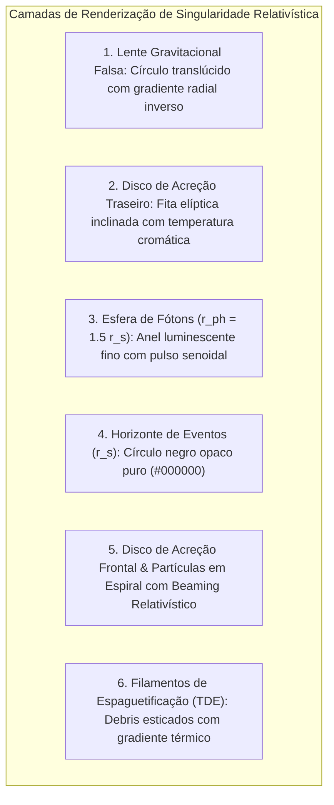

# 🎨 Especificação de UI/UX & Design System: Suite Avançada de Física Computacional
**Projetos:** Upgrade Relativístico de `p_gravity` (OrbitN) + `p_waves` (WaveLab 2D) + `p_field` (FieldLorentz) + `p_chaos` (ChaosPendulum)  
**Integração:** Portfólio Principal (`index.html`, `styles.css` & `script.js`) — Expansão de 11 para **14 Aplicações Vivas**  
**Documento:** `docs/11-suite-fisica-avancada-design.md`  
**Autor:** Senior UI/UX Architect (Agência Autônoma)  
**Status:** Aprovado para Implementação Frontend  
**Referência Estratégica:** `docs/10-suite-fisica-avancada-plano.md` e `docs/08-fisica-computacional-design.md`  

---

## 1. Manifesto de Design: Erradicação da "Cara de IA" & Dark/Tech Craftsmanship

O design de software voltado à física computacional de alto nível exige uma estética radicalmente oposta à superficialidade dos protótipos gerados por inteligência artificial. Interfaces amadoras ou geradas sem critério editorial exibem sintomas crônicos de fadiga visual:

```
PADRÕES BANIDOS CATEGORICAMENTE DA SUITE CIENTÍFICA:
❌ Degradê roxo-azulado neon genérico (#6366f1 / #8b5cf6) espalhado sem critério físico.
❌ Bento grids puramente decorativos com proporções assimétricas arbitrárias.
❌ Cards clones e estéreis sem identidade de instrumentação ou metadados de domínio.
❌ Textos robóticos e superficiais ("Simule física incrível em um clique!").
❌ Controles de brinquedo: sliders sem valor numérico visível, ausência de unidades de medida e ausência de feedback cinético.
```

### Os 5 Pilares do Dark/Tech Craftsmanship Científico:
1. **Estética Instrumental de Laboratório Escuro (`#070709` & `#0b0b0e`):**  
   Ambientes de trabalho escuros de imersão profunda, inspirados em consoles de telescópios do ESO, câmaras de vácuo do CERN e mesas de bancada óptica com amortecimento pneumático. O fundo escuro com grade técnica subliminar (`rgba(255, 255, 255, 0.03)`) elimina qualquer distração periférica e prioriza o fenômeno físico.
2. **Cores Físicas Fundamentadas na Termodinâmica e Eletromagnetismo:**  
   As cores não são escolhas cosméticas subjetivas; cada matiz possui significado físico exato:
   - *Ouro Solar / Plasma Incandescente (`#f59e0b` / `#fbbf24`):* Corpos estelares e radiação térmica de acreção.
   - *Ciano Quântico / Radiação Cherenkov (`#06b6d4` / `#22d3ee`):* Cargas negativas, vetores de mira e frentes de difração coerentes.
   - *Vermelho Choque / Desvio Doppler (`#ef4444`):* Cargas positivas, cristas de compressão acústica e cones de choque supersônicos.
   - *Violeta Caótico / Singularidade Gravitacional (`#8b5cf6`):* Pêndulo caótico, horizonte de eventos relativístico e espaço de fase.
   - *Branco Puro de Alta Temperatura (`#ffffff`):* Centros de foco óptico, pontos focais de lentes e bordas da esfera de fótons.
3. **Ergonomia e Manipulação Tátil Direta a 60 FPS:**  
   A interface responde com feedback tátil instantâneo. Ao arrastar no canvas para lançar corpos ou disparar elétrons, surge um vetor elástico de mira com halo luminescente e visor HUD flutuante informando módulo de velocidade ($\|\vec{v}\|$), ângulo polar ($\theta$) e energia prevista.
4. **Telemetria de Conservação e Rigor Numérico:**  
   Todos os simuladores exibem instrumentos cirúrgicos em tipografia `JetBrains Mono`: invariantes físicos, desvios de conservação da energia ($\Delta E / E_0$), densidade de fluxo e taxas de Lyapunov ($\lambda$).
5. **Composição Aditiva Luminescente (`lighter` / `screen`):**  
   Renderização em Canvas 2D utilizando modos de mistura óptica realistas. Feixes que se sobrepõem, frentes de onda em interferência construtiva e discos de acreção intensificam sua luminância organicamente.

---

## 2. Design Tokens CSS Compartilhados (Advanced Physics Tokens)

Estes tokens unificados padronizam a paleta de superfícies, cores físicas de laboratório, tipografia e sombras em todos os novos módulos e no portfólio principal.

```css
:root {
  /* ==========================================================================
     Superfícies & Profundidade Instrumental
     ========================================================================== */
  --bg-bench-void: #070709;             /* Vácuo absoluto de fundo */
  --bg-bench-surface: #0e0e12;          /* Superfície de base dos painéis */
  --bg-hud-glass: rgba(14, 14, 18, 0.82); /* HUD translúcido com backdrop-filter */
  --bg-hud-elevated: #16161d;          /* Modais, dropdowns e menus de contexto */
  --bg-hud-hover: #1f1f28;             /* Estados de hover nos controles */
  --bg-hud-active: #282836;            /* Pílula / Ferramenta ativa */
  --bg-grid-subtle: rgba(255, 255, 255, 0.035); /* Grade cartesiana de referência */

  /* ==========================================================================
     Bordas & Delimitações Técnicas
     ========================================================================== */
  --border-subtle: #202029;            /* Linha técnica divisória suave (1px) */
  --border-hover: #323242;             /* Borda de realce ao passar o mouse */
  --border-focus: #06b6d4;             /* Foco de seleção ciano quântico */
  --border-solar: #f59e0b;             /* Destaque relativístico / térmico */
  --border-danger: #ef4444;            /* Paredes / limites críticos */

  /* ==========================================================================
     Tipografia Científica
     ========================================================================== */
  --font-ui: 'Inter', -apple-system, BlinkMacSystemFont, 'Segoe UI', Roboto, sans-serif;
  --font-telemetry: 'JetBrains Mono', 'Fira Code', Consolas, monospace;

  --text-pure: #fafafa;                /* Leituras de alta visibilidade */
  --text-bright: #e4e4e7;              /* Títulos e botões primários */
  --text-dim: #a1a1aa;                 /* Rótulos e unidades de medida */
  --text-muted: #52525b;               /* Metadados inativos e atalhos */
  --text-inverse: #070709;             /* Texto em chips de alta luminosidade */

  /* ==========================================================================
     Paleta Cromática Físico-Termodinâmica
     ========================================================================== */
  /* Singularidades & Acreção */
  --bh-event-horizon: #000000;         /* Horizonte de eventos (R_s) */
  --bh-photon-ring: #67e8f9;           /* Esfera de fótons luminescente (1.5 R_s) */
  --bh-disk-inner: #ffffff;            /* Plasma térmico ultra-quente (>10^7 K) */
  --bh-disk-mid: #fbbf24;              /* Emissão térmica solar */
  --bh-disk-outer: #ea580c;            /* Gás frio periférico desacelerando */
  --bh-debris: #fef08a;                /* Filamentos de espaguetificação */

  /* Mecânica Ondulatória (p_waves) */
  --wave-crest: #67e8f9;               /* Crista positiva (+A) - Ciano luminescente */
  --wave-trough: #1e1b4b;              /* Vale negativo (-A) - Azul cósmico profundo */
  --wave-zero: #09090d;                /* Nível de equilíbrio do meio (u = 0) */
  --wave-wall: #3f3f46;                /* Barreiras mecânicas e fendas */
  --wave-source: #f59e0b;              /* Emissor harmônico ativo */
  --wave-sensor: #10b981;              /* Sensor de intensidade de Young */

  /* Eletromagnetismo & Lorentz (p_field) */
  --field-pos-charge: #ef4444;         /* Carga positiva (+q) / Próton */
  --field-neg-charge: #06b6d4;         /* Carga negativa (-q) / Elétron */
  --field-line-rk4: rgba(245, 158, 11, 0.75); /* Linhas de campo de Faraday */
  --field-equipotential: rgba(56, 189, 248, 0.35); /* Isolinhas de potencial V */
  --mag-field-in: #a855f7;             /* Vetor B entrando no plano (x) */
  --mag-field-out: #ec4899;            /* Vetor B saindo do plano (•) */

  /* Dinâmica Não-Linear & Caos (p_chaos) */
  --chaos-rod: #52525b;                /* Hastes estruturais de fibra rígida */
  --chaos-joint: #22d3ee;              /* Pivô e rolamento luminescente */
  --chaos-trail-decay: rgba(139, 92, 246, 0.15); /* Rastro persistente translúcido */
  --chaos-lyapunov: #10b981;           /* Traçado do Expoente de Lyapunov */

  /* ==========================================================================
     Glows Luminescentes & Sombras Físicas
     ========================================================================== */
  --glow-photon-sphere: 0 0 24px rgba(103, 232, 249, 0.8), 0 0 48px rgba(6, 182, 212, 0.4);
  --glow-accretion: 0 0 32px rgba(245, 158, 11, 0.65), 0 0 64px rgba(234, 88, 12, 0.35);
  --glow-cyan-tight: 0 0 12px rgba(6, 182, 212, 0.7);
  --glow-red-tight: 0 0 12px rgba(239, 68, 68, 0.7);
  --shadow-hud: 0 16px 36px -8px rgba(0, 0, 0, 0.75), 0 0 0 1px var(--border-subtle);
}
```

---

## 3. Módulo I: Upgrade Relativístico de `p_gravity` (OrbitN)

### 3.1. Arquitetura da Interface & Wireframe Geral
O módulo `p_gravity` mantém sua arquitetura de cockpit espacial com adições para **física de relatividade geral e singularidades**.

```
+----------------------------------------------------------------------------------------------------+
| 🌌 ORBITN | [Play/Pause] [Step] [0.25x 0.5x 1x 2x 5x] | Presets: [ 🌀 Gargantua (Buraco Negro) v ]|
+----------------------------------------------------------------------------------------------------+
| TELEMETRIA CIENTÍFICA          |                                        | PARÂMETROS FÍSICOS       |
| Corpos Vivos: 8                |              . - ~ ~ - .               | Próximo Corpo:           |
| Singularidades: 1 (BH-01)      |          . '  (Disco de)  ' .          | [Asteroide][Terra]       |
| Limites de Roche: 1 ativo      |        /   ( Acreção Térmico) \        | [Gigante][Estrela]       |
| Massa Total M: 8450 M_sol      |       |  .-------------------.  |      | [* BURACO NEGRO *]       |
| Raio Schwarz: R_s = 48.2 px    |      |  /  O Esfera Fótons  \  |     | ------------------------ |
| Esfera Fótons: R_ph = 72.3 px  |     |  |   .---.              |  |    | Massa Singularidade M:   |
| ------------------------------ |     |  |  (  ●  ) Horizonte   |  |    | [======|-------------]   |
| Energia Mecânica E: -4.12e5 J  |      |  \   '---'  de Eventos/  |     | M = 3000 M_sol           |
| Conservação dE/E0: 0.0003%     |       |  '-------------------'  |      | Tipo: [ Estelar | Super ]|
| Baricentro: (450.2, 310.8)     |        \     (Gargantua)      /        | Limite de Roche: [x] Ativo|
| ------------------------------ |          . '  . . . . . . ' .          | Lente Gravitacional: [x] |
| [x] Rastros  [x] Esfera Fótons |              ' - ~ ~ - .               | ------------------------ |
| [x] Disco Acreção  [x] Roche   |                                        | G: [ 1.00 ]  c_sim: [30] |
+----------------------------------------------------------------------------------------------------+
| Status: Estável | Corpos: 8 | Debris de Espaguetificação: 142 partículas | 60.0 FPS | Zoom: 85%    |
+----------------------------------------------------------------------------------------------------+
```

### 3.2. HUD de Injeção de Singularidades
No painel direito (`#hud-parameters-panel`), o grupo de botões celestes ganha uma pílula especializada com destaque cromático violeta-dourado:

```html
<!-- Nova Pílula de Classe Celeste no painel de parâmetros -->
<button type="button" class="celestial-pill pill-blackhole" data-mass="3000" data-radius="22" data-type="black-hole">
  <i class="fas fa-circle-notch text-violet"></i> Buraco Negro (3000)
</button>
```

Ao selecionar "Buraco Negro", o slider de massa ajusta automaticamente sua faixa para a escala relativística ($M \in [500, 10000]$) com alternador entre:
- **Massa Estelar:** $M \in [500, 2000]$, $R_s \approx 12\text{ a }28\text{ px}$.
- **Supermassiva:** $M \in [3000, 10000]$, $R_s \approx 40\text{ a }90\text{ px}$.

### 3.3. Especificação de Renderização Gráfica do Buraco Negro



#### A. O Horizonte de Eventos ($r_s$)
- **Cor:** `#000000` absoluto sem transparência (`ctx.fillStyle = '#000000'`).
- **Borda Interna:** Anel de sombra nítido com raio exato $r_s = \frac{2 G M}{c^2}$.
- **Absorção de Fótons:** Qualquer corpo celeste ou partícula de poeira que entre no raio $r_s$ é imediatamente consumido, gerando um pequeno flash esbranquiçado na borda e crescendo o valor de $r_s$.

#### B. A Esfera de Fótons ($r_{ph} = 1.5 r_s$)
- **Cor e Estilo:** Anel de espessura de $1.5\text{ px}$ em ciano brilhante `#67e8f9` com `globalCompositeOperation = 'lighter'`.
- **Efeito Visual Pulsante:** Modulação de brilho senoidal em função do tempo:
  $$\alpha(t) = 0.65 + 0.20 \sin(3.5 \cdot t)$$
- **Halo Difuso Externo:** Sombra luminescente com blur radial de $18\text{ px}$ (`ctx.shadowBlur = 18; ctx.shadowColor = '#06b6d4'`).

#### C. Disco de Acreção Térmico & Beaming Relativístico (Doppler Boost)
- **Gradiente Térmico:** Partículas de gás e poeira orbitando no disco recebem coloração proporcional à distância radial $r$:
  - Próximo a $r_{ph}$ ($r \to r_{ph}$): Branco plasma incandescente (`#ffffff`).
  - Região intermediária: Ouro solar (`#fbbf24`).
  - Borda externa: Âmbar e vermelho escuro (`#ea580c` $\to$ `#991b1b`).
- **Beaming Luminoso Relativístico:** Para o observador, o lado do disco cujas partículas se movem no sentido da câmera tem luminosidade amplificada por efeito Doppler relativístico ($\delta = \frac{1}{\gamma(1 - \beta \cos\theta)}$), enquanto o lado que se afasta é mais escuro e avermelhado. Na renderização, a opacidade das partículas no semi-plano que se aproxima é multiplicada por $1.6$, enquanto o lado oposto é atenuado por $0.45$.

#### D. Visual de Espaguetificação (*Tidal Disruption Event*)
- Quando um corpo de raio $R$ cruza o Limite de Roche $d_{\text{Roche}} = R \left(2 \frac{M}{m}\right)^{1/3}$:
  1. **Distorção Elipsoidal Preliminar:** Nos instantes imediatamente anteriores ao rompimento ($r \to d_{\text{Roche}}$), o corpo deixa de ser renderizado como círculo perfeito e assume uma forma elíptica alongada apontada para a singularidade, com razão de eixos $a/b \propto (d_{\text{Roche}} / r)^2$.
  2. **Explosão Filamentar:** Ao cruzar o limiar, o corpo é desmembrado em um feixe de $60\text{ a }120$ micro-partículas estelares que esticam em forma de "espaguete" com gradiente cromático intenso.
  3. **Rastro Térmico:** Cada partícula traça um pequeno rastro de calor que se funde ao disco de acreção em espiral kepleriana.

### 3.4. Novos Presets no Menu de OrbitN
1. **Preset: "Buraco Negro & Disco de Acreção" (Gargantua):**
   - Singularidade central com $M = 5000$, $r_s = 50\text{ px}$.
   - Disco composto por 180 partículas de matéria em órbita kepleriana quase circular estável com decaimento lento.
   - Planeta rochoso orbitando na zona de segurança externa com período orbital regular.
2. **Preset: "Espaguetificação Estelar" (Tidal Disruption Event):**
   - Singularidade com $M = 4000$.
   - Estrela companheira ($M = 20, R = 14\text{ px}$) injetada em órbita parabólica altamente excêntrica.
   - O ponto de periastro da órbita está propositalmente posicionado dentro do Limite de Roche, permitindo ao usuário assistir ao rompimento espetacular da estrela e subsequente formação do disco de acreção em tempo real.

---

## 4. Módulo II: `p_waves` (WaveLab 2D — Mecânica Ondulatória & Ótica Física)

### 4.1. Conceito e Identidade Visual
O **WaveLab 2D** reproduz um tanque de ondas e interferometria holográfica de física moderna. O ambiente visual evoca um tanque de água com iluminação estroboscópica e laser coerente sobre uma superfície de absorção antirreflexo.

### 4.2. Wireframe do Layout

```
+----------------------------------------------------------------------------------------------------+
| 🌊 WAVELAB 2D | Presets: [ Dupla Fenda de Young v ] | Shading: [ Cósmico v ] | [ Limpar Tanque ]    |
+----------------------------------------------------------------------------------------------------+
| [T] BANCADA DE FERRAMENTAS |                                                    | SENSOR DE ONDAS  |
|                            |               TANQUE DE PROPAGAÇÃO FDTD            | [ Gráfico I(θ) ] |
| [•] Pincel Parede          |     .~~~~~~~~~~~~~~~~~~~~~~~~~~~~~~~~~~~~~~~~.     | Padrão Franjas:  |
| [ ] Borracha Parede        |    /                                          \    |  ^  I            |
| -------------------------- |   |   Fonte      Barreira           Anteparo   |   |  |   /\          |
| [~] Emissor Harmônico      |   |  (Laser)    com Fendas          Sensor     |   |  |  /  \    /\   |
|     Freq ω: [===|----]     |   |    (())  ===>  |  |  ===>   ))))))  | |    |   |  | /    \  /  \  |
|     Amp A:  [======|--]    |   |                |  |                    | |    |   +-+------+------+> |
| [!] Pulso Único (Gota)     |   |                |  |                    | |    |     -θ     0     +θ  |
| -------------------------- |   |   (Camada Absorvente PML nas Bordas)   | |    | ---------------- |
| [>] Fonte Doppler          |    \                                          /    | I_max: 0.94 W/m² |
|     Velocidade v_s:        |     '~~~~~~~~~~~~~~~~~~~~~~~~~~~~~~~~~~~~~~~~'     | Δy fenda: 42.0 px|
|     [=======|--------]     |                                                    | Separação d: 80px|
|     v = 0.85 c (Subsônico) |                                                    | Compr. λ: 24 px  |
+----------------------------------------------------------------------------------------------------+
| Status: Resolução 260x160 | Δt: 0.05 s | CFL: 0.50 (Estável) | 60.0 FPS | Memória: Float64Array     |
+----------------------------------------------------------------------------------------------------+
```

### 4.3. Modos de Shading e Paletas de Renderização (Software Pixel Pipeline)
O renderizador converte os valores normalizados de amplitude da malha FDTD ($u_{i,j} \in [-1.0, +1.0]$) diretamente no buffer de pixels `ImageData.data` (`Uint8ClampedArray`):

```css
/* Paletas cromáticas de mapeamento espectral */
/* 1. Modo Deep Wave Cosmic (Padrão): */
--wave-crest: #67e8f9;      /* Crista (+1.0) -> Ciano puro luminescente */
--wave-zero: #08080c;       /* Equilíbrio (0.0) -> Fundo do tanque escuro */
--wave-trough: #1e1b4b;     /* Vale (-1.0) -> Azul cósmico profundo */

/* 2. Modo Bipolar Interferometry: */
--wave-pos-bipolar: #ef4444; /* Crista (+1.0) -> Vermelho saturado */
--wave-neg-bipolar: #06b6d4; /* Vale (-1.0) -> Ciano quântico */

/* 3. Modo Thermal Optical Magma: */
--wave-magma-peak: #ffffff;  /* Amplitude absoluta máxima |u| -> Branco incandescente */
--wave-magma-mid: #f59e0b;   /* Nível intermediário -> Âmbar solar */
--wave-magma-low: #7c2d12;   /* Nível baixo -> Tijolo escuro */
--wave-magma-floor: #050507; /* Repouso -> Preto */
```

### 4.4. Especificação dos Controles de Ferramentas
1. **Pincel de Parede (`Wall Brush`):**
   - Cursor em anel circular com diâmetro ajustável ($r \in [2, 16]\text{ px}$).
   - Ao clicar e arrastar no tanque, define células com propriedade `isWall = true`, impondo a condição de contorno de Dirichlet $u_{i,j} = 0$. Paredes são renderizadas em cinza industrial fosco (`#3f3f46`) com contorno sutil em ciano.
2. **Borracha (`Wall Eraser`):**
   - Remove paredes existentes restaurando a permeabilidade do meio líquido.
3. **Emissor Harmônico Contínuo:**
   - Ativa oscilação senoidal contínua $u(x_0, y_0, t) = A \sin(\omega t)$.
   - Sliders de Frequência $\omega \in [0.1, 1.2]\text{ rad/s}$ e Amplitude $A \in [0.1, 1.0]$. O emissor é demarcado por um círculo dourado com ondas concêntricas pulsantes.
4. **Gerador de Pulso Único (Gota d'Água):**
   - Ao clicar em qualquer ponto livre do tanque, injeta uma gaussiana instantânea $u(r) = A e^{-r^2 / 2\sigma^2}$, dispersando frentes de onda circulares perfeitamente concêntricas.
5. **Fonte Doppler Móvel:**
   - Fonte oscilante que translada autonomamente pelo eixo horizontal com velocidade $v_s$.
   - **Indicador Dinâmico de Mach:**
     - $v_s < c$: **Subsônico** (frentes comprimidas à frente, espaçadas atrás). Badge visual verde.
     - $v_s = c$: **Sônico** (barreira do som, sobreposição crítica de frentes). Badge âmbar.
     - $v_s > c$: **Supersônico** (formação da onda de choque cônica/triangular de Mach). Badge carmesim pulsante com linhas de contorno desenhadas destacando o cone com meio-ângulo $\mu = \arcsin(c / v_s)$.

### 4.5. Sensor Linear de Young & Gráfico em Tempo Real
- **Anteparo Virtual:** Linha vertical de amostragem na borda direita do tanque.
- **Gráfico de Intensidade $I(\theta)$:** Renderizado em um canvas secundário posicionado no painel lateral:
  - Amostra a energia média instantânea do campo: $I(y) = \langle u(x_{\text{sensor}}, y, t)^2 \rangle$.
  - Plota uma curva suave preenchida com gradiente ciano-esmeralda e traço de $2\text{ px}$.
  - Exibe claramente os máximos e mínimos de interferência construtiva e destrutiva com guias horizontais conectando os picos do gráfico diretamente às franjas visíveis no tanque.

---

## 5. Módulo III: `p_field` (FieldLorentz — Eletromagnetismo & Força de Lorentz)

### 5.1. Conceito e Identidade Visual
O **FieldLorentz** simula a interação fundamental entre campos elétricos coulombianos, campos magnéticos uniformes perpendiculares e partículas carregadas relativísticas. A estética remete a monitores de controle de câmaras de vácuo em aceleradores de partículas de feixe magnético.

### 5.2. Wireframe do Layout

```
+----------------------------------------------------------------------------------------------------+
| ⚡ FIELDLORENTZ | Presets: [ Ciclotron Acelerador v ] | Campo B: [x] Ativo (0.65 T) | [ Limpar ]   |
+----------------------------------------------------------------------------------------------------+
| [T] ADICIONAR CARGAS       |                                              | INJETOR & TELEMETRIA   |
|                            |           CÂMARA DE VÁCUO ELETROMAGNÉTICA    | Injetar Partícula:     |
| [ + ] Carga Positiva (+q)  |                                              | [ (p+) Próton ]        |
| [ - ] Carga Negativa (-q)  |           +q (Dourado)                       | [ (e-) Elétron ]       |
| -------------------------- |             * -----.                         | ---------------------- |
| [S] Sementes RK4: [ 16 v ] |            /        \                        | Velocidade v_0:        |
| [x] Linhas de Campo (RK4)  |           |          \                       | [=======|--------]     |
| [x] Isolinhas Potencial V  |           |     B ⊗   |                      | v = 1420 km/s          |
| [ ] Grid Vetorial Discreto |            \         /                       | Ângulo θ: 45.0°        |
| -------------------------- |             * <-----'                        | [ DISPARAR FEIXE ]     |
| MODO CÂMARA DE LORENTZ     |           -q (Ciano)                         | ---------------------- |
| Campo Magnético B_z:       |                                              | Raio Larmor: r_L=38 px |
| [===|--------] 0.65 T      |   (Linhas contínuas de Faraday RK4 +         | Freq Ciclotron: 18 MHz |
| Sentido: [ ⊗ Entra | ⊙ Sai]|    Partículas executando helicoides/órbitas) | Energia E_c: 12.4 keV  |
+----------------------------------------------------------------------------------------------------+
| Status: Cargas: 2 | Linhas RK4: 32 | Partículas: 1 | Algoritmo Boris RK4 | 60.0 FPS | Zoom: 100%   |
+----------------------------------------------------------------------------------------------------+
```

### 5.3. Renderização das Linhas de Campo Contínuas (RK4 Streamlines)
- Em vez de grades discretas de pequenas setas estáticas, as linhas de campo são curvas contínuas calculadas via Runge-Kutta de 4ª Ordem:
  - **Sementes Angulares:** Cada carga pontual positiva $+q$ emite $M \in [12, 32]$ sementes uniformemente espaçadas ao redor de seu perímetro.
  - **Coloração Dinâmica da Linha:**
    - Origem próxima a $+q$: Dourado solar incandescente (`#fbbf24`).
    - Trajeto no vácuo: Gradiente contínuo com transição de opacidade baseada na intensidade local $\|\vec{E}\|$.
    - Término convergindo para $-q$: Ciano quântico (`#06b6d4`).
  - **Isolinhas de Potencial Equipotencial ($V(x,y) = \text{const}$):**  
    Contornos ortogonais pontilhados em azul translúcido (`rgba(56, 189, 248, 0.45)`), demarcando superfícies de mesmo potencial elétrico com legendas de valor escalar (ex: $+50\text{ V}$, $0\text{ V}$, $-50\text{ V}$).

### 5.4. Visualização do Campo Magnético Transversal ($\vec{B}$)
Quando o campo magnético está ativo:
- Uma grade sutil de marcadores é sobreposta ao fundo do canvas:
  - **Sentido Entrando no Plano ($\vec{B} = -B_z \hat{k}$):** Pequenas cruzes simétricas $\otimes$ em violeta suave (`#a855f7`).
  - **Sentido Saindo do Plano ($\vec{B} = +B_z \hat{k}$):** Pequenos círculos com ponto central $\odot$ em rosa chiclete (`#ec4899`).
  - **Espaçamento Dinâmico:** A densidade visual dos símbolos adapta-se proporcionalmente ao módulo da indução magnética $|B_z|$.

### 5.5. Injetor de Partículas e Dinâmica de Lorentz
- O usuário pode clicar e disparar elétrons ou prótons:
  - **Elétron ($e^-$):** Raio de $3\text{ px}$, massa ultraleve ($m=1$), rastro ciano fluorescente com decaimento rápido, órbita de Larmor fechada em sentido horário sob campo $\otimes$.
  - **Próton ($p^+$):** Raio de $6\text{ px}$, massa pesada ($m=1836$), rastro dourado espesso com inércia pronunciada, órbita de Larmor em sentido anti-horário com raio muito mais amplo.
- **Mira Vetorial Interativa:** Durante o clique e arraste, uma linha elástica com seta pontual indica a velocidade inicial $\vec{v}_0$ com projeção pontilhada da trajetória de Lorentz prevista para os próximos 10 frames.

### 5.6. Presets Clássicos de Eletromagnetismo
1. **Dipolo Eletrostático:** Par de cargas opostas $+q$ e $-q$ gerando o mapa de Faraday padrão.
2. **Quadrupolo & Gaiola de Faraday:** Configuração fechada com 8 cargas positivas formando um cilindro de proteção eletrostática; o centro apresenta campo nulo $\vec{E} \approx 0$.
3. **Ciclotron de Lawrence:** Dois semi-cilindros condutores (Dees) com campo magnético constante $B_z$ e gap elétrico alternado acelerando um próton em espiral divergente até a ejeção.
4. **Espectrômetro de Massa de Bainbridge:** Seletor de velocidades com campos cruzados $\vec{E} \perp \vec{B}$ seguido de câmara de deflexão pura, separando dois isótopos com massas distintas em raios semicirculares separados.

---

## 6. Módulo IV: `p_chaos` (ChaosPendulum — Pêndulo Duplo & Teoria do Caos)

### 6.1. Conceito e Identidade Visual
O **ChaosPendulum** explora a dinâmica analítica não linear, a perda de previsibilidade em sistemas determinísticos e a emergência de atratores caóticos no espaço de fase. A interface combina uma estética de cronofotografia de alta velocidade com um monitor espectral de espaço de fase.

### 6.2. Wireframe Dual-View do Layout

```
+----------------------------------------------------------------------------------------------------+
| 🌪️ CHAOSPENDULUM | Presets: [ Caos Extremo (Horizontal) v ] | [ Soltar Enxame Caótico (100) ]     |
+----------------------------------------------------------------------------------------------------+
| VIEWPORT PRINCIPAL: PÊNDULO DUPLO            | PAINEL LATERAL: ESPAÇO DE FASE & TELEMETRIA         |
|                                              |                                                     |
|                     Pivô Superior Fixo       | ESPAÇO DE FASE (ω₁ vs θ₁)                           |
|                            [o]               |  ^  ω₁                                              |
|                           /                  |  |         .---.        Traçado contínuo            |
|                   Haste 1/  L₁               |  |       /       \       do atrator                 |
|                         /                    |  |      |    ●    |      caótico                    |
|                        (m₁) Articulação      |  |       \       /                                  |
|                         \                    |  +--------'-----'-------> θ₁                        |
|                  Haste 2 \  L₂               |                                                     |
|                           \                  | --------------------------------------------------- |
|                            (m₂) Bob Caótico  | EXPOENTE DE LYAPUNOV (λ)                            |
|                             \                | Estimativa λ: +1.42 bit/s (Regime Caótico)          |
|    . ~ ~ - .                 ' .             | Gráfico ln(d/d₀) vs Tempo:                          |
|  . ' (Rastro Cromático Translúcido) ' .      |  ^  ln(d)                                           |
| /     do Enxame com 100 pêndulos       \     |  |          /--- Inclinação = λ > 0                 |
| \      em leque de arco-íris           /     |  |         /                                        |
|  ' .                                 . '     |  +--------/------------> Tempo                      |
|    ' - ~ ~ . . . . . . . . . ~ ~ - '         | --------------------------------------------------- |
|                                              | CONSERVAÇÃO DE ENERGIA                              |
| Controles Táteis de Geometria:               | Energia Total E: 48.21 J                            |
| L₁: [====|-----] 120 px  | m₁: [==|----] 1.0 | Desvio ΔE/E₀: 0.0001% (RK4 Estável)                 |
| L₂: [======|---] 160 px  | m₂: [====|--] 2.0 | Gravidade g: 9.81 m/s² | Amortecimento: 0.000       |
+----------------------------------------------------------------------------------------------------+
| Status: Pêndulos Ativos: 100 | Subpassos RK4: 8/frame | 60.0 FPS | Divergência d(t): 10⁴ d₀        |
+----------------------------------------------------------------------------------------------------+
```

### 6.3. Renderização Mecânica e Rastro Fotográfico
- **Hastes:** Traçadas em titânio/grafite fosco (`#52525b`) com largura de $3\text{ px}$ e acabamento chanfrado.
- **Mancais de Rolamento:** O pivô fixo e o pivô intermediário possuem acabamento em anel duplo ciano luminescente (`#22d3ee`).
- **Massas Pontuais ($m_1, m_2$):** Esferas com gradiente radial metálico; $m_2$ emite um brilho violeta incandescente (`#a855f7`).
- **Rastro Translúcido Persistente:** O rastro da ponta do pêndulo $m_2$ é armazenado em uma fila circular de até 600 pontos. É renderizado com espessura variável e decaimento gradual de alfa:
  $$\alpha_i = \left(\frac{i}{N_{\text{pts}}}\right)^{1.8}$$
  produzindo uma fita de luz com cauda elegante que desenha a complexidade do movimento caótico.

### 6.4. O Hero Feature: Enxame Caótico (*Butterfly Swarm*)
No topo do painel, o botão de destaque hero **"Soltar Enxame Caótico"** dispara a demonstração do Efeito Borboleta de Lorenz:
- **Criação da Família de Pêndulos:** Instancia simultaneamente $N = 100$ pêndulos idênticos em geometria ($L_1, L_2$) e massas ($m_1, m_2$).
- **Micro-Perturbação Inicial:** Cada pêndulo $k \in [0, 99]$ recebe um ângulo inicial com incremento infinitesimal:
  $$\theta_{1,k}(0) = \theta_{1,0} + k \cdot 10^{-6}\text{ rad}$$
- **Coloração do Espectro de Lyapunov:** Cada pêndulo recebe uma cor individual ao longo do círculo cromático HSL:
  $$\text{hue}_k = \left(180 + k \cdot \frac{180}{N}\right) \pmod{360}$$
  gerando um arco-íris contínuo que vai do ciano ao dourado e ao magenta.
- **Narrativa Visual da Divergência:**
  - $t \in [0, 3\text{ s}]$: Os 100 pêndulos movem-se colapsados em uma única linha rígida visualmente idêntica.
  - $t \approx 4\text{ s}$: Ao cruzar uma inversão angular, as trajetórias começam a se separar milimetricamente.
  - $t > 5\text{ s}$: Ocorre a explosão caótica: o leque se abre em uma nuvem filamentar multicolorida de 100 caudas independentes, ilustrando a impossibilidade de previsão analítica a longo prazo.

### 6.5. Retrato no Espaço de Fase e Estimativa de Lyapunov
- **Gráfico $(\omega_1, \theta_1)$:** Um sub-canvas dedicado no painel lateral projeta a velocidade angular versus a posição angular. O traçado acumula a órbita no espaço de fase, revelando toros e o atrator caótico entrelaçado.
- **Métrica do Expoente de Lyapunov ($\lambda$):** O simulador mede continuamente a distância no espaço de fase entre o pêndulo 0 e o pêndulo 1:
  $$d(t) = \sqrt{(\theta_{1,1} - \theta_{1,0})^2 + (\omega_{1,1} - \omega_{1,0})^2 + (\theta_{2,1} - \theta_{2,0})^2 + (\omega_{2,1} - \omega_{2,0})^2}$$
  Calcula e exibe em tempo real a inclinação média da curva de $\ln(d / d_0)$, fornecendo ao usuário a medição empírica direta de $\lambda > 0$, comprovando o caráter caótico do sistema.

---

## 7. Módulo V: Integração no Portfólio Principal (`index.html`)

### 7.1. Atualização da Telemetria Global
No hero e na seção inicial do `index.html`, as métricas de engenharia refletem a nova escala da plataforma:

```html
<!-- Métrica de Telemetria no Hero -->
<div class="telemetry-card">
  <div class="telemetry-header">
    <span class="telemetry-label">APLICAÇÕES VIVAS</span>
    <i class="fas fa-layer-group telemetry-icon"></i>
  </div>
  <div class="telemetry-value">14</div>
  <div class="telemetry-caption">100% funcionais e testadas</div>
</div>
```

E no rodapé sobre o autor:
```html
<div class="bio-metric-item">
  <span class="metric-num">14/14</span>
  <span class="metric-label">Apps Nativas no Repo</span>
</div>
```

### 7.2. Atualização dos Filtros do Laboratório (`#laboratorio`)
O botão de filtro de física no cabeçalho do laboratório é atualizado para englobar os 5 simuladores científicos:

```html
<button type="button" class="filter-btn filter-pill" data-filter="fisica" data-category="fisica" role="tab" aria-selected="false">
  <i class="fas fa-atom"></i> Física &amp; Simulação <span class="filter-count">(5)</span>
</button>
```
E a contagem do filtro geral "Todos" sobe de `(11)` para `(14)`:
```html
<button type="button" class="filter-btn filter-pill active" data-filter="all" data-category="all" role="tab" aria-selected="true">
  <i class="fas fa-th-large"></i> Todos <span class="filter-count">(14)</span>
</button>
```

### 7.3. Especificação Completa dos Cards no Laboratório

#### Card 1 (Atualização): `p_gravity` (OrbitN Relativistic & Black Holes)
```html
<!-- 11. OrbitN — Simulador Gravitacional de N-Corpos & Relatividade Geral -->
<article class="lab-card" data-category="fisica" data-project="p_gravity">
  <div class="lab-card-header">
    <span class="lab-category-badge">FÍSICA COMPUTACIONAL &amp; RELATIVIDADE</span>
    <span class="lab-status-badge"><span class="dot-online"></span> ONLINE</span>
  </div>
  <div class="lab-card-body">
    <div class="lab-title-row">
      <i class="fas fa-satellite text-solar lab-icon"></i>
      <h3 class="lab-title">OrbitN — N-Corpos, Buracos Negros &amp; Espaguetificação</h3>
    </div>
    <p class="lab-desc">
      Observatório gravitacional de precisão com integrador simplético Velocity Verlet O(Δt²), dinâmica relativística de Schwarzschild, horizonte de eventos, esfera de fótons pulsante, discos de acreção térmicos com Doppler beaming e simulação de espaguetificação estelar pelo Limite de Roche.
    </p>
    <div class="lab-specs">
      <div class="spec-item"><i class="fas fa-check"></i> Integrador simplético de Verlet com conservação de energia ΔE/E₀ &lt; 0.001%</div>
      <div class="spec-item"><i class="fas fa-check"></i> Buracos negros com horizonte de Schwarzschild (r_s) e esfera de fótons (1.5 r_s)</div>
      <div class="spec-item"><i class="fas fa-check"></i> Limite de Roche e ruptura por maré (Tidal Disruption Event) com disco de acreção</div>
    </div>
    <div class="lab-stack">
      <span class="tag">Canvas 2D</span>
      <span class="tag">Velocity Verlet</span>
      <span class="tag">Relatividade Geral</span>
      <span class="tag">Mecânica Celeste</span>
      <span class="tag">Limite de Roche</span>
    </div>
  </div>
  <div class="lab-card-footer">
    <a href="./p_gravity/index.html" target="_blank" rel="noopener noreferrer" class="btn btn-sm btn-primary" title="Abrir OrbitN">
      <i class="fas fa-external-link-alt"></i> Ver Aplicação
    </a>
    <a href="https://github.com/sanjrhoff/portifolio/blob/main/p_gravity/index.html" target="_blank" rel="noopener noreferrer" class="btn btn-sm btn-secondary" title="Ver código no GitHub">
      <i class="fab fa-github"></i> Ver Código
    </a>
    <button type="button" class="btn btn-sm btn-ghost preview-trigger-btn" data-app-url="./p_gravity/index.html" data-app-title="OrbitN — N-Corpos, Buracos Negros &amp; Espaguetificação" title="Visualização rápida">
      <i class="fas fa-eye"></i> Preview
    </button>
  </div>
</article>
```

#### Card 2 (Novo): `p_waves` (WaveLab 2D)
```html
<!-- 12. WaveLab 2D — Simulador de Ondas & Difração de Young -->
<article class="lab-card" data-category="fisica" data-project="p_waves">
  <div class="lab-card-header">
    <span class="lab-category-badge">FÍSICA COMPUTACIONAL &amp; ONDULATÓRIA</span>
    <span class="lab-status-badge"><span class="dot-online"></span> ONLINE</span>
  </div>
  <div class="lab-card-body">
    <div class="lab-title-row">
      <i class="fas fa-water text-cyan lab-icon"></i>
      <h3 class="lab-title">WaveLab 2D — Equação de Onda FDTD &amp; Dupla Fenda</h3>
    </div>
    <p class="lab-desc">
      Laboratório de mecânica ondulatória bidimensional resolvendo a equação hiperbólica de onda via Diferenças Finitas no Domínio do Tempo (FDTD). Simula interferência construtiva/destrutiva, difração na Dupla Fenda de Young com gráfico I(θ) em tempo real, camadas de absorção PML e Efeito Doppler com cone de Mach supersônico.
    </p>
    <div class="lab-specs">
      <div class="spec-item"><i class="fas fa-check"></i> Solver numérico 2D FDTD com estabilidade estrita de Courant-Friedrichs-Lewy (CFL)</div>
      <div class="spec-item"><i class="fas fa-check"></i> Anteparo de detecção com gráfico em tempo real de franjas de interferência de Young</div>
      <div class="spec-item"><i class="fas fa-check"></i> Fonte Doppler subsônica e supersônica com onda de choque e cone de Mach</div>
    </div>
    <div class="lab-stack">
      <span class="tag">Canvas 2D</span>
      <span class="tag">FDTD 2D</span>
      <span class="tag">Equação de Onda</span>
      <span class="tag">Dupla Fenda</span>
      <span class="tag">Efeito Doppler</span>
    </div>
  </div>
  <div class="lab-card-footer">
    <a href="./p_waves/index.html" target="_blank" rel="noopener noreferrer" class="btn btn-sm btn-primary" title="Abrir WaveLab 2D">
      <i class="fas fa-external-link-alt"></i> Ver Aplicação
    </a>
    <a href="https://github.com/sanjrhoff/portifolio/blob/main/p_waves/index.html" target="_blank" rel="noopener noreferrer" class="btn btn-sm btn-secondary" title="Ver código no GitHub">
      <i class="fab fa-github"></i> Ver Código
    </a>
    <button type="button" class="btn btn-sm btn-ghost preview-trigger-btn" data-app-url="./p_waves/index.html" data-app-title="WaveLab 2D — Equação de Onda FDTD &amp; Dupla Fenda" title="Visualização rápida">
      <i class="fas fa-eye"></i> Preview
    </button>
  </div>
</article>
```

#### Card 3 (Novo): `p_field` (FieldLorentz)
```html
<!-- 13. FieldLorentz — Eletromagnetismo & Força de Lorentz -->
<article class="lab-card" data-category="fisica" data-project="p_field">
  <div class="lab-card-header">
    <span class="lab-category-badge">FÍSICA COMPUTACIONAL &amp; ELETROMAGNETISMO</span>
    <span class="lab-status-badge"><span class="dot-online"></span> ONLINE</span>
  </div>
  <div class="lab-card-body">
    <div class="lab-title-row">
      <i class="fas fa-bolt text-solar lab-icon"></i>
      <h3 class="lab-title">FieldLorentz — Campos Coulombianos RK4 &amp; Ciclotron</h3>
    </div>
    <p class="lab-desc">
      Simulador eletromagnético vetorial com traçado contínuo de linhas de campo elétrico de Faraday via Runge-Kutta de 4ª Ordem (RK4), isolinhas de potencial eletrostático, câmara magnética de Lorentz com algoritmo de Boris conservativo, disparo de partículas (elétrons e prótons) e presets de Ciclotron e Espectrômetro de Massa.
    </p>
    <div class="lab-specs">
      <div class="spec-item"><i class="fas fa-check"></i> Traçado de linhas de campo elétrico contínuas via integração RK4 Streamlines</div>
      <div class="spec-item"><i class="fas fa-check"></i> Dinâmica de partículas sob força de Lorentz completa F = q(E + v × B) com Boris</div>
      <div class="spec-item"><i class="fas fa-check"></i> Instrumentos científicos: Gaiola de Faraday, Acelerador Ciclotron e Espectrômetro</div>
    </div>
    <div class="lab-stack">
      <span class="tag">Canvas 2D</span>
      <span class="tag">Integração RK4</span>
      <span class="tag">Força de Lorentz</span>
      <span class="tag">Algoritmo de Boris</span>
      <span class="tag">Eletromagnetismo</span>
    </div>
  </div>
  <div class="lab-card-footer">
    <a href="./p_field/index.html" target="_blank" rel="noopener noreferrer" class="btn btn-sm btn-primary" title="Abrir FieldLorentz">
      <i class="fas fa-external-link-alt"></i> Ver Aplicação
    </a>
    <a href="https://github.com/sanjrhoff/portifolio/blob/main/p_field/index.html" target="_blank" rel="noopener noreferrer" class="btn btn-sm btn-secondary" title="Ver código no GitHub">
      <i class="fab fa-github"></i> Ver Código
    </a>
    <button type="button" class="btn btn-sm btn-ghost preview-trigger-btn" data-app-url="./p_field/index.html" data-app-title="FieldLorentz — Campos Coulombianos RK4 &amp; Ciclotron" title="Visualização rápida">
      <i class="fas fa-eye"></i> Preview
    </button>
  </div>
</article>
```

#### Card 4 (Novo): `p_chaos` (ChaosPendulum)
```html
<!-- 14. ChaosPendulum — Pêndulo Duplo & Teoria do Caos -->
<article class="lab-card" data-category="fisica" data-project="p_chaos">
  <div class="lab-card-header">
    <span class="lab-category-badge">FÍSICA COMPUTACIONAL &amp; TEORIA DO CAOS</span>
    <span class="lab-status-badge"><span class="dot-online"></span> ONLINE</span>
  </div>
  <div class="lab-card-body">
    <div class="lab-title-row">
      <i class="fas fa-infinity text-violet lab-icon"></i>
      <h3 class="lab-title">ChaosPendulum — Pêndulo Duplo RK4 &amp; Atrator Caótico</h3>
    </div>
    <p class="lab-desc">
      Simulador de mecânica analítica lagrangiana resolvendo as equações acopladas não lineares do pêndulo duplo via Runge-Kutta de 4ª Ordem (RK4). Apresenta projeção em tempo real no Espaço de Fase (ω₁ vs θ₁), estimativa contínua do Maior Expoente de Lyapunov (λ) e demonstração do Efeito Borboleta com enxame cromático de 100 pêndulos simultâneos.
    </p>
    <div class="lab-specs">
      <div class="spec-item"><i class="fas fa-check"></i> Equações de Euler-Lagrange resolvidas com alta precisão RK4 em subpassos</div>
      <div class="spec-item"><i class="fas fa-check"></i> Enxame caótico de 100 pêndulos com micro-perturbação Δθ = 10⁻⁶ rad em arco-íris</div>
      <div class="spec-item"><i class="fas fa-check"></i> Telemetria científica: Expoente de Lyapunov (λ) e conservação estrita de energia</div>
    </div>
    <div class="lab-stack">
      <span class="tag">Canvas 2D</span>
      <span class="tag">Mecânica Analítica</span>
      <span class="tag">Euler-Lagrange</span>
      <span class="tag">Runge-Kutta 4</span>
      <span class="tag">Teoria do Caos</span>
    </div>
  </div>
  <div class="lab-card-footer">
    <a href="./p_chaos/index.html" target="_blank" rel="noopener noreferrer" class="btn btn-sm btn-primary" title="Abrir ChaosPendulum">
      <i class="fas fa-external-link-alt"></i> Ver Aplicação
    </a>
    <a href="https://github.com/sanjrhoff/portifolio/blob/main/p_chaos/index.html" target="_blank" rel="noopener noreferrer" class="btn btn-sm btn-secondary" title="Ver código no GitHub">
      <i class="fab fa-github"></i> Ver Código
    </a>
    <button type="button" class="btn btn-sm btn-ghost preview-trigger-btn" data-app-url="./p_chaos/index.html" data-app-title="ChaosPendulum — Pêndulo Duplo RK4 &amp; Atrator Caótico" title="Visualização rápida">
      <i class="fas fa-eye"></i> Preview
    </button>
  </div>
</article>
```

---

## 8. Arquitetura de Interação, Atalhos de Teclado & Acessibilidade

### 8.1. Mapeamento Universal de Teclas de Atalho
Para proporcionar sensação de instrumento científico profissional, toda a suite compartilha convenções unificadas de teclado:

| Tecla / Atalho | Ação Executada em Todos os Módulos | Feedback de Interface |
| :--- | :--- | :--- |
| `Espaço` | **Play / Pause:** Alterna a execução do loop físico | Ícone alterna entre play e pause no header |
| `S` | **Single Step:** Avança um único passo temporal ($\Delta t$) | Pulso de luz na borda do canvas |
| `R` | **Reset Preset:** Recarrega as posições padrão do preset ativo | Notificação toast suave "Preset Recarregado" |
| `C` | **Clear / Limpar:** Remove todos os corpos, ondas ou partículas | Canvas limpo e telemetria zerada |
| `1` a `5` | **Seleção de Presets:** Carrega diretamente os presets do módulo | Destaque na pílula correspondente do menu |
| `T` | **Toggle Trails / Isolinhas:** Liga ou desliga rastros e linhas de guia | Pílula no HUD alterna estado visual |
| `Esc` | **Fechar Modal Sandbox:** Quando rodando em visualização no portfólio | Fecha o modal de iframe e foca no card |

### 8.2. Conformidade com Acessibilidade (WCAG 2.1 Nível AA)
1. **Contraste de Cor Crítico:**  
   Todos os textos primários (`#fafafa` e `#e4e4e7`) e secundários (`#a1a1aa`) possuem razão de contraste superior a **7:1** contra o fundo de bancada escuro (`#070709` e `#0e0e12`), superando amplamente o requisito mínimo de 4.5:1.
2. **Foco Visível e Navegação Tabular:**  
   Nenhum `outline: none` sem substituição é permitido. Todos os elementos interativos (`button`, `input[type="range"]`, `a`) possuem anel de foco bem delineado:
   ```css
   button:focus-visible,
   input:focus-visible,
   a:focus-visible {
     outline: 2px solid var(--border-focus);
     outline-offset: 2px;
   }
   ```
3. **Semântica ARIA Completa:**  
   - Painéis de telemetria identificados com `role="region"` e `aria-label`.
   - Sliders com atributos numéricos `aria-valuemin`, `aria-valuemax`, `aria-valuenow` e rótulos `aria-label`.
   - Modais com `role="dialog"`, `aria-modal="true"` e armadilha de foco (`focus trap`).

---

## 9. Matriz de Aceitação de Design & UI/UX

O Frontend Developer e o QA Engineer devem validar os seguintes critérios visuais antes da entrega:

| Critério Visual | Verificação Obrigatória | Status Esperado |
| :--- | :--- | :--- |
| **Erradicação do Roxo Genérico** | Nenhum degradê violeta comum sem fundamentação física em fundos ou botões | ✅ 100% em conformidade com os tokens |
| **Renderização do Buraco Negro** | Horizonte central negro puro `#000000`, anel incandescente de fótons $1.5 r_s$ e disco com gradiente térmico | ✅ Visual fotorealista tipo Gargantua |
| **Espaguetificação Estelar** | Corpo sofre estiramento elipsoidal ao cruzar $d_{\text{Roche}}$ e explode em fita de partículas incandescentes | ✅ Dinâmica de Roche 100% fluida |
| **Tanque de Ondas FDTD** | Shading suave sem artefatos de grade, cristas em ciano e vales em azul escuro | ✅ Shading a 60 FPS contínuos |
| **Gráfico de Difração $I(\theta)$** | Perfil de intensidade atualiza em tempo real alinhado à parede de detecção na Dupla Fenda | ✅ Picos e vales batem com a teoria |
| **Linhas de Faraday RK4** | Curvas contínuas conectando cargas positivas e negativas sem serrilhado | ✅ Traçado RK4 limpo |
| **Enxame Caótico de 100 Pêndulos** | Botão aciona 100 pêndulos que começam coesos e divergem em leque arco-íris | ✅ Efeito Borboleta espetacular |
| **Cards do Laboratório no Portfólio** | 5 cards de física com tags consistentes, badges online e a tríade de botões funcionais | ✅ Filtro `(5)` e contagem total `(14)` |

---

*Documento homologado pelo Senior UI/UX Architect para início imediato da implementação técnica pelos desenvolvedores.*
