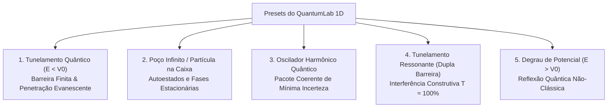

# ⚛️ QuantumLab 1D: Especificação de Engenharia & Plano de Produto
**Projeto:** Simulador Interativo da Equação de Schrödinger Dependente do Tempo (TDSE 1D)  
**Diretório:** `p_quantum/`  
**Integração:** Portfólio Principal (`index.html`) — Expansão para a Suite de Física Computacional  
**Documento:** `docs/13-plano-quantum-lab.md`  
**Autor:** Project Planner & Product Manager (Agência Autônoma)  
**Lead do Projeto:** Sandro Junior Hoffmann de Oliveira (@sanjrhoff) — Bacharel em Física (UFES) & Graduando em TSI (IFES)  
**Status:** Aprovado para Design de UI/UX, Implementação Frontend e QA  
**Ambiente de Produção:** GitHub Pages (`https://sanjrhoff.github.io/portifolio/`)  

---

## 1. Visão Executiva & Fundamentação Estratégica

### 1.1. O Posicionamento: Física Teórica Aliada à Engenharia de Software Moderna
O ecossistema global de tecnologia e computação científica busca engenheiros com capacidade comprovada de transitar entre **formalismos matemáticos complexos** e **software de alta performance e usabilidade impecável**.

A trajetória acadêmica de **Sandro — graduado em Física pela Universidade Federal do Espírito Santo (UFES)** e acadêmico de **Sistemas para Internet pelo Instituto Federal do Espírito Santo (IFES)** — confere uma chancela rara e diferenciada:
- **Domínio Numérico Rigoroso:** Enquanto muitos simuladores web utilizam aproximações ingênuas de Euler explícito (que divergem catastroficamente na mecânica quântica) ou bibliotecas pré-moldadas pesadas, o **QuantumLab 1D** é construído do zero absoluto em JavaScript Puro (Vanilla ES6+), resolvendo a Equação de Schrödinger com o método implícito **Crank-Nicolson** e o **Algoritmo de Thomas (TDMA) Tridiagonal Complexo**, alcançando complexidade linear $O(N)$ e conservação exata da unitariedade.
- **Narrativa Visual da Mecânica Quântica:** A função de onda $\psi(x,t)$ é uma quantidade intrinsecamente complexa ($\psi \in \mathbb{C}$), frequentemente incompreendida quando reduzida apenas a uma curva estática. O QuantumLab 1D mapeia a **densidade de probabilidade $|\psi|^2$** simultaneamente à **fase quântica contínua $\arg(\psi)$ via gradiente espectral HSL**, permitindo observar visualmente frentes de onda, interferência quântica, velocidade de fase e dispersão de pacotes.
- **Autoridade em Portfólio:** A aplicação consolida a vitrine de Sandro para posições sênior de engenharia frontend, visualização científica de dados, simulação física e computação de alta performance.

### 1.2. Ficha Técnica do Produto
| Item | Especificação |
| :--- | :--- |
| **Nome da Aplicação** | QuantumLab 1D |
| **Domínio Físico** | Mecânica Quântica Não-Relativística / Física Computacional |
| **Equação Fundamental** | Equação de Schrödinger Dependente do Tempo (1D TDSE) |
| **Método Numérico** | Crank-Nicolson Implícito com Operador de Cayley Unitário |
| **Solucionador Linear** | Algoritmo de Thomas (TDMA) Tridiagonal para Números Complexos em $O(N)$ |
| **Resolução Espacial** | Grade discretizada de $N = 500$ a $800$ nós espaciais |
| **Taxa de Quadros** | 60 FPS contínuos e estáveis com Canvas 2D nativo |
| **Dependências** | **Zero dependências externas** (Sem Three.js, Math.js, jQuery ou bibliotecas CSS) |
| **Design System** | Dark Zinc Editorial (`#09090b`, `#121215`, `#27272a`, ciano, âmbar, esmeralda, violeta) |

---

## 2. Fundamentação Física & Formulação Matemática

### 2.1. A Equação de Schrödinger Dependente do Tempo (TDSE)
Para uma partícula de massa $m$ sob a influência de um potencial unidimensional $V(x)$, a evolução dinâmica de seu estado quântico $|\psi(t)\rangle$ no espaço das posições é regida por:
$$i \hbar \frac{\partial \psi(x,t)}{\partial t} = \hat{H} \psi(x,t) = \left( -\frac{\hbar^2}{2m} \frac{\partial^2}{\partial x^2} + V(x) \right) \psi(x,t)$$

Adotando unidades atômicas naturais no simulador para máxima estabilidade numérica e clareza dimensional:
- $\hbar = 1$
- $m = 1$
A equação se simplifica para:
$$i \frac{\partial \psi}{\partial t} = -\frac{1}{2} \frac{\partial^2 \psi}{\partial x^2} + V(x)\psi$$

### 2.2. A Desafio da Unitariedade e o Fracasso do Esquema Explícito
A densidade de probabilidade de encontrar a partícula em uma região do espaço é dada pela norma $P(x,t) = |\psi(x,t)|^2 = \psi^* \psi$. Pelo postulado de conservação quântica:
$$\int_{-\infty}^{+\infty} |\psi(x,t)|^2 \, dx = 1, \quad \forall t \ge 0$$

Se utilizássemos uma discretização temporal explícita ingênua (Forward Euler):
$$\psi^{n+1} = \psi^n - i \Delta t \hat{H} \psi^n = (I - i \Delta t \hat{H})\psi^n$$
O operador de evolução $(I - i \Delta t \hat{H})$ possui autovalores de módulo $|1 - i \Delta t E_k| = \sqrt{1 + (\Delta t E_k)^2} > 1$, o que causa **explosão numérica exponencial imediata**, destruindo a probabilidade e tornando a simulação inútil em poucos passos de tempo.

### 2.3. O Método Numérico Crank-Nicolson Complexo
Para contornar esse obstáculo, implementamos a aproximação de Cayley para o operador de evolução unitário $e^{-i \hat{H} \Delta t}$:
$$e^{-i \hat{H} \Delta t} \approx \frac{I - \frac{i \Delta t}{2} \hat{H}}{I + \frac{i \Delta t}{2} \hat{H}}$$

Multiplicando ambos os lados pelo denominador:
$$\left( I + \frac{i \Delta t}{2} \hat{H} \right) \psi^{n+1} = \left( I - \frac{i \Delta t}{2} \hat{H} \right) \psi^n$$

Como $\hat{H}$ é um operador hermitiano ($\hat{H}^\dagger = \hat{H}$), o operador de Cayley $U = (I - i \frac{\Delta t}{2} \hat{H})(I + i \frac{\Delta t}{2} \hat{H})^{-1}$ é **estritamente unitário**:
$$U^\dagger U = I$$
**Garantia Teórica:** A norma $\|\psi\|^2$ é conservada até a precisão de máquina de ponto flutuante de 64 bits ($Float64Array$), tornando o método **incondicionalmente estável** e matematicamente imune a dispersões numéricas artificiais.

### 2.4. Discretização Espacial em Grade 1D
Discretizamos o domínio contínuo $x \in [0, L]$ em $N$ pontos com espaçamento $\Delta x = \frac{L}{N - 1}$:
$$x_j = j \cdot \Delta x, \quad j = 0, 1, \dots, N-1$$

A derivada segunda espacial é aproximada pelo operador de diferenças finitas centradas de 2ª ordem:
$$\frac{\partial^2 \psi_j}{\partial x^2} \approx \frac{\psi_{j+1} - 2\psi_j + \psi_{j-1}}{\Delta x^2}$$

Substituindo na equação de Crank-Nicolson, definimos a constante adimensional de acoplamento:
$$\alpha = \frac{\Delta t}{4 \Delta x^2}$$

Para cada nó interior $j \in [1, N-2]$, a equação matricial discreta se decompõe em:
$$-i \alpha \, \psi_{j-1}^{n+1} + \left( 1 + 2i\alpha + \frac{i \Delta t}{2} V_j \right) \psi_j^{n+1} - i \alpha \, \psi_{j+1}^{n+1} = i \alpha \, \psi_{j-1}^n + \left( 1 - 2i\alpha - \frac{i \Delta t}{2} V_j \right) \psi_j^n + i \alpha \, \psi_{j+1}^n$$

Isso forma um sistema linear tridiagonal complexo da forma:
$$a_j \psi_{j-1}^{n+1} + d_j \psi_j^{n+1} + c_j \psi_{j+1}^{n+1} = b_j^n$$
Onde:
- Subdiagonal: $a_j = -i \alpha$
- Diagonal principal: $d_j = 1 + 2i\alpha + \frac{i \Delta t}{2} V_j$
- Superdiagonal: $c_j = -i \alpha$
- Vetor do lado direito (Right-Hand Side $b_j$):
  $$b_j = i \alpha \psi_{j-1}^n + \left( 1 - 2i\alpha - \frac{i \Delta t}{2} V_j \right) \psi_j^n + i \alpha \psi_{j+1}^n$$

### 2.5. O Algoritmo de Thomas Tridiagonal (TDMA) Complexo em $O(N)$
A inversão de uma matriz arbitrária de ordem $N \times N$ consome tempo $O(N^3)$, o que inviabilizaria qualquer simulação interativa em JavaScript. No entanto, por ser estritamente tridiagonal, o sistema pode ser resolvido com o **Algoritmo de Thomas (TDMA)** adaptado para álgebra de números complexos, em tempo estritamente **$O(N)$** e espaço de memória $O(N)$!

#### Aritmética de Números Complexos em Arrays Paralelos:
Para evitar sobrecarga de alocação de objetos (Garbage Collector thrashing) a cada frame de 16.6ms, armazenamos as partes real e imaginária de $\psi$, dos coeficientes modificados $c'$ e do vetor $d'$ em arrays tipados de alta performance `Float64Array`:
- `psiR` (Parte Real de $\psi$) e `psiI` (Parte Imaginária de $\psi$)
- `cPrimeR`, `cPrimeI`
- `dPrimeR`, `dPrimeI`

#### Passos do Algoritmo:
1. **Forward Elimination (Varredura Direta de $j=1$ até $N-2$):**
   $$c'_j = \frac{c_j}{d_j - a_j c'_{j-1}}$$
   $$b'_j = \frac{b_j - a_j b'_{j-1}}{d_j - a_j c'_{j-1}}$$
2. **Back Substitution (Varredura Reversa de $j=N-2$ até $1$):**
   $$\psi_{N-1}^{n+1} = 0 \quad \text{(Condição de contorno de Dirichlet)}$$
   $$\psi_j^{n+1} = b'_j - c'_j \psi_{j+1}^{n+1}$$

Todo o cálculo de divisão e multiplicação complexa é derivado analiticamente em componentes escalares diretos:
$$(u + i v)(x + i y) = (ux - vy) + i(uy + vx)$$
$$\frac{u + i v}{x + i y} = \frac{(ux + vy) + i(vx - uy)}{x^2 + y^2}$$

### 2.6. Condições de Contorno e Camada Absorvedora (PML)
1. **Fronteiras Impenetráveis (Paredes de Potencial Infinito):**
   $\psi_0 = 0$ e $\psi_{N-1} = 0$.
2. **Potencial de Absorção Imaginário Opcional (Boundary Damping / Complex Absorbing Potential):**
   Para experimentos de tunelamento e espalhamento onde o usuário deseja observar a reflexão e transmissão puras sem ecos nas paredes da caixa, adiciona-se nas extremidades ($x < x_{\text{abs}}$ e $x > L - x_{\text{abs}}$) um potencial óptico negativo com parte imaginária:
   $$V_{\text{eff}}(x) = V(x) - i \, W(x)$$
   onde $W(x) \ge 0$ atenua suavemente a amplitude da onda incidente, absorvendo o pacote sem reflexões espúrias.

---

## 3. Telemetria Quântica & Diagnóstico em Tempo Real

O QuantumLab 1D não é apenas uma animação; ele calcula continuamente os observáveis mecânico-quânticos reais a cada ciclo de renderização:

### 3.1. Conservação da Norma & Unitariedade
$$\text{Norma}(t) = \int_0^L |\psi(x,t)|^2 \, dx \approx \sum_{j=0}^{N-1} \left( \psi_R[j]^2 + \psi_I[j]^2 \right) \Delta x$$
- Exibição de telemetria: `Norma: 1.000000` com alerta visual se houver desvio superior a $10^{-5}$.

### 3.2. Coeficientes de Transmissão ($T$) e Reflexão ($R$)
Para barreiras localizadas no intervalo $[x_a, x_b]$:
- **Coeficiente de Reflexão ($R$):**
  $$R(t) = \int_0^{x_a} |\psi(x,t)|^2 \, dx$$
- **Coeficiente de Transmissão ($T$):**
  $$T(t) = \int_{x_b}^L |\psi(x,t)|^2 \, dx$$
- **Probabilidade Intrabarreira:**
  $$P_{\text{barreira}}(t) = \int_{x_a}^{x_b} |\psi(x,t)|^2 \, dx$$
- Validação constante: $T + R + P_{\text{barreira}} = 1.000$.

### 3.3. Teorema de Ehrenfest & Valores Esperados Quânticos
1. **Posição Média $\langle x \rangle$ e Incerteza $\Delta x$:**
   $$\langle x \rangle = \int x |\psi|^2 dx$$
   $$\langle x^2 \rangle = \int x^2 |\psi|^2 dx \implies \Delta x = \sqrt{\langle x^2 \rangle - \langle x \rangle^2}$$
2. **Momento Linear Médio $\langle p \rangle$ e Incerteza $\Delta p$:**
   $$\langle p \rangle = \int \psi^* \left(-i \frac{\partial \psi}{\partial x}\right) dx = \int \left( \psi_R \frac{\partial \psi_I}{\partial x} - \psi_I \frac{\partial \psi_R}{\partial x} \right) dx$$
   $$\langle p^2 \rangle = \int \left| \frac{\partial \psi}{\partial x} \right|^2 dx \implies \Delta p = \sqrt{\langle p^2 \rangle - \langle p \rangle^2}$$
3. **Princípio de Incerteza de Heisenberg:**
   $$\Delta x \cdot \Delta p \ge \frac{\hbar}{2} = 0.500$$
   A telemetria exibe o produto $\Delta x \cdot \Delta p$ ao vivo, mostrando quando o pacote está em seu estado de mínima incerteza coerente ($\approx 0.500$) e como ele se alarga ao longo do tempo.
4. **Energia Total Média $\langle E \rangle$:**
   $$\langle E \rangle = \langle \hat{H} \rangle = \int \left[ \frac{1}{2} \left| \frac{\partial \psi}{\partial x} \right|^2 + V(x) |\psi|^2 \right] dx$$
   Uma linha pontilhada horizontal no canvas visualiza a linha de energia incidente $\langle E \rangle$ em relação à barreira $V_0$.

---

## 4. Presets Didáticos de Alto Impacto Científico

O simulador oferece 5 presets científicos pré-configurados que exemplificam os fenômenos mais fundamentais e contraintuitivos da mecânica quântica:



### Preset 1: Tunelamento Quântico em Barreira Retangular ($E < V_0$)
- **Contexto Físico:** Clássicamente, uma partícula com energia $E < V_0$ é $100\%$ refletida por uma barreira. Na física quântica, a função de onda penetra na região proibida como uma onda evanescente exponencial decrescente $\psi(x) \propto e^{-\kappa x}$ com $\kappa = \sqrt{2m(V_0 - E)}/\hbar$, emergindo do outro lado com amplitude não nula.
- **Configuração:**
  - Pacote Gaussiano: $x_0 = 0.20 \cdot L$, $\sigma = 0.035 \cdot L$, $k_0 = 45.0$ rad/u.
  - Barreira: $x_{\text{start}} = 0.48 \cdot L$, largura $a = 0.04 \cdot L$, altura $V_0 = 1200 > E_0 \approx 1012$.
- **Fenômeno Observado:** Divisão do pacote em onda transmitida e refletida. O usuário compara o coeficiente medido experimentalmente no simulador $T_{\text{num}}$ com a aproximação analítica clássica:
  $$T_{\text{teorico}} \approx 16 \frac{E}{V_0} \left(1 - \frac{E}{V_0}\right) e^{-2 \kappa a}$$

### Preset 2: Poço Infinito de Potencial (Autoestados & Superposição)
- **Contexto Físico:** Caixa quântica unidimensional com paredes infinitas em $x=0$ e $x=L$.
- **Autoestados:**
  $$\psi_n(x) = \sqrt{\frac{2}{L}} \sin\left(\frac{n\pi x}{L}\right), \quad E_n = \frac{n^2 \pi^2 \hbar^2}{2m L^2}$$
- **Modos Selecionáveis:**
  - *Autoestado Fundamental ($n=1$):* $|\psi|^2$ permanece estritamente imóvel, enquanto a fase $\arg(\psi)$ gira em bloco no sentido horário com velocidade angular constante $\omega = E_1/\hbar$.
  - *Primeiro Estado Excitado ($n=2$):* Presença de um nó central onde a probabilidade é rigorosamente zero.
  - *Superposição Coerente de Schrödinger ($\frac{\psi_1 + \psi_2}{\sqrt{2}}$):* A interferência mútua cria um batimento espacial periódico em que o pacote de probabilidade oscila de um lado para o outro da caixa com período de batimento $T = \frac{2\pi \hbar}{E_2 - E_1}$.

### Preset 3: Oscilador Harmônico Quântico ($V(x) = \frac{1}{2} m \omega_0^2 (x - x_c)^2$)
- **Contexto Físico:** Potencial parabólico universal.
- **Configuração de Pacote Coerente de Glauber:**
  Um pacote gaussiano deslocado da posição de equilíbrio $x_c$.
- **Fenômeno Observado:** O pacote oscila harmonicamente de um lado para o outro do poço parabólico **sem dispersar** (sua largura $\sigma$ e incerteza $\Delta x \Delta p = \hbar/2$ permanecem constantes no tempo). Demonstração visual perfeita do princípio da correspondência e do Teorema de Ehrenfest: $\frac{d\langle x \rangle}{dt} = \frac{\langle p \rangle}{m}$ e $\frac{d\langle p \rangle}{dt} = -\langle \frac{\partial V}{\partial x} \rangle$.

### Preset 4: Tunelamento Ressonante em Dupla Barreira (Diodo Quântico)
- **Contexto Físico:** Duas barreiras de potencial idênticas separadas por uma distância de poço central.
- **Fenômeno Observado:** Quando a energia da partícula incidente coincide exatamente com um nível quase-ligado do poço central, ocorre **ressonância quântica**: múltiplas reflexões internas no poço interferem construtivamente, acumulando uma densidade de probabilidade gigantesca no poço e transmitindo a partícula com **probabilidade $T \to 100\%$**, mesmo que a energia seja muito inferior à altura das barreiras! É o princípio de funcionamento do Diodo de Tunelamento Ressonante (RTD).

### Preset 5: Degrau de Potencial & Reflexão Não-Clássica ($E > V_0$)
- **Contexto Físico:** Degrau onde $V(x) = 0$ para $x < x_0$ e $V(x) = V_0$ para $x \ge x_0$.
- **Fenômeno Contra-Intuitivo:** Se a partícula incide com energia $E > V_0$, a física clássica afirma que $100\%$ das partículas continuam com velocidade reduzida. Na mecânica quântica, a descontinuidade de impedância de onda ($k_1 \ne k_2 = \sqrt{2m(E - V_0)}$) provoca uma reflexão parcial finita da onda incidente:
  $$R = \left( \frac{k_1 - k_2}{k_1 + k_2} \right)^2 > 0$$
  O simulador comprova visualmente a existência do pacote refletido com $E > V_0$.

---

## 5. Arquitetura de Interface & Renderização Visual

### 5.1. Esquema de Renderização em Duas Camadas Sincronizadas
A interface utiliza um elemento HTML5 `<canvas>` dimensionado dinamicamente com suporte a monitores Retina/HiDPI (`window.devicePixelRatio`).

O display é dividido horizontalmente em:
1. **Canal Superior: Visualização Quântica e Potencial (Display Principal)**
   - **Curva de Densidade de Probabilidade $|\psi(x)|^2$:** Linha suave com espessura de 2.5px em ciano quântico (`#06b6d4`), preenchida até o chão com gradiente vertical translúcido.
   - **Renderização de Fase Quântica $\arg(\psi)$ (Modo Fase HSL):** A função de onda tem fase $\theta(x) = \text{atan2}(\psi_I, \psi_R) \in [-\pi, \pi]$.
     A cor sob a curva é segmentada ou colorida via HSL contínuo:
     $$\text{Hue} = \left( \frac{\theta + \pi}{2\pi} \right) \times 360^\circ$$
     - $\theta = 0 \to \text{Ciano/Verde}$
     - $\theta = \pi/2 \to \text{Magenta/Violeta}$
     - $\theta = \pm \pi \to \text{Vermelho/Laranja}$
     - $\theta = -\pi/2 \to \text{Azul}$
     Permite ao observador identificar instantaneamente cristas e vales da onda quântica e verificar a contração do comprimento de onda de De Broglie $\lambda = \frac{h}{p}$ em regiões de maior energia cinética!
   - **Potencial $V(x)$:** Bloco semi-transparente estilizado em âmbar (`rgba(245, 158, 11, 0.25)`) com borda em âmbar vivo (`#f59e0b`).
   - **Linha de Energia Média $\langle E \rangle$:** Linha tracejada horizontal em esmeralda neon (`#10b981`) ou violeta elétrico indicando o patamar energético do pacote incidente em relação à altura da barreira $V_0$.
2. **Canal de Telemetria e Indicadores de Conservação (Heads-Up Display HUD)**
   - Painel superior em glassmorphism com:
     - `Norma: 1.0000` (Verde se unitária).
     - `T (Transmissão): 0.241` (Ciano).
     - `R (Reflexão): 0.759` (Âmbar).
     - `T + R: 1.000` (Confirmação ao vivo de conservação).
     - `⟨x⟩: 142.3` / `⟨p⟩: 45.1` / `Δx·Δp: 0.512 ℏ`.
     - `FPS: 60.0` (Contador de estabilidade de frames).
3. **Pincel Interativo de Potencial (Custom Barrier Paint):**
   - O usuário pode clicar e arrastar com o mouse ou toque diretamente sobre a tela para desenhar qualquer perfil de potencial arbitrário $V(x)$ em tempo real (ex: barreiras triangulares, poços múltiplos, redes periódicas de Dirac).
   - Botões de limpar potencial e restaurar ground state.

---

## 6. Design System Dark Zinc Editorial

Para assegurar total harmonia com o design system do portfólio de Sandro (`SANDRO/portifolio/styles.css`):

### 6.1. Paleta de Cores
- **Zinc 950 (Fundo Master):** `#09090b`
- **Zinc 900 (Superfície dos Painéis):** `#121215`
- **Zinc 800 (Bordas e Containers):** `#27272a`
- **Zinc 700 (Divisórias e Sliders Track):** `#3f3f46`
- **Zinc 400 (Textos Secundários e Labels):** `#a1a1aa`
- **Zinc 100 (Títulos e Texto Principal):** `#f4f4f5`
- **Ciano Quântico (Destaque Principal / $|\psi|^2$):** `#06b6d4` (Glow: `rgba(6, 182, 212, 0.25)`)
- **Âmbar Potencial ($V(x)$ / Reflexão):** `#f59e0b` (Glow: `rgba(245, 158, 11, 0.20)`)
- **Esmeralda Unitária (Conservação / $\langle E \rangle$):** `#10b981`
- **Violeta Fase ($\arg(\psi)$):** `#8b5cf6`

### 6.2. Tipografia
- **Interface e Títulos:** `Inter`, -apple-system, BlinkMacSystemFont, 'Segoe UI', Roboto, sans-serif.
- **Valores Numéricos, Telemetria e Fórmulas:** `JetBrains Mono`, 'Fira Code', monospace.

### 6.3. Controles Interativos & Sliders
- Slider de **Energia / Momento $k_0$** ($10.0$ a $80.0$ rad/u).
- Slider de **Largura da Barreira $a$** ($5$ a $60$ nós).
- Slider de **Altura da Barreira $V_0$** ($0$ a $3000$ unidades).
- Slider de **Largura do Pacote $\sigma$** ($0.01$ a $0.08$ do domínio).
- Seletor de Modo de Renderização:
  1. `Densidade + Fase HSL` (Modo padrão de máxima expressividade).
  2. `Densidade Pura |ψ|²` (Modo clássico limpo).
  3. `Partes Real e Imaginária (Re/Im)` (Visualização analítica de senos e cossenos).
- Botões de Controle de Fluxo:
  - `Play / Pause` (Barra de espaço).
  - `Step (Passo a Passo)` (Permite avançar $\Delta t$ individualmente).
  - `Reset de Pacote` (Recria o pacote no estado inicial sem alterar o potencial).
  - `Limpar Potencial` (Zera $V(x)$ tornando o espaço livre).

---

## 7. Estrutura de Arquivos e Integração no Portfólio

### 7.1. Árvore de Diretórios
```
SANDRO/portifolio/
├── p_quantum/
│   ├── index.html        # Estrutura semântica, canvas responsivo, header e painéis
│   ├── styles.css        # CSS Dark Zinc, sliders temáticos, grid HUD e modal-friendly
│   └── script.js         # Solucionador TDSE Crank-Nicolson, TDMA complexo, presets e render
├── docs/
│   ├── 10-suite-fisica-avancada-plano.md
│   ├── 11-suite-fisica-avancada-design.md
│   ├── 12-qa-suite-fisica-avancada.md
│   └── 13-plano-quantum-lab.md (Este documento)
├── index.html            # Card do QuantumLab 1D no laboratório do portfólio
└── script.js             # Mapeamento do modal iframe e filtros de categoria
```

### 7.2. Integração no `index.html` do Portfólio Principal
O QuantumLab 1D será adicionado à seção `#laboratorio` do portfólio de Sandro com o badge de **Física Computacional**:
- **Título do Card:** `QuantumLab 1D`
- **Subtítulo:** `Simulador TDSE, Tunelamento Quântico & Crank-Nicolson O(N)`
- **Tags de Tecnologia:** `Física Quântica` `Crank-Nicolson O(N)` `Canvas 2D` `Thomas TDMA` `Unitariedade`
- **Link do Card:** `./p_quantum/index.html` (Abre diretamente ou via Sandbox Modal interativa).

---

## 8. Plano de Execução & Fases de Entrega

| Fase | Responsável | Escopo de Tarefas | Entregável |
| :--- | :--- | :--- | :--- |
| **Fase 1: Planejamento** | Project Planner (Este agente) | Especificação técnica completa, formulação do TDSE, equações de Crank-Nicolson, TDMA e requisitos funcionais. | `docs/13-plano-quantum-lab.md` |
| **Fase 2: Arquitetura & UI/UX** | UI/UX Designer & Architect | Especificação de layout, canvas 2D HiDPI, painéis HUD, paleta Dark Zinc, gradiente espectral HSL e responsividade mobile/desktop. | `docs/14-quantum-lab-design.md` |
| **Fase 3: Implementação Frontend** | Frontend & Physics Engine Dev | Codificação completa de `p_quantum/index.html`, `p_quantum/styles.css` e `p_quantum/script.js` + inserção do card no portfólio. | Código fonte executável em `p_quantum/` |
| **Fase 4: QA & Code Review** | QA & Reality Checker | Validação de 60 FPS, teste de conservação de unitariedade ($T+R=1.000$), precisão analítica de tunelamento e ausência de bugs no console. | `docs/15-qa-quantum-lab.md` |

---

## 9. Critérios de Aceite & Métricas de Qualidade

1. **Unitariedade Numérica Estrita:**  
   Em qualquer execução contínua com barreiras fechadas, a norma total $\int |\psi|^2 dx$ deve se manter entre $0.9999$ e $1.0001$ após mais de $10.000$ iterações temporais, sem dispersão espúria.
2. **Desempenho Gráfico 60 FPS:**  
   O loop de animação acoplado ao solucionador TDMA tridiagonal complexo deve rodar a 60 FPS contínuos em resolução padrão (desktop e mobile moderno) sem picos de lixeira (zero alocações desnecessárias no loop).
3. **Fidelidade Didático-Científica:**  
   Todos os 5 presets devem reproduzir exatamente a fenomenologia teórica correspondente (decaimento evanescente em $E < V_0$, autoestados estacionários, pacote coerente harmônico e ressonância de dupla barreira com $T \approx 1$).
4. **Pincel Interativo Funcional:**  
   Arrastar o cursor pelo canvas deve alterar suavemente a função de potencial $V(x)$ sem travamentos ou quebra do solucionador.
5. **Zero Dependências:**  
   Nenhum script externo ou fonte não-nativa necessária além do CSS do Google Fonts já presente no ecossistema do portfólio.

---

> [!NOTE]  
> Este documento técnico consolida a base teórica e de engenharia para que os agentes de UI/UX, Desenvolvimento e QA implementem o **QuantumLab 1D** com excelência acadêmica e sofisticação de código de produção.
