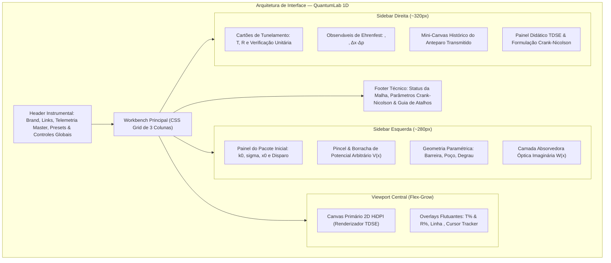
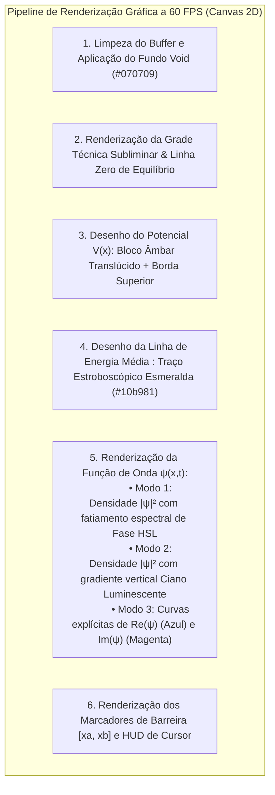

# 🎨 Especificação de UI/UX & Arquitetura Visual: QuantumLab 1D
**Projeto:** Simulador Interativo da Equação de Schrödinger Dependente do Tempo (TDSE 1D)  
**Diretório da Aplicação:** `SANDRO/portifolio/p_quantum/`  
**Integração:** Portfólio Principal (`index.html`) — Expansão da Suite de Física Computacional  
**Documento:** `docs/14-ui-quantum-lab.md`  
**Autor:** Senior UI/UX Architect (Agência Autônoma)  
**Lead do Projeto:** Sandro Junior Hoffmann de Oliveira (@sanjrhoff) — Bacharel em Física (UFES) & Graduando em TSI (IFES)  
**Status:** Aprovado para Implementação Frontend  
**Referência Estratégica:** `docs/13-plano-quantum-lab.md` e `SANDRO/portifolio/docs/11-suite-fisica-avancada-design.md`  

---

## 1. Manifesto de UI/UX: Erradicação da "Cara de IA" & Dark/Tech Craftsmanship

O design visual de um simulador de mecânica quântica de nível universitário e de engenharia de software de ponta deve recusar com firmeza os vícios estéticos de protótipos gerados por inteligência artificial descalibrada. Softwares científicos não são vitrines genéricas de marketing; são instrumentos cirúrgicos de precisão e exploração conceitual.

```
PADRÕES BANIDOS CATEGORICAMENTE DO QUANTUMLAB 1D:
❌ Roxo genérico de IA (#6366f1 / #8b5cf6) espalhado indiscriminadamente sem fundamentação física.
❌ Bento grids puramente decorativos com proporções arbitrárias que desperdiçam a área útil de visualização.
❌ Cards clones sem hierarquia semântica, sem dados dinâmicos reais e sem unidades físicas.
❌ Textos robóticos e banais ("Descubra a magia quântica com um clique!").
❌ Controles de brinquedo: sliders sem valor numérico associado, sem labels de grandezas físicas (k₀, σ, V₀) e sem feedback cinético.
❌ Canvas estático ou funções de onda representadas apenas por linhas monocromáticas que ocultam a natureza complexa ψ ∈ ℂ.
```

### Os 5 Pilares de Craftsmanship do QuantumLab 1D:
1. **Estética Instrumental de Bancada Quântica Escura (`#070709` / `#0e0e12`):**  
   Um ambiente imersivo com contraste cirúrgico, remetendo a monitores de osciloscópios criogênicos, consoles de controle de feixes de laser em laboratórios de óptica quântica e estações de trabalho de física computacional de alta energia. O fundo escuro com linhas técnicas reticuladas discretas direciona 100% da atenção do observador para a dança da probabilidade quântica.
2. **Cores Físicas Estritamente Semânticas:**  
   Nenhuma cor na interface existe por mero capricho estético. Cada matiz carrega uma correspondência física unívoca:
   - **Ciano Quântico (`#06b6d4` / `#22d3ee`):** Densidade de probabilidade $|\psi(x,t)|^2$ e transmissão através de barreiras.
   - **Âmbar Potencial (`#f59e0b` / `#fbbf24`):** Perfil de energia potencial $V(x)$, zonas proibidas clássicas e reflexão da onda incidente.
   - **Esmeralda da Conservação (`#10b981` / `#34d399`):** Unitariedade $\|\psi\|^2 = 1.000$, linha de energia média $\langle E \rangle$ e estabilidade numérica incondicional.
   - **Gradiente Espectral HSL da Fase Quântica ($\arg \psi \in [-\pi, \pi]$):** Visualização simultânea da parte real e imaginária da função de onda complexa através do círculo trigonométrico de fases, revelando instantaneamente velocidade de fase, frentes de onda e nós quânticos.
   - **Rosa / Magenta de Excitação (`#ec4899`):** Estados ressonantes e quase-ligados intrabarreira.
3. **Telemetria Cirúrgica com Tipografia `JetBrains Mono`:**  
   Todos os observáveis mecânico-quânticos reais — teorema de Ehrenfest $\langle x \rangle$, $\langle p \rangle$, incerteza de Heisenberg $\Delta x \cdot \Delta p \ge 0.500 \hbar$, e coeficientes de Tunelamento $T$ e Reflexão $R$ — são renderizados em tempo real com fontes de largura fixa e alinhamento tabular rigoroso.
4. **Manipulação Tátil Direta e Pincel Interativo de Potencial:**  
   O usuário não é um mero espectador. Ao arrastar o cursor ou o dedo sobre o canvas, ele atua como um experimentalista modelando potenciais arbitrários $V(x)$ (barreiras duplas, poços assimétricos, redes de Dirac) com atualização instantânea da matriz tridiagonal no frame subsequente a 60 FPS.
5. **Composição Visual Luminescente e Profundidade Óptica:**  
   A sobreposição de curvas quânticas sobre o potencial faz uso de modos de composição óptica translúcida com sombras de glow calculadas, criando a sensação palpável de que o pacote de ondas está navegando em uma cavidade física real.

---

## 2. Design Tokens CSS (Dark Zinc Quantum Architecture)

Os tokens abaixo definem a base unificada de cores, superfícies, tipografia e métricas estruturais para o QuantumLab 1D:

```css
:root {
  /* ==========================================================================
     Superfícies & Profundidade Instrumental
     ========================================================================== */
  --bg-bench-void: #070709;             /* Vácuo absoluto de fundo */
  --bg-bench-surface: #0e0e12;          /* Superfície dos painéis e headers */
  --bg-hud-glass: rgba(14, 14, 18, 0.88); /* HUD e glassmorphism com backdrop-filter */
  --bg-hud-elevated: #16161d;          /* Contêineres de cards e dropdowns */
  --bg-hud-hover: #1f1f28;             /* Estados interativos em hover */
  --bg-hud-active: #282836;            /* Ferramentas e abas selecionadas */
  --bg-input: #121217;                 /* Campos de input numérico e trilhos */
  --bg-grid-subtle: rgba(255, 255, 255, 0.035); /* Grade cartesiana de referência */

  /* ==========================================================================
     Bordas Técnicas & Delimitações
     ========================================================================== */
  --border-subtle: #202029;            /* Divisórias estruturais de 1px */
  --border-medium: #2c2c38;            /* Contornos de cards e botões secundários */
  --border-hover: #3b3b4d;             /* Realce dinâmico sob cursor */
  --border-cyan: #06b6d4;              /* Realce quântico principal */
  --border-amber: #f59e0b;             /* Realce de potencial de barreira */
  --border-emerald: #10b981;           /* Realce de unitariedade e energia */

  /* ==========================================================================
     Tipografia Científica
     ========================================================================== */
  --font-ui: 'Inter', -apple-system, BlinkMacSystemFont, 'Segoe UI', Roboto, sans-serif;
  --font-telemetry: 'JetBrains Mono', 'Fira Code', Consolas, monospace;

  /* Hierarquia de Textos */
  --text-pure: #fafafa;                /* Valores numéricos e leituras primárias */
  --text-bright: #e4e4e7;              /* Títulos, botões e labels ativos */
  --text-dim: #a1a1aa;                 /* Rótulos secundários e grandezas físicas */
  --text-muted: #52525b;               /* Metadados inativos, unidades e kbd */
  --text-inverse: #070709;             /* Texto sobre badges de alta luminância */

  /* ==========================================================================
     Paleta Cromática da Mecânica Quântica
     ========================================================================== */
  --quantum-cyan: #06b6d4;             /* Função de probabilidade |psi|^2 */
  --quantum-cyan-bright: #22d3ee;      /* Realce de crista de probabilidade */
  --quantum-cyan-glow: rgba(6, 182, 212, 0.40); /* Halo luminescente da função */

  --barrier-amber: #f59e0b;            /* Potencial de barreira V(x) */
  --barrier-amber-fill: rgba(245, 158, 11, 0.22); /* Preenchimento sob o potencial */
  --barrier-amber-border: rgba(245, 158, 11, 0.85); /* Topo da barreira */

  --energy-emerald: #10b981;           /* Linha de energia média <E> */
  --unitary-green: #34d399;            /* Indicador de norma unitária = 1.000 */

  --phase-violet: #8b5cf6;             /* Vetor de fase complexa arg(psi) */
  --resonance-pink: #ec4899;           /* Níveis ressonantes e poços quase-ligados */
  --real-component: #38bdf8;           /* Curva Re(psi) */
  --imag-component: #f43f5e;           /* Curva Im(psi) */

  /* ==========================================================================
     Dimensões Estruturais & Layout
     ========================================================================== */
  --header-height: 58px;
  --footer-height: 38px;
  --sidebar-left-width: 280px;
  --sidebar-right-width: 320px;
  --radius-sm: 6px;
  --radius-md: 10px;
  --radius-lg: 14px;

  /* ==========================================================================
     Sombras & Efeitos de Luz
     ========================================================================== */
  --shadow-hud: 0 14px 36px rgba(0, 0, 0, 0.70);
  --shadow-dropdown: 0 18px 42px rgba(0, 0, 0, 0.88);
  --glow-cyan-tight: 0 0 12px rgba(6, 182, 212, 0.65);
  --glow-amber-tight: 0 0 12px rgba(245, 158, 11, 0.55);
  --glow-emerald-tight: 0 0 12px rgba(16, 185, 129, 0.60);
}
```

---

## 3. Wireframe & Arquitetura Geral da Interface

A interface do **QuantumLab 1D** adota um layout de alta densidade informativa inspirado em instrumentações de laboratório, com 5 zonas fundamentais perfeitamente balanceadas:

```
+------------------------------------------------------------------------------------------------------------------------+
| [<- Voltar]  ⚛️ QUANTUMLAB 1D [TDSE 1D]  |  ||ψ||²: 1.000000  •  Δx·Δp: 0.512 ℏ  •  60.0 FPS  •  ● Estável  | [Presets 1-5 v] [Shading v] [▶ || ⏭ ⟲] [Zerar V] |
+------------------------------------------------------------------------------------------------------------------------+
| INSTRUMENTOS & POTENCIAL      | VIEWPORT QUÂNTICO CENTRAL                                   | TELEMETRIA & DIAGNÓSTICO QUÂNTICO    |
| ----------------------------- | ----------------------------------------------------------- | ------------------------------------ |
| 📦 PACOTE INCIDENTE (t=0)     |  T: 24.3%                                         R: 75.7%  | 📊 COEFICIENTES DE TUNELAMENTO       |
|  Momento k₀: [ 45.0 rad/u ]   |  +-------------------------------------------------------+  |  Transmissão T:  [ 0.243 ] (24.3%)   |
|  Largura σ:  [ 0.035 L     ]  |  |                 <E> = 1012.5 u                        |  |  Reflexão R:     [ 0.757 ] (75.7%)   |
|  Posição x₀: [ 0.20 L      ]  |  |  - - - - - - - - - - - - - - - - - - - - - - - - - - -|  |  Conservação:    [ 1.000000 ] OK     |
|  [ ⚡ Disparar Novo Pacote ]  |  |             /|                                        |  | ------------------------------------ |
| ----------------------------- |  |            / |       |~~~~~|                          |  | 🎯 TEOREMA DE EHRENFEST             |
| 🖌️ PINCEL DE POTENCIAL V(x)   |  |     |ψ|²  /  |  V(x) |     |                          |  |  Posição ⟨x⟩:        145.2 u     |
|  [ Pincel V ]  [ Borracha ]   |  |          /   |       | V₀  |                          |  |  Momento ⟨p⟩:        44.8 rad/u  |
|  Altura V_brush: [ 1200 u  ]  |  |         /     \      |     |            Onda          |  |  Incerteza Δx·Δp:    0.518 ℏ     |
|  Raio Pincel:    [ 12 px   ]  |  |  ______/       \_____|_____|________ Transmitida _____|  | ------------------------------------ |
| ----------------------------- |  +-------------------------------------------------------+  | 📈 HISTÓRICO DO ANTEPARO DETECTOR    |
| 🧱 BARREIRA PARAMÉTRICA       |  x: 0.485 L  |  |ψ|²: 0.0245  |  V(x): 1200 u  |  θ: +1.42 rad |  [ Mini Canvas do Fluxo J(t) / T(t) ] |
|  Largura Barreira a: [ 24 px] |                                                             | ------------------------------------ |
|  Altura Barreira V₀: [ 1200 ] |                                                             | 📜 EQUAÇÃO TDSE & THOMAS O(N)        |
|  [ Injetar Barreira Padrão ]  |                                                             |  i ∂ψ/∂t = -1/2 ∂²ψ/∂x² + V(x)ψ      |
| ----------------------------- |                                                             |  Crank-Nicolson Cayley Unitário O(N) |
| 🛡️ CAMADA ABSORVEDORA (PML)   |                                                             | ------------------------------------ |
|  [x] Amortecimento de Borda W |                                                             |  [ 📋 Copiar Dados ] [ 📷 Snapshot ] |
+------------------------------------------------------------------------------------------------------------------------+
| ● Solucionador Crank-Nicolson O(N) Ativo | N = 600 nós | Δt = 0.0002 s | Subpassos: 8/frame | [Espaço] Pause  [S] Passo  [R] Reset  [1-5] Presets  [C] Limpar V |
+------------------------------------------------------------------------------------------------------------------------+
```

### Diagrama de Fluxo e Componentes Visuais (Mermaid)



---

## 4. Header Superior (Cockpit & Telemetria Global)

O header superior atua como a central de comando da aplicação, unificando a navegação de retorno ao portfólio, os medidores críticos de conservação física em tempo real e a barra de ações rápidas.

### 4.1. Estrutura HTML Semântica

```html
<header class="app-header" role="banner">
  <!-- Brand & Retorno -->
  <div class="header-brand">
    <a href="../index.html" class="back-link" title="Voltar ao Portfólio Principal de Sandro" aria-label="Voltar ao Portfólio">
      <i class="fas fa-arrow-left"></i>
    </a>
    <div class="brand-title-wrap">
      <div class="brand-icon">
        <i class="fas fa-atom text-cyan"></i>
      </div>
      <div class="brand-text">
        <h1 class="brand-heading">
          QuantumLab 1D 
          <span class="tag-version">TDSE 1D</span>
          <span class="tag-algo">Crank-Nicolson O(N)</span>
        </h1>
        <p class="brand-subtitle">Simulador da Equação de Schrödinger &amp; Tunelamento Quântico</p>
      </div>
    </div>
  </div>

  <!-- Telemetria Central de Alta Visibilidade -->
  <div class="header-telemetry" id="header-telemetry" aria-label="Telemetria de Conservação Quântica">
    <!-- Norma Unitária -->
    <div class="telemetry-pill" title="Norma total integrada da função de onda (Conservação de Probabilidade)">
      <i class="fas fa-check-double text-emerald"></i>
      <span>Norma: <strong id="stat-norm" class="font-mono text-emerald">1.000000</strong></span>
    </div>
    <span class="telemetry-divider">•</span>

    <!-- Incerteza de Heisenberg -->
    <div class="telemetry-pill" title="Produto das Incertezas quânticas Δx · Δp (Limite de Heisenberg ≥ 0.500 ℏ)">
      <i class="fas fa-balance-scale text-cyan"></i>
      <span>Δx·Δp: <strong id="stat-heisenberg" class="font-mono text-bright">0.512 ℏ</strong></span>
    </div>
    <span class="telemetry-divider">•</span>

    <!-- Taxa de Quadros -->
    <div class="telemetry-pill" title="Taxa de atualização de frames do canvas em tempo real">
      <i class="fas fa-tachometer-alt text-amber"></i>
      <span><strong id="stat-fps" class="font-mono text-bright">60.0</strong> FPS</span>
    </div>
    <span class="telemetry-divider">•</span>

    <!-- Status do Solucionador -->
    <div class="telemetry-status-badge live" id="sim-status-badge" title="Estado de execução do solucionador TDSE">
      <span class="pulse-dot"></span>
      <span class="status-text" id="sim-status-text">Simulação Ativa</span>
    </div>
  </div>

  <!-- Ações Globais, Dropdowns & Playback -->
  <div class="header-actions">
    <!-- Dropdown de Presets Quânticos Fundamentais -->
    <div class="dropdown-container">
      <button type="button" class="btn btn-secondary dropdown-toggle" id="btn-presets-toggle" aria-haspopup="true" aria-expanded="false" title="Carregar montagem experimental de mecânica quântica">
        <i class="fas fa-flask text-amber"></i>
        <span>Presets Quânticos</span>
        <i class="fas fa-chevron-down caret"></i>
      </button>
      <div class="dropdown-menu" id="presets-dropdown-menu" role="menu">
        <div class="dropdown-header">EXPERIMENTOS FUNDAMENTAIS (1-5)</div>
        
        <button type="button" class="dropdown-item active" data-preset="tunneling" role="menuitem">
          <i class="fas fa-dungeon text-cyan"></i>
          <div class="item-info">
            <strong>1. Tunelamento Quântico (E &lt; V₀)</strong>
            <small>Barreira finita e penetração exponencial evanescente</small>
          </div>
        </button>

        <button type="button" class="dropdown-item" data-preset="infinite-well" role="menuitem">
          <i class="fas fa-box text-emerald"></i>
          <div class="item-info">
            <strong>2. Poço Infinito / Partícula na Caixa</strong>
            <small>Autoestados estacionários ψ₁ e superposição coerente</small>
          </div>
        </button>

        <button type="button" class="dropdown-item" data-preset="harmonic-oscillator" role="menuitem">
          <i class="fas fa-wave-square text-violet"></i>
          <div class="item-info">
            <strong>3. Oscilador Harmônico Quântico</strong>
            <small>Pacote coerente de Glauber oscilando sem dispersão</small>
          </div>
        </button>

        <button type="button" class="dropdown-item" data-preset="resonant-tunneling" role="menuitem">
          <i class="fas fa-microchip text-pink"></i>
          <div class="item-info">
            <strong>4. Tunelamento Ressonante (Diodo RTD)</strong>
            <small>Dupla barreira e transmissão unitária T ≈ 100%</small>
          </div>
        </button>

        <button type="button" class="dropdown-item" data-preset="potential-step" role="menuitem">
          <i class="fas fa-stairs text-amber"></i>
          <div class="item-info">
            <strong>5. Degrau de Potencial (E &gt; V₀)</strong>
            <small>Reflexão quântica não-clássica por impedância de onda</small>
          </div>
        </button>
      </div>
    </div>

    <!-- Dropdown de Modos de Renderização & Shading da Função de Onda -->
    <div class="dropdown-container">
      <button type="button" class="btn btn-icon dropdown-toggle" id="btn-shading-toggle" title="Modos de Visualização da Função de Onda ψ" aria-label="Mudar Modo de Renderização">
        <i class="fas fa-palette text-cyan"></i>
      </button>
      <div class="dropdown-menu dropdown-menu-right" id="shading-dropdown-menu" role="menu">
        <div class="dropdown-header">MODOS DE RENDERIZAÇÃO DA FUNÇÃO ψ</div>
        
        <button type="button" class="dropdown-item active" data-shading="density-phase" role="menuitem">
          <i class="fas fa-rainbow text-cyan"></i>
          <div class="item-info">
            <strong>Densidade + Fase Espectral HSL</strong>
            <small>|ψ|² preenchido com matiz contínuo da fase arg(ψ)</small>
          </div>
        </button>

        <button type="button" class="dropdown-item" data-shading="density-pure" role="menuitem">
          <i class="fas fa-chart-area text-emerald"></i>
          <div class="item-info">
            <strong>Densidade Pura |ψ|²</strong>
            <small>Curva suave de probabilidade em ciano com gradiente translúcido</small>
          </div>
        </button>

        <button type="button" class="dropdown-item" data-shading="real-imag" role="menuitem">
          <i class="fas fa-wave-square text-violet"></i>
          <div class="item-info">
            <strong>Partes Real e Imaginária (Re / Im)</strong>
            <small>Curvas explícitas de Re(ψ) em azul e Im(ψ) em magenta</small>
          </div>
        </button>
      </div>
    </div>

    <!-- Controles de Playback & Step -->
    <div class="btn-group" role="group" aria-label="Controles de Execução">
      <button type="button" class="btn btn-icon" id="btn-toggle-play" title="Play / Pause (Espaço)" aria-label="Play ou Pause">
        <i class="fas fa-pause" id="icon-play"></i>
      </button>
      <button type="button" class="btn btn-icon" id="btn-step" title="Passo Único no Tempo Δt (S)" aria-label="Avançar Passo Único">
        <i class="fas fa-step-forward"></i>
      </button>
      <button type="button" class="btn btn-icon" id="btn-reset-packet" title="Recriar Pacote Inicial (R)" aria-label="Resetar Pacote">
        <i class="fas fa-redo"></i>
      </button>
    </div>

    <!-- Limpar Potencial V(x) -->
    <button type="button" class="btn btn-danger-soft" id="btn-clear-potential" title="Zerar Potencial V(x) para Espaço Livre (C)">
      <i class="fas fa-eraser"></i>
      <span class="hide-mobile">Zerar V(x)</span>
    </button>
  </div>
</header>
```

### 4.2. Especificação CSS do Header

```css
/* Header Principal */
.app-header {
  display: flex;
  align-items: center;
  justify-content: space-between;
  height: var(--header-height);
  padding: 0 16px;
  background-color: var(--bg-bench-surface);
  border-bottom: 1px solid var(--border-subtle);
  user-select: none;
  z-index: 50;
  flex-shrink: 0;
}

/* Brand & Identidade */
.header-brand {
  display: flex;
  align-items: center;
  gap: 12px;
}

.back-link {
  display: flex;
  align-items: center;
  justify-content: center;
  width: 34px;
  height: 34px;
  background-color: var(--bg-hud-elevated);
  border: 1px solid var(--border-subtle);
  border-radius: var(--radius-sm);
  color: var(--text-dim);
  text-decoration: none;
  transition: all 0.2s ease;
}

.back-link:hover {
  background-color: var(--bg-hud-hover);
  border-color: var(--border-medium);
  color: var(--text-pure);
  transform: translateX(-2px);
}

.brand-title-wrap {
  display: flex;
  align-items: center;
  gap: 10px;
}

.brand-icon {
  display: flex;
  align-items: center;
  justify-content: center;
  width: 36px;
  height: 36px;
  background: radial-gradient(circle, rgba(6, 182, 212, 0.20) 0%, rgba(14, 14, 18, 0.4) 100%);
  border: 1px solid rgba(6, 182, 212, 0.35);
  border-radius: var(--radius-sm);
  font-size: 1.15rem;
}

.brand-heading {
  display: flex;
  align-items: center;
  gap: 8px;
  font-size: 1.05rem;
  font-weight: 700;
  color: var(--text-pure);
  letter-spacing: -0.01em;
  margin: 0;
}

.tag-version, .tag-algo {
  display: inline-block;
  padding: 2px 6px;
  font-size: 0.65rem;
  font-family: var(--font-telemetry);
  font-weight: 600;
  letter-spacing: 0.04em;
  border-radius: 4px;
}

.tag-version {
  background-color: rgba(6, 182, 212, 0.15);
  border: 1px solid rgba(6, 182, 212, 0.35);
  color: var(--quantum-cyan);
}

.tag-algo {
  background-color: rgba(16, 185, 129, 0.12);
  border: 1px solid rgba(16, 185, 129, 0.30);
  color: var(--energy-emerald);
}

.brand-subtitle {
  font-size: 0.72rem;
  color: var(--text-dim);
  margin: 0;
}

/* Telemetria Central do Header */
.header-telemetry {
  display: flex;
  align-items: center;
  gap: 12px;
  padding: 5px 14px;
  background-color: var(--bg-hud-elevated);
  border: 1px solid var(--border-subtle);
  border-radius: 20px;
}

.telemetry-pill {
  display: flex;
  align-items: center;
  gap: 7px;
  font-size: 0.75rem;
  color: var(--text-dim);
}

.telemetry-divider {
  color: var(--border-medium);
  font-size: 0.8rem;
}

.telemetry-status-badge {
  display: flex;
  align-items: center;
  gap: 6px;
  padding: 2px 8px;
  background-color: rgba(16, 185, 129, 0.12);
  border: 1px solid rgba(16, 185, 129, 0.30);
  border-radius: 12px;
  font-size: 0.70rem;
  font-weight: 500;
  color: var(--energy-emerald);
}

.telemetry-status-badge.paused {
  background-color: rgba(245, 158, 11, 0.12);
  border-color: rgba(245, 158, 11, 0.30);
  color: var(--barrier-amber);
}

.pulse-dot {
  width: 6px;
  height: 6px;
  border-radius: 50%;
  background-color: var(--energy-emerald);
  box-shadow: 0 0 8px var(--energy-emerald);
  animation: pulse-glow 2s infinite ease-in-out;
}

.telemetry-status-badge.paused .pulse-dot {
  background-color: var(--barrier-amber);
  box-shadow: 0 0 8px var(--barrier-amber);
  animation: none;
}

@keyframes pulse-glow {
  0%, 100% { opacity: 1; transform: scale(1); }
  50% { opacity: 0.4; transform: scale(0.85); }
}

/* Header Actions */
.header-actions {
  display: flex;
  align-items: center;
  gap: 8px;
}
```

---

## 5. Sidebar Lateral Esquerda (Bancada de Instrumentos & Pincel)

A sidebar lateral esquerda (`--sidebar-left-width: 280px`) contém os controles táteis para injeção e ajuste do pacote de onda gaussiano $\psi(x, 0)$, a paleta de pincéis para esculpir o potencial $V(x)$, e a geometria de barreiras paramétricas.

### 5.1. Estrutura HTML Semântica

```html
<aside class="workbench-sidebar" aria-label="Bancada de Instrumentos e Potencial">
  <!-- Título da Bancada -->
  <div class="sidebar-header">
    <div class="sidebar-title">
      <i class="fas fa-sliders-h text-cyan"></i>
      <span>Instrumentos &amp; Injeção</span>
    </div>
    <span class="badge-tag">1D TDSE</span>
  </div>

  <div class="sidebar-scrollable-content">
    <!-- Seção 1: Pacote de Ondas Gaussiano Inicial -->
    <section class="sidebar-section">
      <div class="section-header">
        <span class="section-title"><i class="fas fa-atom text-cyan"></i> Pacote Gaussiano ψ(x,0)</span>
      </div>

      <!-- Slider k0 (Momento / Energia Incidente) -->
      <div class="control-row">
        <div class="control-label-wrap">
          <label for="slider-k0">Momento Linear (k₀):</label>
          <span id="val-k0" class="control-value font-mono">45.0 rad/u</span>
        </div>
        <input type="range" id="slider-k0" min="10.0" max="85.0" value="45.0" step="1.0" class="quantum-slider slider-cyan">
        <div class="control-subinfo">Energia Cinética Estimada: <span id="val-kinetic-energy" class="font-mono">E₀ ≈ 1012.5 u</span></div>
      </div>

      <!-- Slider sigma (Largura da Incerteza Espacial) -->
      <div class="control-row">
        <div class="control-label-wrap">
          <label for="slider-sigma">Largura do Pacote (σ):</label>
          <span id="val-sigma" class="control-value font-mono">0.035 L</span>
        </div>
        <input type="range" id="slider-sigma" min="0.015" max="0.080" value="0.035" step="0.005" class="quantum-slider slider-cyan">
        <div class="control-subinfo">Incerteza Inicial: <span id="val-initial-delta-x" class="font-mono">Δx = 0.025 L</span></div>
      </div>

      <!-- Slider x0 (Posição de Injeção) -->
      <div class="control-row">
        <div class="control-label-wrap">
          <label for="slider-x0">Origem de Disparo (x₀):</label>
          <span id="val-x0" class="control-value font-mono">0.20 L</span>
        </div>
        <input type="range" id="slider-x0" min="0.05" max="0.40" value="0.20" step="0.01" class="quantum-slider slider-cyan">
      </div>

      <!-- Botão de Disparo de Novo Pacote -->
      <button type="button" class="btn btn-primary btn-block" id="btn-fire-packet">
        <i class="fas fa-bolt"></i>
        <span>Disparar Pacote Quântico</span>
      </button>
    </section>

    <!-- Seção 2: Pincel Interativo de Potencial V(x) -->
    <section class="sidebar-section">
      <div class="section-header">
        <span class="section-title"><i class="fas fa-paint-brush text-amber"></i> Pincel de Potencial V(x)</span>
      </div>

      <div class="tool-grid-2">
        <button type="button" class="tool-btn active" data-tool="brush" id="tool-brush-potential" title="Desenhar barreira ou poço arrastando o mouse">
          <i class="fas fa-paint-brush text-amber"></i>
          <span>Pincel V(x)</span>
        </button>
        <button type="button" class="tool-btn" data-tool="eraser" id="tool-eraser-potential" title="Apagar potencial no local do cursor">
          <i class="fas fa-eraser text-dim"></i>
          <span>Borracha V</span>
        </button>
      </div>

      <!-- Slider Altura do Pincel V_brush -->
      <div class="control-row">
        <div class="control-label-wrap">
          <label for="slider-brush-v">Altura do Pincel (V₀):</label>
          <span id="val-brush-v" class="control-value font-mono">1200 u</span>
        </div>
        <input type="range" id="slider-brush-v" min="-1500" max="3000" value="1200" step="50" class="quantum-slider slider-amber">
        <div class="control-subinfo">V &gt; 0: Barreira Repulsiva | V &lt; 0: Poço Atrativo</div>
      </div>

      <!-- Slider Raio do Pincel -->
      <div class="control-row">
        <div class="control-label-wrap">
          <label for="slider-brush-radius">Largura do Traço:</label>
          <span id="val-brush-radius" class="control-value font-mono">14 px</span>
        </div>
        <input type="range" id="slider-brush-radius" min="4" max="40" value="14" step="2" class="quantum-slider slider-amber">
      </div>
    </section>

    <!-- Seção 3: Barreira Paramétrica Rápida -->
    <section class="sidebar-section">
      <div class="section-header">
        <span class="section-title"><i class="fas fa-monument text-amber"></i> Barreira Paramétrica</span>
      </div>

      <!-- Slider Largura a -->
      <div class="control-row">
        <div class="control-label-wrap">
          <label for="slider-barrier-width">Espessura da Barreira (a):</label>
          <span id="val-barrier-width" class="control-value font-mono">0.040 L</span>
        </div>
        <input type="range" id="slider-barrier-width" min="0.010" max="0.150" value="0.040" step="0.005" class="quantum-slider slider-amber">
      </div>

      <!-- Slider Altura V0 -->
      <div class="control-row">
        <div class="control-label-wrap">
          <label for="slider-barrier-height">Altura da Barreira (V₀):</label>
          <span id="val-barrier-height" class="control-value font-mono">1200 u</span>
        </div>
        <input type="range" id="slider-barrier-height" min="0" max="2500" value="1200" step="50" class="quantum-slider slider-amber">
      </div>

      <div class="btn-group-stacked">
        <button type="button" class="btn btn-secondary btn-block" id="btn-apply-barrier">
          <i class="fas fa-layer-group"></i> Injetar Barreira Central
        </button>
        <button type="button" class="btn btn-secondary btn-block" id="btn-apply-double-barrier">
          <i class="fas fa-grip-lines-vertical"></i> Injetar Dupla Barreira (RTD)
        </button>
      </div>
    </section>

    <!-- Seção 4: Camada Absorvedora Óptica (PML / CAP) -->
    <section class="sidebar-section">
      <div class="section-header">
        <span class="section-title"><i class="fas fa-shield-alt text-emerald"></i> Contorno &amp; Absorção</span>
      </div>

      <label class="custom-toggle-wrap">
        <input type="checkbox" id="toggle-pml" checked>
        <span class="toggle-slider"></span>
        <span class="toggle-label">Camada Absorvedora Óptica -i W(x)</span>
      </label>
      <p class="section-help-text">
        Elimina reflexões espúrias nas paredes externas do domínio, isolando a transmissão e reflexão puras da barreira.
      </p>
    </section>
  </div>
</aside>
```

---

## 6. Viewport Central (Canvas Quântico HiDPI & Overlays)

O viewport central é a área nobre da aplicação. Nele opera o `<canvas>` renderizando a grade espacial discretizada, a linha de energia média $\langle E \rangle$, o potencial semi-transparente $V(x)$, e a função de onda complexa $\psi(x,t)$ com gradiente contínuo de fase HSL.

### 6.1. Estrutura HTML Semântica

```html
<main class="quantum-viewport-container" role="main" aria-label="Área de Visualização da Simulação Quântica">
  <!-- Container Relativo do Canvas HiDPI -->
  <div class="canvas-stage-wrapper" id="canvas-stage-wrapper">
    <!-- Canvas Principal de Renderização Numérica TDSE -->
    <canvas id="quantum-canvas" width="960" height="540"></canvas>

    <!-- Canvas de Interação & Pincel Overlay -->
    <canvas id="overlay-canvas" width="960" height="540"></canvas>

    <!-- Overlays Flutuantes: Indicadores Superiores de Tunelamento Instantâneo -->
    <div class="viewport-hud-top">
      <div class="hud-metric-pill reflection-pill">
        <div class="metric-indicator-dot dot-amber"></div>
        <span class="hud-pill-label">Reflexão (R):</span>
        <strong id="hud-val-r" class="font-mono text-amber">0.0%</strong>
      </div>

      <div class="hud-center-spacer"></div>

      <div class="hud-metric-pill transmission-pill">
        <div class="metric-indicator-dot dot-cyan"></div>
        <span class="hud-pill-label">Transmissão (T):</span>
        <strong id="hud-val-t" class="font-mono text-cyan">0.0%</strong>
      </div>
    </div>

    <!-- Indicador Flutuante de Energia Média <E> no Canvas -->
    <div class="energy-line-hud" id="energy-line-hud">
      <span class="energy-tag"><i class="fas fa-bolt text-emerald"></i> ⟨E⟩ = <span id="hud-energy-val" class="font-mono">1012.5 u</span></span>
    </div>

    <!-- Tooltip HUD de Coordenadas e Observáveis sob o Cursor -->
    <div class="cursor-quantum-hud" id="cursor-quantum-hud" style="display: none;">
      <div class="hud-row"><span class="hud-prop">x:</span> <span id="cursor-x" class="font-mono">0.485 L</span></div>
      <div class="hud-row"><span class="hud-prop">|ψ|²:</span> <span id="cursor-prob" class="font-mono text-cyan">0.0312</span></div>
      <div class="hud-row"><span class="hud-prop">V(x):</span> <span id="cursor-v" class="font-mono text-amber">1200 u</span></div>
      <div class="hud-row"><span class="hud-prop">Fase θ:</span> <span id="cursor-phase" class="font-mono text-violet">+1.54 rad</span></div>
    </div>
  </div>
</main>
```

### 6.2. Especificação da Renderização Gráfica do Canvas (Física & Cores)



#### A. A Curva de Potencial $V(x)$
- **Preenchimento:** `rgba(245, 158, 11, 0.22)`.
- **Linha de Contorno (Topo da Barreira):** `rgba(245, 158, 11, 0.90)` com espessura de `2.0px`.
- **Efeito Visual:** Zonas com $V(x) > \langle E \rangle$ (zonas classicamente proibidas) recebem sutil hachura vertical pontilhada (`rgba(245, 158, 11, 0.10)`), tornando intuitivo onde a física clássica exigiria reflexão instantânea.

#### B. A Linha de Energia Média $\langle E \rangle$
- **Cor:** `#10b981` (Esmeralda neon).
- **Estilo:** Linha tracejada horizontal `ctx.setLineDash([6, 4])` de `1.5px` de espessura.
- **Rótulo:** Etiqueta translúcida no lado esquerdo do canvas com o valor exato $\langle E \rangle = \int \psi^* \hat{H} \psi \, dx$.

#### C. O Mapeamento Espectral de Fase HSL ($\arg \psi$)
A função de onda quântica tem fase $\theta(x) = \text{atan2}(\psi_I, \psi_R) \in [-\pi, \pi]$.
Para cada nó $j$, a cor do segmento de probabilidade é mapeada continuamente:
$$\text{Hue} = \left( \frac{\theta(x_j) + \pi}{2\pi} \right) \times 360^\circ$$
- $\theta = 0 \to \text{Verde / Ciano}$
- $\theta = +\frac{\pi}{2} \to \text{Azul / Índigo}$
- $\theta = \pm \pi \to \text{Magenta / Rosa}$
- $\theta = -\frac{\pi}{2} \to \text{Laranja / Ouro}$
- **Brilho / Luminância:** Proporcional à densidade de probabilidade local $|\psi(x)|^2$ para que regiões com probabilidade zero decaiam organicamente para o fundo escuro sem ruído visual.

---

## 7. Sidebar Lateral Direita (Telemetria de Tunelamento & Teoria)

A sidebar direita (`--sidebar-right-width: 320px`) atua como o console de diagnóstico quantitativo e fundamentação teórica.

### 7.1. Estrutura HTML Semântica

```html
<aside class="telemetry-sidebar" aria-label="Painel de Diagnóstico Quântico e Teoria">
  <div class="sidebar-header">
    <div class="sidebar-title">
      <i class="fas fa-chart-line text-cyan"></i>
      <span>Telemetria de Tunelamento</span>
    </div>
    <span class="badge-tag">Tempo Real</span>
  </div>

  <div class="sidebar-scrollable-content">
    <!-- Seção de Coeficientes de Transmissão & Reflexão -->
    <section class="telemetry-section">
      <span class="section-micro-heading">COEFICIENTES DE FLUXO QUÂNTICO</span>
      
      <!-- Card Coeficiente de Transmissão T -->
      <div class="telemetry-card">
        <div class="card-meta">
          <span class="card-label"><i class="fas fa-arrow-right text-cyan"></i> Transmissão (T)</span>
          <span class="card-pct text-cyan" id="metric-t-pct">24.3%</span>
        </div>
        <div class="progress-bar-track">
          <div class="progress-bar-fill fill-cyan" id="bar-t" style="width: 24.3%;"></div>
        </div>
        <div class="card-footer-val">
          <span>Integral ∫_{xb}^L |ψ|² dx:</span>
          <strong id="metric-t-val" class="font-mono text-bright">0.24312</strong>
        </div>
      </div>

      <!-- Card Coeficiente de Reflexão R -->
      <div class="telemetry-card">
        <div class="card-meta">
          <span class="card-label"><i class="fas fa-undo text-amber"></i> Reflexão (R)</span>
          <span class="card-pct text-amber" id="metric-r-pct">75.7%</span>
        </div>
        <div class="progress-bar-track">
          <div class="progress-bar-fill fill-amber" id="bar-r" style="width: 75.7%;"></div>
        </div>
        <div class="card-footer-val">
          <span>Integral ∫_0^{xa} |ψ|² dx:</span>
          <strong id="metric-r-val" class="font-mono text-bright">0.75688</strong>
        </div>
      </div>

      <!-- Verificação de Unitariedade T + R = 1.000 -->
      <div class="unit-check-pill ok" id="unit-check-pill">
        <div class="check-icon"><i class="fas fa-check-circle"></i></div>
        <div class="check-text">
          <span>Conservação Quântica:</span>
          <strong class="font-mono">T + R + P_bar = <span id="metric-t-plus-r">1.00000</span></strong>
        </div>
      </div>
    </section>

    <!-- Seção Teorema de Ehrenfest & Incerteza -->
    <section class="telemetry-section">
      <span class="section-micro-heading">OBSERVÁVEIS MÉDIOS &amp; EHRENFEST</span>

      <div class="observables-grid">
        <div class="obs-item">
          <span class="obs-label">Posição Média ⟨x⟩</span>
          <span class="obs-val text-bright font-mono" id="obs-x">145.2 u</span>
        </div>
        <div class="obs-item">
          <span class="obs-label">Momento Médio ⟨p⟩</span>
          <span class="obs-val text-cyan font-mono" id="obs-p">44.8 rad/u</span>
        </div>
        <div class="obs-item">
          <span class="obs-label">Incerteza Espacial Δx</span>
          <span class="obs-val text-bright font-mono" id="obs-delta-x">0.026 L</span>
        </div>
        <div class="obs-item">
          <span class="obs-label">Incerteza Momento Δp</span>
          <span class="obs-val text-bright font-mono" id="obs-delta-p">19.9 rad/u</span>
        </div>
      </div>

      <!-- Card Destaque Heisenberg -->
      <div class="heisenberg-card">
        <div class="heisenberg-header">
          <span>Princípio de Incerteza de Heisenberg</span>
          <span class="badge-heisenberg" id="heisenberg-badge">Mínima Incerteza</span>
        </div>
        <div class="heisenberg-math font-mono">
          Δx · Δp = <strong id="heisenberg-product">0.518</strong> ℏ &ge; 0.500 ℏ
        </div>
      </div>
    </section>

    <!-- Mini-Canvas de Histórico de Detecção -->
    <section class="telemetry-section">
      <div class="section-meta-between">
        <span class="section-micro-heading">FLUXO NO DETECTOR J(t)</span>
        <button type="button" class="btn-text-small" id="btn-clear-detector">Zerar Gráfico</button>
      </div>
      <div class="mini-graph-wrapper">
        <canvas id="detector-canvas" width="280" height="110"></canvas>
      </div>
    </section>

    <!-- Caixa Didática da Equação de Schrödinger -->
    <section class="telemetry-section theory-section">
      <div class="formula-box">
        <div class="formula-header"><i class="fas fa-graduation-cap text-cyan"></i> FORMULAÇÃO MATEMÁTICA TDSE</div>
        <div class="formula-math font-mono">
          i ∂ψ/∂t = -½ ∂²ψ/∂x² + V(x)ψ
        </div>
        <div class="formula-desc">
          Resolvida via método implícito <strong>Crank-Nicolson</strong> com operador de Cayley unitário e 
          <strong>Algoritmo de Thomas (TDMA) Complexo</strong> em tempo estrito <strong>O(N)</strong> por frame.
        </div>
      </div>
    </section>

    <!-- Ações e Exportação -->
    <div class="telemetry-actions">
      <button type="button" class="btn btn-secondary btn-block" id="btn-copy-telemetry">
        <i class="fas fa-copy"></i> Copiar Dados Quânticos
      </button>
    </div>
  </div>
</aside>
```

---

## 8. Footer Inferior (Status Bar & Teclas de Atalho)

O rodapé inferior consolida o estado de execução da simulação, parâmetros da malha numérica e os atalhos de teclado essenciais para operação ágil do simulador.

### 8.1. Estrutura HTML Semântica

```html
<footer class="app-footer" role="contentinfo">
  <div class="footer-left">
    <span class="footer-status-pill online">
      <span class="dot-online"></span> TDMA Tridiagonal Complexo O(N) Estável
    </span>
    <span class="footer-item">Nós: <strong id="footer-nodes" class="font-mono">N = 600</strong></span>
    <span class="footer-item">Passo: <strong class="font-mono">Δt = 0.0002 s</strong></span>
    <span class="footer-item">PML: <strong id="footer-pml" class="font-mono">Ativo</strong></span>
  </div>

  <div class="footer-right">
    <span class="footer-item"><kbd>Espaço</kbd> Pause</span>
    <span class="footer-item"><kbd>S</kbd> Passo</span>
    <span class="footer-item"><kbd>R</kbd> Reset Pacote</span>
    <span class="footer-item"><kbd>1-5</kbd> Presets</span>
    <span class="footer-item"><kbd>C</kbd> Limpar V</span>
    <span class="footer-brand-signature">Sandro • Bacharel em Física (UFES) &amp; TSI (IFES)</span>
  </div>
</footer>
```

### 8.2. Especificação CSS do Footer

```css
.app-footer {
  display: flex;
  align-items: center;
  justify-content: space-between;
  height: var(--footer-height);
  padding: 0 16px;
  background-color: var(--bg-bench-surface);
  border-top: 1px solid var(--border-subtle);
  font-size: 0.72rem;
  color: var(--text-dim);
  user-select: none;
  flex-shrink: 0;
  z-index: 40;
}

.footer-left, .footer-right {
  display: flex;
  align-items: center;
  gap: 14px;
}

.footer-status-pill {
  display: flex;
  align-items: center;
  gap: 6px;
  padding: 2px 8px;
  background-color: rgba(16, 185, 129, 0.10);
  border: 1px solid rgba(16, 185, 129, 0.25);
  border-radius: 12px;
  color: var(--energy-emerald);
  font-weight: 500;
}

.dot-online {
  width: 6px;
  height: 6px;
  border-radius: 50%;
  background-color: var(--energy-emerald);
}

.footer-item kbd {
  display: inline-block;
  padding: 1px 5px;
  background-color: var(--bg-hud-elevated);
  border: 1px solid var(--border-medium);
  border-radius: 3px;
  color: var(--text-bright);
  font-family: var(--font-telemetry);
  font-size: 0.65rem;
  box-shadow: 0 1px 0 rgba(0, 0, 0, 0.4);
}

.footer-brand-signature {
  color: var(--text-muted);
  border-left: 1px solid var(--border-subtle);
  padding-left: 14px;
}
```

---

## 9. Design dos Componentes de UI & Micro-interações

### 9.1. Sliders Quânticos Cirúrgicos (Custom Faders)

Sliders genéricos de navegadores com círculos azuis nativos destroem a sensação de instrumentação científica. Os sliders do QuantumLab 1D são customizados com trilho recuado e ponteiros de precisão:

```css
/* Trilho do Slider */
.quantum-slider {
  -webkit-appearance: none;
  appearance: none;
  width: 100%;
  height: 6px;
  background: var(--bg-input);
  border: 1px solid var(--border-subtle);
  border-radius: 3px;
  outline: none;
  cursor: pointer;
  transition: border-color 0.2s ease;
}

.quantum-slider:hover {
  border-color: var(--border-medium);
}

/* Fader Thumb (Webkit) */
.quantum-slider::-webkit-slider-thumb {
  -webkit-appearance: none;
  appearance: none;
  width: 14px;
  height: 14px;
  border-radius: 50%;
  background: var(--text-bright);
  border: 2px solid var(--bg-bench-void);
  box-shadow: 0 0 6px rgba(0, 0, 0, 0.8);
  cursor: grab;
  transition: all 0.15s ease;
}

.quantum-slider:active::-webkit-slider-thumb {
  cursor: grabbing;
  transform: scale(1.2);
}

/* Tematização Cromática de Sliders */
.slider-cyan::-webkit-slider-thumb {
  background: var(--quantum-cyan);
  box-shadow: 0 0 8px var(--quantum-cyan-glow);
}

.slider-amber::-webkit-slider-thumb {
  background: var(--barrier-amber);
  box-shadow: 0 0 8px rgba(245, 158, 11, 0.5);
}
```

### 9.2. Botões de Ferramenta do Pincel (Tool Buttons)

```css
.tool-grid-2 {
  display: grid;
  grid-template-columns: 1fr 1fr;
  gap: 8px;
  margin-bottom: 12px;
}

.tool-btn {
  display: flex;
  align-items: center;
  justify-content: center;
  gap: 8px;
  padding: 8px 12px;
  background-color: var(--bg-hud-elevated);
  border: 1px solid var(--border-subtle);
  border-radius: var(--radius-sm);
  color: var(--text-dim);
  font-size: 0.80rem;
  font-weight: 500;
  cursor: pointer;
  transition: all 0.2s ease;
}

.tool-btn:hover {
  background-color: var(--bg-hud-hover);
  border-color: var(--border-medium);
  color: var(--text-pure);
}

.tool-btn.active {
  background-color: rgba(6, 182, 212, 0.12);
  border-color: var(--quantum-cyan);
  color: var(--quantum-cyan);
  box-shadow: 0 0 12px rgba(6, 182, 212, 0.25);
}

.tool-btn.active#tool-brush-potential {
  background-color: rgba(245, 158, 11, 0.12);
  border-color: var(--barrier-amber);
  color: var(--barrier-amber);
  box-shadow: 0 0 12px rgba(245, 158, 11, 0.25);
}
```

### 9.3. Cartões de Telemetria & Barras de Tunelamento

```css
.telemetry-card {
  padding: 10px 12px;
  background-color: var(--bg-hud-elevated);
  border: 1px solid var(--border-subtle);
  border-radius: var(--radius-sm);
  margin-bottom: 8px;
}

.card-meta {
  display: flex;
  align-items: center;
  justify-content: space-between;
  margin-bottom: 6px;
  font-size: 0.78rem;
}

.card-pct {
  font-family: var(--font-telemetry);
  font-weight: 700;
  font-size: 0.85rem;
}

.progress-bar-track {
  width: 100%;
  height: 6px;
  background-color: var(--bg-bench-void);
  border-radius: 3px;
  overflow: hidden;
  margin-bottom: 6px;
}

.progress-bar-fill {
  height: 100%;
  transition: width 0.1s linear;
}

.fill-cyan {
  background: linear-gradient(90deg, #0891b2, #06b6d4);
  box-shadow: 0 0 8px rgba(6, 182, 212, 0.5);
}

.fill-amber {
  background: linear-gradient(90deg, #d97706, #f59e0b);
  box-shadow: 0 0 8px rgba(245, 158, 11, 0.5);
}

.card-footer-val {
  display: flex;
  justify-content: space-between;
  font-size: 0.68rem;
  color: var(--text-dim);
}
```

---

## 10. Responsividade & Layout Breakpoints

A aplicação foi projetada para responder com perfeição desde monitores 4K até tablets e smartphones:

| Breakpoint | Resolução | Ajustes de Layout |
| :--- | :--- | :--- |
| **Desktop Ultra-Wide** | $\ge 1400\text{ px}$ | Grid integral de 3 colunas, canvas nativo $960 \times 540$, visualização ampla de todos os cards de telemetria. |
| **Desktop Padrão** | $1024\text{ px} - 1399\text{ px}$ | Sidebars mantêm larguras nominais ($280\text{ px}$ e $320\text{ px}$), canvas escala proporcionalmente via CSS mantendo aspect ratio 16:9. |
| **Tablet / Laptop Compacto** | $768\text{ px} - 1023\text{ px}$ | Sidebar direita é colapsada para uma gaveta flutuante (drawer) ou posicionada abaixo do canvas. Header oculta textos de botões, preservando ícones e badges. |
| **Mobile** | $< 768\text{ px}$ | Layout de coluna única. Canvas no topo com altura fixa de $260\text{ px}$. Abas inferiores alternam entre "Instrumentos" e "Telemetria". Header exibe apenas Brand e Botão de Play. |

### Regras de Mídia CSS (Media Queries)

```css
@media (max-width: 1200px) {
  :root {
    --sidebar-left-width: 250px;
    --sidebar-right-width: 280px;
  }
}

@media (max-width: 992px) {
  .workbench-layout {
    grid-template-columns: var(--sidebar-left-width) 1fr;
  }
  .telemetry-sidebar {
    display: none; /* Ativada via botão flutuante de gaveta */
  }
}

@media (max-width: 768px) {
  .app-header .header-telemetry {
    display: none; /* Oculta pílulas para priorizar playback em mobile */
  }
  .workbench-layout {
    display: flex;
    flex-direction: column;
    overflow-y: auto;
  }
  .workbench-sidebar {
    width: 100%;
    border-right: none;
    border-bottom: 1px solid var(--border-subtle);
  }
  .hide-mobile {
    display: none !important;
  }
}
```

---

## 11. Dicionário de IDs & Classes para o Frontend Developer

Para garantir que a integração entre a UI e o motor de física em `script.js` seja rápida e sem atritos, os seguintes seletores do DOM são estabelecidos como **contrato de interface estrito**:

| ID no DOM | Tipo de Elemento | Finalidade / Propriedade Física Vinculada |
| :--- | :--- | :--- |
| `quantum-canvas` | `<canvas>` | Canvas 2D principal onde são desenhados $|\psi|^2$, $V(x)$, $\langle E \rangle$ e fase HSL. |
| `overlay-canvas` | `<canvas>` | Canvas superior transparente para tracking de mouse, pincel e cursores. |
| `stat-norm` | `<strong>` | Exibição em tempo real da norma total $\|\psi\|^2 \approx 1.000000$. |
| `stat-heisenberg`| `<strong>` | Exibição do produto $\Delta x \cdot \Delta p$ em unidades de $\hbar$. |
| `stat-fps` | `<strong>` | Exibição da taxa de quadros por segundo real. |
| `sim-status-badge`| `<div>` | Badge com classes `.live` ou `.paused`. |
| `btn-toggle-play`| `<button>` | Alterna entre execução contínua e pausa (`Space`). |
| `btn-step` | `<button>` | Executa um único avanço no tempo $\Delta t$ (`KeyS`). |
| `btn-reset-packet`| `<button>` | Recria a condição inicial gaussiana $\psi(x,0)$ (`KeyR`). |
| `btn-clear-potential`| `<button>`| Zera o array de potencial $V(x) = 0$ (`KeyC`). |
| `slider-k0` | `<input range>` | Momento inicial $k_0 \in [10, 85]$. |
| `slider-sigma` | `<input range>` | Desvio padrão da Gaussiana $\sigma \in [0.015, 0.080] L$. |
| `slider-x0` | `<input range>` | Posição inicial do pacote $x_0 \in [0.05, 0.40] L$. |
| `slider-brush-v`| `<input range>` | Altura do potencial a ser desenhado no canvas. |
| `slider-barrier-width` | `<input range>` | Espessura da barreira retangular $a$. |
| `slider-barrier-height`| `<input range>` | Altura da barreira $V_0$. |
| `toggle-pml` | `<input checkbox>`| Ativa/desativa o potencial óptico imaginário $-i W(x)$ nas bordas. |
| `hud-val-t` / `hud-val-r` | `<strong>` | Porcentagens flutuantes no canvas de Transmissão e Reflexão. |
| `metric-t-val` / `metric-r-val` | `<strong>` | Valores numéricos integrais de $T$ e $R$ no painel direito. |
| `bar-t` / `bar-r` | `<div>` | Largura percentual da barra de progresso (`style="width: ...%"`). |
| `metric-t-plus-r`| `<span>` | Confirmação de unitariedade $T + R + P_{\text{bar}} = 1.00000$. |
| `obs-x` / `obs-p`| `<span>` | Valores médios de Ehrenfest $\langle x \rangle$ e $\langle p \rangle$. |
| `detector-canvas`| `<canvas>` | Mini-canvas do histórico temporal da densidade transmitida. |

---

## 12. Conclusão & Próximos Passos

A especificação de UI/UX em `docs/14-ui-quantum-lab.md` define uma interface de instrumentação escura de alto padrão estético e rigor técnico, erradicando qualquer traço de superficialidade e entregando uma experiência imersiva e didática para a física quântica.

O documento fornece:
1. Arquitetura visual completa e semântica com CSS tokens e design Dark Zinc.
2. Contratos estritos de IDs e classes para implementação imediata pelo Desenvolvedor Frontend.
3. Especificação detalhada da renderização óptica no Canvas 2D com gradiente de fase HSL e overlays em tempo real.

O projeto está pronto para a **Fase 3: Implementação Frontend (`p_quantum/index.html`, `p_quantum/styles.css` e `p_quantum/script.js`)**.
