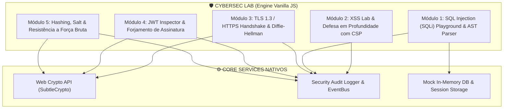
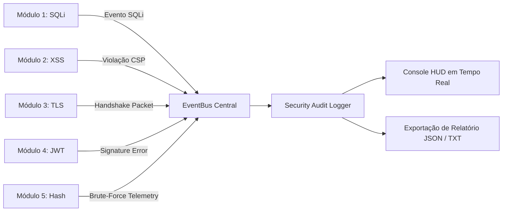

# 🛡️ CyberSec Lab: Especificação de Engenharia & Plano de Produto
**Projeto:** Laboratório Visual de Segurança da Informação, OWASP Top 10 & Criptografia Interativa  
**Identificador / Diretório:** `p_cybersec/`  
**Integração:** Portfólio Principal (`index.html`) — Projeto #16 na Seção `#laboratorio`  
**Documento:** `docs/16-plano-cybersec-lab.md`  
**Autor:** Project Planner & Product Manager (Agência Autônoma de Software)  
**Lead do Projeto:** Sandro Junior Hoffmann de Oliveira (@sanjrhoff) — Bacharel em Física (UFES), Graduando em Sistemas para Internet (IFES) e Assistente de TI (Silvato)  
**Status:** Aprovado para Arquitetura UI/UX, Implementação Frontend e QA  
**Ambiente de Produção:** GitHub Pages (`https://sanjrhoff.github.io/portifolio/p_cybersec/`)  

---

## 1. Visão Executiva & Fundamentação Estratégica

### 1.1. O Posicionamento: Da Teoria Física ao Rigor da Segurança da Informação
A segurança da informação moderna exige mais do que a simples aplicação de regras empíricas ou frameworks automatizados: demanda **compreensão matemática dos fundamentos de criptografia**, discernimento arquitetural sobre a **anatomia de protocolos de rede** e precisão na **análise de vulnerabilidades de software**.

A trajetória acadêmica e profissional de **Sandro — Bacharel em Física pela Universidade Federal do Espírito Santo (UFES), graduando em Sistemas para Internet pelo Instituto Federal do Espírito Santo (IFES) e Assistente de TI na Silvato** — cria uma convergência singular:
- **Rigor Matemático & Entropia da Informação:** A formação em Física confere pleno domínio de teoria da probabilidade, teoria dos números, mecânica estatística e álgebra abstrata, pilares diretos da criptografia moderna (criptoanálise, curvas elípticas, exponenciação modular Diffie-Hellman e distribuição de entropia pseudoaleatória CSPRNG).
- **Prática de TI & Engenharia de Sistemas:** A vivência em TSI/IFES e a atuação prática no suporte e infraestrutura de TI corporativa fornecem o conhecimento de campo necessário sobre tráfego de rede, cabeçalhos HTTP, políticas de acesso, autenticação federada (JWT/OAuth) e os perigos reais das falhas de injeção e adulteração de dados.
- **Autoridade em Portfólio de TI & CyberSecurity:** O **CyberSec Lab** não é um repositório passivo de slides explicativos, mas sim um **laboratório interativo de alta densidade técnica**, executado inteiramente no navegador via JavaScript Puro e Web APIs nativas, demonstrando na prática as principais falhas do catálogo **OWASP Top 10** e os mecanismos modernos de defesa defensiva.

### 1.2. Ficha Técnica do Produto
| Item | Especificação |
| :--- | :--- |
| **Nome da Aplicação** | CyberSec Lab (Laboratório Interativo de Segurança & Criptografia) |
| **Domínio Técnico** | Segurança de Aplicações Web (AppSec), Criptografia Aplicada e OWASP Top 10 |
| **Arquitetura** | 100% Client-side (Vanilla HTML5, CSS3 moderno, JavaScript ES6+ modular) |
| **APIs Nativas Principais** | `window.crypto.subtle` (Web Crypto API), `TextEncoder/TextDecoder`, `Canvas 2D`, `EventTarget` |
| **Dependências Externas** | **Zero dependências de terceiros** (sem Axios, CryptoJS, Lodash ou Bootstrap) |
| **Módulos Práticos** | 5 Módulos Interativos: SQLi + AST, XSS + CSP, TLS Handshake, JWT Inspector, Hash & Salt |
| **Design System** | Dark Zinc Industrial (`#09090b`, `#121215`, `#18181b`, `#27272a`, acentos ciano, esmeralda, crimson, âmbar e violeta) |
| **Compatibilidade** | Chrome, Edge, Firefox, Safari (Padrão Evergreen W3C) & GitHub Pages |

---

## 2. Escopo Funcional & Os 5 Módulos Interativos

O **CyberSec Lab** é estruturado em cinco estações de trabalho de segurança independentes, acessíveis por abas rápidas e integradas a um console unificado de auditoria.



---

### 2.1. Módulo 1: SQL Injection (SQLi) Playground & AST Parser

#### 2.1.1. Contexto Teórico & Relevância OWASP
Classificado na categoria **A03:2021 – Injection** da OWASP, a Injeção de SQL ocorre quando dados controlados pelo usuário são interpolados diretamente na estrutura sintática de um comando SQL sem sanitização ou parametrização prévia. O interpretador do banco de dados não consegue distinguir comandos lógicos de dados fornecidos, permitindo que atacantes subvertam a consulta pretendida.

#### 2.1.2. Especificação Funcional do Módulo
1. **Interface de Simulação:**
   - Formulário de login corporativo simulado (`Usuário` e `Senha`).
   - Campo de busca de registros (`Buscar usuários ou produtos`).
   - Seletor de modo de execução:
     - ❌ **Modo Vulnerável:** Interpolação direta de strings (`SELECT * FROM users WHERE username = '${input}' AND password = '${pass}'`).
     - 🛡️ **Modo Seguro (Prepared Statements):** Parametrização estruturada (`SELECT * FROM users WHERE username = ? AND password = ?`).
2. **Mock Database Engine em Memória:**
   - Tabela `users` simulada com campos: `id`, `username`, `password_hash`, `role` (`admin`, `analista`, `financeiro`), `email`, `salary`.
   - Execução transparente dos comandos simulados: quando a query é executada, os registros resultantes são exibidos em formato de tabela de banco de dados interativa.
3. **Parser Léxico e Visualizador de Árvore Sintática (AST):**
   - Um lexer em JavaScript divide a consulta digitada em tokens: `KEYWORD`, `IDENTIFIER`, `LITERAL_STRING`, `OPERATOR_LOGIC` (`AND`, `OR`), `COMMENT` (`--`, `/* */`), `PARENTHESIS`.
   - **Renderização Visual da Árvore Lógica:**
     - Em uma consulta legítima (`admin` / `senha123`), a árvore expressa:
       `[SELECT] ➔ [FROM users] ➔ [WHERE: (username = 'admin') AND (password = 'senha123')]`.
     - Quando o usuário insere um payload de ataque (ex: `' OR '1'='1' --`), a árvore é reconstruída graficamente:
       `[WHERE: (username = '') OR (TRUE) ] ➔ [TRUNCATED COMMENT]`.
     - O nó `OR TRUE` é destacado em cor carmesim pulsante (`#ef4444`), indicando a tautologia que anula a necessidade de senha e força o banco a retornar todos os registros.
4. **Demonstração do Patch com Bind de Parâmetros:**
   - Ao ativar o modo "Prepared Statement", o AST bloqueia a reestruturação da gramática: a string `' OR '1'='1' --` é tratada unicamente como valor literal do parâmetro `username`, resultando em busca sem registros encontrados (`0 rows returned`) e logando a tentativa de injeção bloqueada.
5. **Biblioteca de Presets de Payloads Prontos:**
   - `Bypass de Login Clássico`: `' OR '1'='1' --`
   - `Bypass de Admin Específico`: `admin' --`
   - `Union-Based Data Exfiltration`: `' UNION SELECT 99, username, password_hash, role, email, 0 FROM users --`
   - `Tautologia Booleana Numérica`: `1' OR 1=1 #`

---

### 2.2. Módulo 2: XSS (Cross-Site Scripting) & Defesa com CSP

#### 2.2.1. Contexto Teórico & Relevância OWASP
Inserido em **A03:2021 – Injection**, o Cross-Site Scripting é uma das falhas mais frequentes em sistemas web. Ocorre quando uma aplicação insere dados não confiáveis em uma página web sem codificação adequada, permitindo que scripts maliciosos injetados sejam executados no contexto de segurança da sessão do navegador da vítima.

#### 2.2.2. Especificação Funcional do Módulo
1. **Ambiente Seguro de Sandbox Isolada:**
   - Para garantir total segurança do usuário que testa a ferramenta no portfólio, os scripts injetados são executados em um ambiente de visualização mock isolado (Iframe controlado com `sandbox="allow-scripts"` restrito ou mini-DOM virtual controlado), garantindo que nenhum cookie real do site anfitrião seja tocado.
2. **Cenários Simulados:**
   - **Reflected XSS:** Simulação de parâmetro de busca refletido diretamente no HTML da página (`Resultados para: ${query}`).
   - **Stored XSS:** Mural de comentários persistente no estado local da aplicação, onde o payload é salvo e reexecutado toda vez que a lista de comentários é renderizada.
   - **DOM-based XSS:** Manipulação perigosa via propriedades JavaScript como `element.innerHTML` ou `document.write` lendo de `location.hash`.
3. **Simulador de Sessão da Vítima:**
   - Painel lateral exibindo o armazenamento simulado da vítima:
     - `Mock Cookie:` `session_id=SANDRO_SEC_AUTH_9981aef; HttpOnly=false`
     - `LocalStorage:` `jwt_token=eyJhbGciOi...`, `user_role=finance_director`
   - Quando um payload malicioso executa (ex: `<script>stealData()</script>` ou ``), uma janela modal de exfiltração exibe a tentativa de envio dos dados da vítima para `https://attacker-c2.evil/log?data=...`.
4. **Camadas de Mitigação Defensiva Lado a Lado:**
   - **Sanitização & Contextual Output Encoding:**
     - Função de escape nativa que converte caracteres especiais em entidades HTML:
       - `&` $\to$ `&amp;`
       - `<` $\to$ `&lt;`
       - `>` $\to$ `&gt;`
       - `"` $\to$ `&quot;`
       - `'` $\to$ `&#x27;`
     - Comparação em tempo real do código fonte antes e depois do encoding.
   - **Simulador de Política CSP (Content Security Policy):**
     - Seletor de cabeçalho HTTP simulado:
       - 🚫 `Sem CSP` (Execução de scripts inline e carregamento de fontes externas liberados).
       - 🛡️ `CSP Restritiva`: `Content-Security-Policy: default-src 'self'; script-src 'self'; object-src 'none'`.
     - **Console de Relatórios CSP (Violation Reporter):**
       - Quando ativado, a injeção do script é bloqueada e um evento de violação detalhado é impresso no console de segurança:  
         `[CSP BLOCKED] Refused to execute inline script because it violates directive: "script-src 'self'". Blocked URI: inline.`

---

### 2.3. Módulo 3: TLS 1.3 / HTTPS Handshake Simulator

#### 2.3.1. Contexto Teórico & Relevância
Relacionado a **A02:2021 – Cryptographic Failures**. O protocolo TLS (Transport Layer Security) é o alicerce da confidencialidade, autenticidade e integridade da web global. Compreender seu handshake é essencial para profissionais de redes e desenvolvimento que precisam justificar o uso de HTTPS, certificados X.509 e cifras modernas com Forward Secrecy (sigilo de encaminhamento perfeito).

#### 2.3.2. Especificação Funcional do Módulo
1. **Linha do Tempo Visual Animada (Sequência Bidirecional):**
   - Animação interativa estilo diagrama de sequência entre os atores:
     `Cliente (Navegador)` $\longleftrightarrow$ `Rede Insegura (Wi-Fi Público)` $\longleftrightarrow$ `Servidor Web (HTTPS)` $\longleftrightarrow$ `Autoridade Certificadora (CA)`.
2. **As 5 Fases Detalhadas do Handshake TLS 1.3:**
   - **Fase 1: `ClientHello`**
     - Envio de parâmetros: versões TLS suportadas (1.3/1.2), lista de Cipher Suites elegíveis (ex: `TLS_AES_256_GCM_SHA384`, `TLS_CHACHA20_POLY1305_SHA256`), `Client Random` (32 bytes de entropia) e chaves públicas efêmeras de Diffie-Hellman (`Key Share`).
   - **Fase 2: `ServerHello` & Certificado X.509**
     - Resposta do servidor: seleção da cifra escolhida, `Server Random`, chave pública efêmera do servidor e Certificado Digital X.509 com cadeia de confiança verificável.
   - **Fase 3: Troca de Chaves Diffie-Hellman Efêmero (ECDHE)**
     - Visualizador matemático didático:
       - Parâmetros públicos: Base $g$, Módulo primo $p$.
       - Segredo privado do cliente $a \implies$ Envia chave pública $A = g^a \pmod p$.
       - Segredo privado do servidor $b \implies$ Envia chave pública $B = g^b \pmod p$.
       - Ambos calculam o segredo compartilhado:  
         $$K = B^a \pmod p = A^b \pmod p = g^{ab} \pmod p$$
       - Demonstração visual de por que um bisbilhoteiro na rede que intercepta apenas $g$, $p$, $A$ e $B$ não consegue calcular $K$ sem resolver o problema do logaritmo discreto.
   - **Fase 4: Derivação de Chaves de Sessão (HKDF)**
     - A partir do Pre-Master Secret $K$, deriva-se a chave simétrica de sessão de 256 bits para criptografia de alto desempenho (AES-GCM).
   - **Fase 5: Handshake Finished & Canal Cifrado Ativo**
     - O cadeado verde se acende na interface. Todo o tráfego HTTP subsequente (cabeçalhos, URLs, cookies, corpo POST) viaja como ciphertext ininteligível.
3. **Simulador de Sniffing / Man-in-the-Middle (MitM):**
   - Alternância entre dois cenários de rede:
     - 🔓 **Conexão HTTP Clara:** O painel "Packet Sniffer" exibe as requisições em texto plano: `GET /dashboard`, `Cookie: auth_token=123`, `POST /login username=sandro password=supersecret`.
     - 🔒 **Conexão HTTPS (TLS Ativo):** O mesmo sniffer captura apenas bytes cifrados aleatórios (`4a 8f b2 c0 91...`). Tentativas de forjar certificados disparam o aviso de erro de certificado não confiável (Untrusted CA).

---

### 2.4. Módulo 4: JWT (JSON Web Token) Inspector & Signature Forgery

#### 2.4.1. Contexto Teórico & Relevância OWASP
Ligado a **A01:2021 – Broken Access Control** e **A07:2021 – Identification and Authentication Failures**. Tokens JWT (RFC 7519) tornaram-se o padrão hegemônico de autenticação stateless em arquiteturas SPA e microsserviços. Implementações ingênuas cometem falhas catastróficas ao confiar cegamente no payload sem validar a assinatura criptográfica ou ao permitir o algoritmo nulo (`alg: none`).

#### 2.4.2. Especificação Funcional do Módulo
1. **Decodificador Visual Tricolor (Padrão RFC 7519):**
   - Campo de entrada do token bruto codificado em Base64URL com coloração contextual:
     - 🔴 **Header (Vermelho/Rosa `#f43f5e`):** Algoritmo e tipo de token.
     - 🟣 **Payload / Claims (Roxo/Violeta `#a855f7`):** Dados de identidade, permissões (`role`), emissor (`iss`), expiração (`exp`).
     - 🔵 **Signature (Azul/Ciano `#06b6d4`):** Assinatura digital criptografada.
2. **Editor Bidirecional Reativo:**
   - Modificar os campos JSON à direita recalcula instantaneamente a string codificada à esquerda e vice-versa.
3. **Mecanismo de Assinatura Real via Web Crypto API:**
   - Implementação nativa de HMAC-SHA256 utilizando `crypto.subtle.importKey` e `crypto.subtle.sign`.
   - Campo para inserção do segredo do servidor (`Secret Key`).
   - Verificação em tempo real: se o usuário altera o payload (ex: mudando `"role": "user"` para `"role": "admin"`) sem alterar o segredo, o status do token transita imediatamente para **"INVALID SIGNATURE / TOKEN TAMPERED"** com badge vermelho e mensagem explicativa de recusa pelo backend mock.
4. **Laboratório Prático de Ataques e Vulnerabilidades:**
   - ⚠️ **Ataque `alg: none` (Bypass de Assinatura):**
     - O usuário ativa o botão de exploit. O cabeçalho é alterado para `{"alg": "none", "typ": "JWT"}` e a assinatura é removida.
     - Simulação de backend vulnerável: o sistema aceita o token e libera acesso total de administrador.
     - Explicação e demonstração da correção: validação em backend rejeitando estritamente tokens sem algoritmo válido aprovado.
   - 🔑 **Brute-Force Local de Chave Fraca (Dicionário de Segredos):**
     - Simulação de ataque de dicionário executado localmente via Web Crypto API contra palavras comuns (`"secret"`, `"123456"`, `"admin"`, `"password"`, `"jwt"`, `"developer"`).
     - Medição de tempo e demonstração de como segredos fracos são descobertos em milissegundos, contrastando com chaves de 256 bits geradas por CSPRNG.

---

### 2.5. Módulo 5: Hashing, Salt & Resistência a Força Bruta

#### 2.5.1. Contexto Teórico & Relevância OWASP
Inserido em **A02:2021 – Cryptographic Failures**. O armazenamento seguro de credenciais é uma das responsabilidades mais críticas da engenharia de software. O uso indevido de funções de hash rápidas (como MD5 ou SHA-1, já quebradas teoricamente, ou mesmo SHA-256 sem salt) expõe senhas a ataques de tabelas arco-íris (Rainbow Tables) e ataques massivos paralelizados via GPU.

#### 2.5.2. Especificação Funcional do Módulo
1. **Gerador de Hashes em Tempo Real:**
   - O usuário digita qualquer senha ou texto e observa instantaneamente a geração paralela dos hashes:
     - `MD5` (128 bits / 32 hex chars) — Implementação Vanilla pura sem dependências.
     - `SHA-1` (160 bits / 40 hex chars) — Calculado via `crypto.subtle.digest('SHA-1', ...)`.
     - `SHA-256` (256 bits / 64 hex chars) — Calculado via `crypto.subtle.digest('SHA-256', ...)`.
     - `Bcrypt / Argon2 Simulator` — Função lenta com custo computacional iterativo simulado ($2^{\text{cost}}$ rounds).
2. **Demonstração Visual de Salting & Rainbow Tables:**
   - Cenário com dois usuários cadastrados que escolheram a mesma senha: `senha123`.
   - **Caso 1: Hashes Sem Salt (Vulnerável):**
     - Ambos os usuários possuem o hash SHA-256 exatamente idêntico:  
       `55525f... == 55525f...`
     - Demonstração da consulta em uma Rainbow Table mock: uma única entrada revela a senha de todos os usuários com o mesmo hash.
   - **Caso 2: Hashes Com Salt Criptográfico Único (Seguro):**
     - Geração de salt aleatório de 16 bytes via `crypto.getRandomValues()`.
     - Usuário A (`salt_1` + `senha123`) $\implies$ Hash `9a7b...`
     - Usuário B (`salt_2` + `senha123`) $\implies$ Hash `3f21...`
     - Visualização clara: mesmo com a mesma senha, os hashes tornam-se completamente distintos e imunes a tabelas pré-computadas.
3. **Calculadora & Benchmark de Força Bruta (GPU vs Funções Lentas):**
   - Benchmark ao vivo no navegador: o motor executa $10.000$ iterações de SHA-256 e mede o tempo de cálculo por hash.
   - Tabela comparativa interativa com projeção de tempo de quebra para senhas de diferentes comprimentos (6, 8, 10 e 12 caracteres alfanuméricos com símbolos):
     - Taxa em GPU de ponta (ex: NVIDIA RTX 4090: ~20 bilhões de MD5/s vs ~5 bilhões de SHA-256/s vs ~3.000 Bcrypt cost 12/s).
     - Evidência empírica: enquanto uma senha comum em MD5/SHA-256 cai em minutos ou segundos, no Bcrypt com custo adequado levaria dezenas a centenas de anos.

---

## 3. Console Unificado de Auditoria & Security Logger

Todos os cinco módulos comunicam eventos a um subsistema central de auditoria (`SecurityLogger`), espelhando a operação de um **SIEM (Security Information and Event Management)** corporativo:



### 3.1. Tipos de Eventos Monitorados
- `INFO`: Navegação de módulos, alternância de modos de proteção, geração de parâmetros.
- `WARN`: Detecção de parâmetros não-sanitizados, chaves fracas identificadas.
- `EXPLOIT_TRIGGERED`: Sucesso de injeção SQL, execução de XSS em sandbox, forjamento de token com `alg: none`.
- `DEFENSE_BLOCKED`: Injeção frustrada por Prepared Statement, bloqueio de script por CSP, rejeição de JWT por HMAC incorreto.
- `CRYPTO_VERIFIED`: Validação bem-sucedida de certificado TLS, derivação correta de chave Diffie-Hellman, hash verificado.

### 3.2. Funcionalidades do Console
- Filtragem por severidade (`ALL`, `INFO`, `WARN`, `EXPLOITS`, `DEFENSES`).
- Contador de métricas em tempo real (Total de Exploits Testados, Defesas Acionadas, Hashes Gerados).
- Botão "Exportar Relatório de Auditoria (.json / .txt)" contendo histórico dos testes realizados para fins de comprovação e estudos.
- Botão "Limpar Console".

---

## 4. Arquitetura de Software & Estrutura de Arquivos

### 4.1. Princípios Arquiteturais
- **Vanilla Puro Moderno:** Sem frameworks, sem transpiladores, sem bibliotecas pesadas de build.
- **Isolamento Modular:** Cada módulo de segurança possui seu próprio arquivo JS com escopo encapsulado em classe ou objeto singleton, expondo métodos de ciclo de vida (`init`, `render`, `destroy`).
- **Segurança da Execução:** As simulações de ataque são estritamente contidas. O código JavaScript executa parsers sintáticos e mini-máquinas de estado para modelar o comportamento de servidores e bancos de dados sem expor a página do portfólio.
- **Performance de 60 FPS e Zero Lag:** Uso de `requestAnimationFrame` para transições no simulador TLS e `Float32Array` / `Uint8Array` para manipulação de bytes na Web Crypto API.

### 4.2. Árvore de Diretórios
```
SANDRO/portifolio/
├── p_cybersec/
│   ├── index.html            # Estrutura semântica, abas, painéis dos 5 módulos e console HUD
│   ├── css/
│   │   └── style.css         # Dark Zinc Industrial, layout flex/grid, badges e terminal styling
│   └── js/
│       ├── app.js            # Orquestrador geral, gerenciamento de abas, atalhos de teclado
│       ├── logger.js         # Security Audit Logger & Emissor de Relatórios
│       ├── sqli.js           # Módulo 1: SQL Injection Playground, Lexer, AST Parser & Mock DB
│       ├── xss.js            # Módulo 2: XSS Lab, Sanitizer & Simulador de Header CSP
│       ├── tls.js            # Módulo 3: TLS 1.3 Handshake Timeline & Diffie-Hellman Visualizer
│       ├── jwt.js            # Módulo 4: JWT Inspector, Web Crypto HMAC-SHA256 & Signature Engine
│       └── hash.js           # Módulo 5: Hashing, Salt Engine & Calculadora de Força Bruta
├── docs/
│   ├── 16-plano-cybersec-lab.md    # Este documento de planejamento e especificação
│   ├── 17-cybersec-lab-design.md   # Especificação visual de UI/UX e Design System
│   └── 18-qa-cybersec-lab.md       # Relatório de qualidade, auditoria e testes
├── index.html                # Card #16 na grade do portfólio e modal Sandbox
└── script.js                 # Integração de filtros e suporte a modal iframe
```

---

## 5. Design System, UX & Identidade Visual

### 5.1. Paleta de Cores Industrial Dark Zinc
A interface adota a estética de **centro de operações de segurança cibernética (SOC)** de alta densidade de informação:

| Nome do Token | Valor Hexadecimal | Aplicação Principal |
| :--- | :--- | :--- |
| `--bg-base` | `#09090b` | Fundo principal da aplicação |
| `--bg-surface` | `#121215` | Superfície dos cards e painéis operacionais |
| `--bg-panel` | `#18181b` | Painéis secundários, cabeçalhos de tabela e inputs |
| `--border-subtle` | `#27272a` | Divisórias e bordas discretas |
| `--border-focus` | `#3f3f46` | Estados de foco e hover em elementos interativos |
| `--text-primary` | `#f4f4f5` | Títulos, rótulos principais e dados destacados |
| `--text-secondary` | `#a1a1aa` | Explicações técnicas e documentação de apoio |
| `--text-muted` | `#71717a` | Timestamps, comentários de código e metadados |
| `--accent-cyan` | `#06b6d4` | Criptografia, Web Crypto API, chaves públicas e integridade |
| `--accent-emerald` | `#10b981` | Defesas ativas, validações bem-sucedidas, Prepared Statements, HTTPS seguro |
| `--accent-crimson` | `#ef4444` | Vulnerabilidades críticas, payloads de exploit, violações de CSP |
| `--accent-amber` | `#f59e0b` | Alertas de segurança, segredos fracos, tokens sem expiração |
| `--accent-violet` | `#8b5cf6` | Tokens JWT, cabeçalhos de protocolo, claims e identidade |

### 5.2. Tipografia
- **Interface e Títulos:** `Inter`, -apple-system, BlinkMacSystemFont, 'Segoe UI', Roboto, sans-serif (legibilidade e densidade ergonômica).
- **Código, Hashes, Queries SQL e Terminal:** `JetBrains Mono`, 'Fira Code', monospace (alinhamento preciso de colunas e bytes).

### 5.3. Acessibilidade e Atalhos de Teclado
- **Navegação por Abas Rápidas:**
  - `Alt + 1` ou tecla `1`: Ir para o Módulo 1 (SQLi).
  - `Alt + 2` ou tecla `2`: Ir para o Módulo 2 (XSS).
  - `Alt + 3` ou tecla `3`: Ir para o Módulo 3 (TLS).
  - `Alt + 4` ou tecla `4`: Ir para o Módulo 4 (JWT).
  - `Alt + 5` ou tecla `5`: Ir para o Módulo 5 (Hashing).
  - `Alt + L` ou tecla `L`: Focar/Alternar visualização do Console de Logs.
- **Compatibilidade com Leitores de Tela:** Todos os painéis possuem atributos ARIA (`role="tab"`, `role="tabpanel"`, `aria-selected`, `aria-live="polite"` para o console de logs).

---

## 6. Integração no Portfólio Principal (`index.html`)

### 6.1. O Card #16 no Laboratório de Projetos
O CyberSec Lab será registrado como o **16º projeto oficial** do portfólio de Sandro:
- **Categoria do Filtro:** `bancos` (Bancos & Criptografia / Segurança da Informação).
- **Identificador de Dados:** `data-project="p_cybersec"`
- **Badge de Categoria:** `SEGURANÇA DA INFORMAÇÃO & CRIPTOGRAFIA`
- **Título do Card:** `CyberSec Lab`
- **Subtítulo:** `OWASP Top 10, AST Parser, TLS 1.3, JWT Inspector & Criptografia Interativa`
- **Descrição Curta:**  
  *Laboratório prático de cibersegurança executado 100% no navegador com Web Crypto API nativa. Simule ataques reais de SQL Injection com parser AST, Cross-Site Scripting com defesa CSP, handshake TLS/HTTPS animado, decodificador e forjamento de JWT, e resistência de hashes criptográficos contra ataques de força bruta.*
- **Tags de Tecnologia:**  
  `CyberSecurity` `OWASP Top 10` `Web Crypto API` `AST Parser` `TLS Handshake` `JWT RFC 7519`
- **Ações:**
  - Botão Primário: `Ver Aplicação` (`./p_cybersec/index.html`)
  - Botão Secundário: `Ver Código` (`https://github.com/sanjrhoff/portifolio/tree/main/p_cybersec`)
  - Botão Ghost: `Preview` (Abre instantaneamente no Sandbox Modal existente com `data-app-url="./p_cybersec/index.html"`).

### 6.2. Atualização das Métricas de Telemetria
No cabeçalho do `index.html`:
- Telemetria de Aplicações Vivas: Atualizar contador de **15** para **16**.
- Barra de Filtros: Atualizar contador da categoria Todos de `(15)` para `(16)` e da categoria Bancos & Criptografia de `(2)` para `(3)`.

---

## 7. Plano de Execução & Fases da Agência Autônoma

| Fase | Agente Responsável | Escopo de Tarefas | Entregável Principal |
| :--- | :--- | :--- | :--- |
| **Fase 1: Planejamento** | **Project Planner** (Este agente) | Levantamento de requisitos, formulação técnica de cada módulo, especificação de AST, Web Crypto API e integração. | `docs/16-plano-cybersec-lab.md` |
| **Fase 2: Arquitetura & UI/UX** | **UI/UX Designer & Architect** | Especificação detalhada de componentes, layout das 5 abas, painel de AST visual, timeline do TLS, tokens e temas. | `docs/17-cybersec-lab-design.md` |
| **Fase 3: Implementação Frontend** | **Frontend Engineer** | Codificação completa de `p_cybersec/index.html`, `p_cybersec/css/style.css`, módulos JS em `p_cybersec/js/` e atualização do `index.html` do portfólio. | Aplicação 100% funcional em `p_cybersec/` |
| **Fase 4: QA & Code Review** | **QA & Security Reality Checker** | Teste de todos os 5 módulos, validação de compatibilidade no modal sandbox, auditoria de performance e ausência de erros no console. | `docs/18-qa-cybersec-lab.md` |

---

## 8. Critérios de Aceite & Validação de Qualidade

1. **Autonomia Client-Side Estrita:**  
   O laboratório deve funcionar completamente offline ou no GitHub Pages sem realizar requisições a APIs externas ou servidores de backend.
2. **Precisão Criptográfica:**  
   As assinaturas HMAC-SHA256 do módulo JWT e os hashes SHA-1/SHA-256 do módulo de hashing devem utilizar rigorosamente a `Web Crypto API` nativa (`crypto.subtle`), gerando digests idênticos aos padrões internacionais de teste (RFC 7519 e FIPS 180-4).
3. **Fidelidade Visual do AST no SQLi:**  
   A árvore sintática deve refletir com clareza imediata a alteração estrutural quando o usuário insere operadores de quebra como `' OR '1'='1' --`, demonstrando didaticamente a subversão da lógica booleana da consulta.
4. **Isolamento de Segurança (Zero Self-Exploitation):**  
   O módulo de XSS deve ser completamente contido dentro do sandbox simulado, de modo que nenhum payload executado interfira no DOM da página anfitriã ou roube credenciais reais do usuário.
5. **Ergonomia e Design Industrial:**  
   Interface fluida, tipografia mono alinhada, cores com contraste WCAG AA no tema Dark Zinc, responsividade completa para visualização em telas móveis e desktop, e suporte nativo ao modal Sandbox do portfólio principal.

---

> [!NOTE]  
> Este documento técnico serve como especificação fundacional e guia de implementação para as etapas subsequentes de UI/UX Design, Engenharia Frontend e Garantia de Qualidade da Agência Autônoma.
