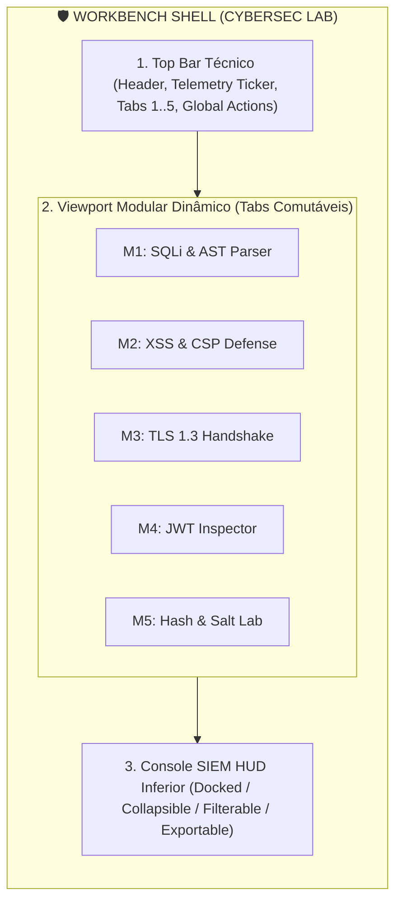

# 🎨 Especificação de UI/UX & Arquitetura Visual: CyberSec Lab
**Projeto:** Laboratório Visual de Segurança da Informação, OWASP Top 10 & Criptografia Interativa  
**Identificador / Diretório:** `SANDRO/portifolio/p_cybersec/`  
**Integração:** Portfólio Principal (`index.html`) — Projeto #16 na Seção `#laboratorio` (Categoria Bancos & Criptografia)  
**Documento:** `docs/17-ui-cybersec-lab.md`  
**Autor:** Senior UI/UX Architect (Agência Autônoma de Software)  
**Lead do Projeto:** Sandro Junior Hoffmann de Oliveira (@sanjrhoff) — Bacharel em Física (UFES), Graduando em Sistemas para Internet (IFES) e Assistente de TI (Silvato)  
**Status:** Aprovado para Implementação Frontend  
**Referência Estratégica:** `docs/16-plano-cybersec-lab.md`

---

## 1. Manifesto de UI/UX: Erradicação da "Cara de IA" & Industrial Security Craftsmanship

O design visual de um laboratório de cibersegurança e criptografia aplicada deve rejeitar peremptoriamente a estética genérica, inflada e pasteurizada de ferramentas concebidas por IAs ingênuas. Softwares de segurança da informação (AppSec, SOC, forense digital e criptoanálise) não são landing pages corporativas vazias; são **estações de trabalho industriais de alta densidade de informação**, onde cada pixel, token semântico e linha de código tem propósito funcional imediato.

```
PADRÕES BANIDOS CATEGORICAMENTE DO CYBERSEC LAB:
❌ Roxo genérico de IA (#6366f1 / #8b5cf6) espalhado como cor primária sem justificativa semântica.
❌ Bento grids puramente decorativos com proporções arbitrárias que sufocam tabelas e editores de query.
❌ Cards clones idênticos com ícones flutuantes genéricos e sem dados dinâmicos em tempo real.
❌ Textos robóticos e marketeiros ("Proteja seus dados com nossa incrível inteligência artificial!").
❌ Ilustrações 3D fofas de cadeados ou escudos de brinquedo.
❌ Gráficos estáticos ou mocks inertes que não executam cálculos criptográficos reais.
```

### Os 5 Pilares de Craftsmanship do CyberSec Lab:

1. **Estética Industrial Dark Zinc & Cockpit Forense (`#070709` / `#0f0f12`):**  
   Um ambiente imersivo de altíssimo contraste, remetendo a interfaces analíticas de nível profissional — como Burp Suite Professional, Wireshark, Splunk SOC Dashboards, Ghidra e CyberChef. O fundo escuro profundo e neutro elimina fadiga visual e prioriza o conteúdo crítico: payloads, gramática de queries, pacotes de rede e certificados.

2. **Semântica Cromática Rígida de Cibersegurança:**  
   As cores não são adornos; são vetores imediatos de diagnóstico de ameaça e integridade:
   - **Crimson / Rose (`#ef4444` / `#f43f5e`):** Ameaça crítica, payload de exploit ativo, injeção SQL bem-sucedida, script XSS executado, assinatura JWT corrompida/forjada, hash MD5 quebrado.
   - **Emerald / Green (`#10b981` / `#34d399`):** Defesa ativa e eficaz, Prepared Statement imune, sanitização de contexto aplicada, política CSP bloqueando execução, assinatura HMAC-SHA256 íntegra, canal HTTPS seguro.
   - **Amber / Orange (`#f59e0b` / `#fbbf24`):** Alerta/Warning, chave fraca detectada, parâmetro suscetível mas mitigado, função de hash rápida insegura para senhas, token sem prazo de expiração.
   - **Cyan / Sky (`#06b6d4` / `#38bdf8`):** Operações criptográficas da Web Crypto API, chaves públicas, canal cifrado TLS, handshake ECDHE e parâmetros de cifra.
   - **Violet / Purple (`#a855f7` / `#c084fc`):** Assinatura digital, HKDF, tokens JWT RFC 7519 (especificamente a porção do payload de claims) e entropia de Salt.

3. **Tipografia Dual de Alta Densidade (`Inter` + `JetBrains Mono`):**  
   Estrutura tipográfica cirúrgica: `Inter` governa labels técnicos, botões de ação e descrições conceituais com legibilidade impecável; `JetBrains Mono` governa 100% dos dados técnicos (queries SQL, tokens AST, tags HTML, cabeçalhos HTTP, digests hexadecimais, pacotes capturados e telemetria SIEM).

4. **Modelagem Gramatical e Protocolar Visual:**  
   Em vez de apenas mensagens de texto "Vulnerável/Seguro", o usuário enxerga a **Árvore Sintática Abstrata (AST)** sendo bifurcada em tempo real no SQLi, a **troca bidirecional de mensagens nas raias do TLS 1.3** e a anatomia tricolor do token JWT. A interface ensina através da visualização anatômica da falha.

5. **Terminal SIEM HUD Unificado & Telemetria em Tempo Real:**  
   Um console de auditoria fixo na base da bancada intercepta todos os eventos dos cinco módulos com carimbo de data/hora ISO com milissegundos, severidade padronizada e recurso nativo de cópia e exportação de relatórios em `.json` e `.txt`.

---

## 2. Design Tokens CSS (Dark Zinc Security Architecture)

Tokens estruturados e padronizados para garantir consistência visual estrita em toda a aplicação `p_cybersec/`:

```css
:root {
  /* ==========================================================================
     Superfícies & Profundidade do Workbench (Industrial Dark Zinc)
     ========================================================================== */
  --bg-void: #070709;                /* Fundo vácuo mestre */
  --bg-surface: #0f0f12;             /* Superfície dos módulos e cartões principais */
  --bg-panel: #141418;               /* Painéis de controle, viewports e tabelas */
  --bg-elevated: #1a1a20;            /* Elementos suspensos, dropdowns e tooltips */
  --bg-input: #0b0b0e;               /* Campos de código, inputs e áreas textuais */
  --bg-input-focus: #101015;         /* Input ativo sob foco */
  --bg-glass-hud: rgba(15, 15, 18, 0.88); /* HUD de console com backdrop-filter */

  /* ==========================================================================
     Bordas Técnicas & Delimitações Estruturais
     ========================================================================== */
  --border-subtle: #222228;           /* Divisórias estruturais de 1px */
  --border-medium: #2e2e38;           /* Contornos de cartões e botões secundários */
  --border-strong: #3f3f4e;           /* Bordas de destaque neutro e hover */
  --border-focus: #525266;            /* Foco de acessibilidade :focus-visible */

  /* ==========================================================================
     Paleta Semântica de Cibersegurança & Criptografia
     ========================================================================== */
  /* Crimson / Red - Exploit & Falha Crítica */
  --sec-crimson: #ef4444;
  --sec-crimson-bright: #f87171;
  --sec-crimson-bg: rgba(239, 68, 68, 0.12);
  --sec-crimson-border: rgba(239, 68, 68, 0.40);
  --sec-crimson-glow: rgba(239, 68, 68, 0.25);

  /* Emerald / Green - Defesa Ativa & Integridade Validada */
  --sec-emerald: #10b981;
  --sec-emerald-bright: #34d399;
  --sec-emerald-bg: rgba(16, 185, 129, 0.12);
  --sec-emerald-border: rgba(16, 185, 129, 0.40);
  --sec-emerald-glow: rgba(16, 185, 129, 0.25);

  /* Amber / Orange - Alertas, Mitigações Parciais & Hashes Fracos */
  --sec-amber: #f59e0b;
  --sec-amber-bright: #fbbf24;
  --sec-amber-bg: rgba(245, 158, 11, 0.12);
  --sec-amber-border: rgba(245, 158, 11, 0.40);
  --sec-amber-glow: rgba(245, 158, 11, 0.25);

  /* Cyan / Blue - Web Crypto API, Criptografia Simétrica & Handshake */
  --sec-cyan: #06b6d4;
  --sec-cyan-bright: #22d3ee;
  --sec-cyan-bg: rgba(6, 182, 212, 0.12);
  --sec-cyan-border: rgba(6, 182, 212, 0.40);
  --sec-cyan-glow: rgba(6, 182, 212, 0.25);

  /* Violet / Purple - Assinaturas Digitais, Salts & RFC 7519 Claims */
  --sec-violet: #a855f7;
  --sec-violet-bright: #c084fc;
  --sec-violet-bg: rgba(168, 85, 247, 0.12);
  --sec-violet-border: rgba(168, 85, 247, 0.40);
  --sec-violet-glow: rgba(168, 85, 247, 0.25);

  /* ==========================================================================
     Tipografia Cirúrgica
     ========================================================================== */
  --font-ui: 'Inter', -apple-system, BlinkMacSystemFont, 'Segoe UI', Roboto, sans-serif;
  --font-mono: 'JetBrains Mono', 'Fira Code', 'Courier New', monospace;

  /* Hierarquia de Escalas de Texto */
  --text-pure: #fafafa;               /* Títulos de topo e valores em destaque */
  --text-primary: #e4e4e7;            /* Texto base de leitura e labels ativos */
  --text-secondary: #a1a1aa;          /* Explicações técnicas e documentação */
  --text-muted: #71717a;              /* Timestamps, comentários de código e kbd */
  --text-dim: #52525b;                /* Separadores e placeholders */

  /* ==========================================================================
     Métricas Estruturais & Layout
     ========================================================================== */
  --header-height: 64px;
  --logger-collapsed-height: 44px;
  --logger-expanded-height: 280px;
  --radius-sm: 4px;
  --radius-md: 6px;
  --radius-lg: 8px;
  --radius-pill: 9999px;
  --transition-fast: 0.15s cubic-bezier(0.16, 1, 0.3, 1);
  --transition-normal: 0.25s cubic-bezier(0.16, 1, 0.3, 1);
}
```

---

## 3. Wireframe Estrutural: Arquitetura do Workbench

O CyberSec Lab foi concebido com uma **estrutura em três camadas verticais (Three-Tier Forensic Workbench)**:
1. **Top Bar Técnico:** Navegação, telemetria global em tempo real e ações mestras.
2. **Viewport Modular Interativo:** Área de trabalho expansiva comutável entre os 5 módulos de laboratório.
3. **Console SIEM HUD Inferior:** Painel de telemetria acoplado, retrátil e consultável em qualquer etapa do teste.



### 3.1. Anatomia do Top Bar Técnico

```
+-------------------------------------------------------------------------------------------------------------------------+
| [🛡️ CYBERSEC LAB]  [OWASP Top 10 + Web Crypto API]   |  TELEMETRIA: ⚡ EXPLOITS: 03  🛡️ BLOCKED: 05  🔑 CRYPTO: 12      |
|-------------------------------------------------------------------------------------------------------------------------|
| [1. SQLi & AST]  [2. XSS & CSP]  [3. TLS Handshake]  [4. JWT Inspector]  [5. Hash & Salt]  |  [↺ Reset] [⬇ Export] [✕ Portfólio] |
+-------------------------------------------------------------------------------------------------------------------------+
```

- **Logo & Badge do Framework:**
  - Ícone de escudo em SVG com ponto pulsante verde esmeralda.
  - Título em caixa alta: `CYBERSEC LAB` (Fonte UI, peso 700).
  - Badge institucional: `OWASP TOP 10 · CLIENT-SIDE FORENSICS` (Fundo `--sec-cyan-bg`, texto `--sec-cyan`).
- **Ticker de Telemetria Global:**
  - `EXPLOITS TESTED`: Contador numérico dinâmico em cor carmesim (`#ef4444`).
  - `DEFENSES ACTIVE`: Contador em cor esmeralda (`#10b981`).
  - `CRYPTO OPS`: Contador de operações criptográficas nativas executadas via `crypto.subtle` em ciano (`#06b6d4`).
- **Seletor de Módulos (Tab Navigation):**
  - 5 abas horizontais com indicadores numéricos e atalhos de teclado visíveis (`[1]`, `[2]`, `[3]`, `[4]`, `[5]`).
  - Aba ativa possui borda inferior sólida de 2px na cor de acento do módulo correspondente e fundo ligeiramente elevado (`--bg-elevated`).
- **Ações Globais:**
  - `Reset Cenário` (`Alt+R`): Restaura dados padrões do módulo ativo.
  - `Exportar Auditoria` (`Alt+E`): Gera arquivo `.json` ou `.txt` com logs das operações realizadas.
  - `Voltar ao Portfólio` (`Esc`): Link de saída amigável retornando para `../index.html#laboratorio`.

---

## 4. Especificação Detalhada dos 5 Módulos Interativos

---

### 4.1. Módulo 1: SQL Injection (SQLi) & Visual AST Parser

#### 4.1.1. Propósito e Filosofia de Design
Desmistificar a injeção de SQL tradicional demonstrando visualmente que o SQLi não é um "bug místico", mas uma **subversão gramatical da árvore sintática (AST)** causada pela falta de separação entre o código do comando e os dados do usuário.

#### 4.1.2. Layout em Duas Colunas (Workbench Split)

```
+----------------------------------------------------+----------------------------------------------------+
| COLUNA DA ESQUERDA: ENTRADA & SIMULADOR DE LOGIN   | COLUNA DA DIREITA: PARSER AST & MOCK DATABASE VIEW |
|----------------------------------------------------|----------------------------------------------------|
| MODO DE EXECUÇÃO:                                  | ÁRVORE SINTÁTICA ABSTRATA (AST VISUAL):            |
| [❌ MODO VULNERÁVEL (CONCAT)]  [🛡️ PREPARED STMT]   |                                                    |
|                                                    |      [SELECT * FROM users]                         |
| PRESETS DE EXPLOIT:                                |                |                                   |
| [Bypass Login] [Admin Force] [UNION Exfiltration]  |         [WHERE CLAUSE]                             |
|                                                    |          /          \                              |
| FORMULÁRIO DE LOGIN SIMULADO:                      |   [user = '']       [OR '1'='1' (TAUTOLOGY)] ⚠️    |
| Usuário: [ ' OR '1'='1' --                       ] |                           \                        |
| Senha:   [ **************                        ] |                            [COMMENT: TRUNCATED] ✂️ |
|                                                    |                                                    |
| QUERY RESULTANTE (HIGHLIGHTED):                    | STATUS DO BANCO DE DADOS (MOCK DB):                |
| SELECT * FROM users WHERE username = ''            | 3 REGISTROS VAZADOS! AUTENTICAÇÃO VIOLADA COMO ADMIN|
| OR '1'='1' --' AND password = '***'                | +----+----------+-----------+--------------------+ |
|                                                    | | ID | USERNAME | ROLE      | PASSWORD_HASH      | |
| [ ⚡ EXECUTAR QUERY ]   [ ↺ LIMPAR CAMPOS ]        | +----+----------+-----------+--------------------+ |
|                                                    | |  1 | admin    | superuser | $2b$12$e8...       | |
|                                                    | |  2 | sandro   | security  | $2b$12$a1...       | |
|                                                    | +----+----------+-----------+--------------------+ |
+----------------------------------------------------+----------------------------------------------------+
```

#### 4.1.3. Componentes Chave do Módulo 1:
1. **Interruptor de Modo Arquitetural:**
   - Toggle button com dois estados nítidos:
     - `Vulnerável (String Concat)`: borda carmesim, ícone de alerta de perigo.
     - `Seguro (Prepared Statement)`: borda esmeralda, ícone de escudo.
2. **Editor de Query SQL com Syntax Highlighting Tokenizado:**
   - Palavras-chave SQL (`SELECT`, `FROM`, `WHERE`, `AND`, `OR`, `UNION`) em azul/ciano.
   - Literais de string em verde esmeralda suave.
   - **Payload Injetado Destacado:** Se o modo for vulnerável e houver caracteres de escape de aspas ou tautologia, o trecho específico recebe fundo carmesim translúcido e borda tracejada (`--sec-crimson-border`).
3. **Canvas / SVG de Renderização da Árvore Sintática (AST):**
   - Nós retangulares com cantos arredondados e conectores SVG fluidos:
     - **Nós Normais:** Fundo escuro com borda sutil (`#2e2e38`) e texto branco.
     - **Nó de Injeção / Tautologia:** Fundo carmesim pulsante (`animation: pulseCrimson 2s infinite`), texto vermelho vivo e badge `[LOGIC HIJACK]`.
     - **Nó Truncado / Comentário (`--`):** Opacidade reduzida (50%) com ícone de tesoura cortando a verificação de senha subsequente.
   - **No Modo Prepared Statement:** A árvore não se altera. O payload inteiro permanece encapsulado dentro de um único nó folha `LITERAL_VALUE(?)`, demonstrando graficamente que os caracteres `' OR 1=1` são interpretados puramente como uma string literal de busca.
4. **Tabela do Banco de Dados em Memória:**
   - Formato tabular denso, estilo console de banco de dados (estilo psql/mysql client):
     - Linhas destacadas em vermelho caso a autenticação de administrador tenha sido usurpada sem a senha correta.
     - Coluna de hashes de senhas e roles corporativos.

---

### 4.2. Módulo 2: XSS (Cross-Site Scripting) & Defesa com CSP

#### 4.2.1. Propósito e Filosofia de Design
Demonstrar a gravidade da injeção de scripts no contexto do navegador da vítima (roubo de cookies, tokens de sessão e hijacking de DOM) e confrontar diretamente as duas estratégias de contenção: **Sanitização de Saída (Contextual Encoding)** e **Política de Segurança de Conteúdo (CSP)**.

#### 4.2.2. Layout Dividido (Input Forense vs Sandbox da Vítima)

```
+----------------------------------------------------+----------------------------------------------------+
| PAINEL ESQUERDO: INJETOR & MITIGAÇÃO DEFENSIVA     | PAINEL DIREITO: SANDBOX DO NAVEGADOR DA VÍTIMA     |
|----------------------------------------------------|----------------------------------------------------|
| TIPO DE ATAQUE:                                    | VISUALIZAÇÃO DA PÁGINA ALVO (IFRAME ISOLADO):      |
| (•) Reflected XSS   ( ) Stored XSS   ( ) DOM XSS   | +------------------------------------------------+ |
|                                                    | | MURAL DE COMENTÁRIOS DO PORTAL CORPORATIVO     | |
| PRESETS DE PAYLOAD:                                | | [Sandro]: Relatório de rede finalizado.        | |
| [<script> Steal]  []  [<svg onload>]  | | [Atacante]: <script>exfiltrate()</script>      | |
|                                                    | +------------------------------------------------+ |
| INPUT DE ENTRADA DO USUÁRIO:                       |                                                    |
| [    ] | ARMAZENAMENTO SIMULADO DA SESSÃO DA VÍTIMA:        |
|                                                    | • Document Cookie: auth_token=SEC-99812-TOKEN;     |
| DEFESAS EM PROFUNDIDADE:                           | • LocalStorage:   jwt=eyJhbGciOi... role=admin     |
| [x] Sanitização Contextual (HTML Entity Encoding)  |                                                    |
| [ ] Cabeçalho HTTP CSP (Content-Security-Policy)   | MODAL DE ALERTA DE EXFILTRAÇÃO (C2 ATTACKER):      |
|                                                    | ⚠️ [DADOS ENVIADOS PARA https://evil-c2.dev/drop]   |
| CABEÇALHO CSP EMULADO:                             | Cookie capturado: auth_token=SEC-99812-TOKEN       |
| Content-Security-Policy: default-src 'self';       |                                                    |
| script-src 'self'; object-src 'none';              | CONSOLE DE VIOLAÇÕES CSP (REPORTING API):          |
|                                                    | [CSP BLOCKED] Refused inline script violation.     |
+----------------------------------------------------+----------------------------------------------------+
```

#### 4.2.3. Componentes Chave do Módulo 2:
1. **Sandbox Isolada com Iframe Seguro:**
   - O código injetado roda em um `<iframe>` restrito com atributos de sandbox estritos para garantir 100% de segurança da página hospedeira.
   - O DOM simulado representa um feed de intranet corporativa.
2. **Simulador de Armazenamento da Vítima (Target State):**
   - Um cartão estilizado com iluminação sutil exibindo os dados sensíveis simulados da vítima:
     - `session_id` em cookie com indicador de vulnerabilidade `HttpOnly: false`.
     - `jwt_token` armazenado em `localStorage`.
3. **Simulador de Exfiltração C2 (Command & Control):**
   - Quando um payload tem sucesso, uma notificação flutuante com borda carmesim e efeito glow surge simulando o endpoint do atacante (`https://evil-c2.dev/collector?token=...`) recebendo o cookie roubado.
4. **Comparador Lado a Lado de Código Antes/Depois do Encoding:**
   - Exibe a transformação de `<` para `&lt;` e `"` para `&quot;`, demonstrando como o parser HTML passa a interpretar o payload como texto puro e inofensivo.
5. **Console de Violação CSP:**
   - Imprime o log exato gerado pelo motor do navegador quando a política CSP bloqueia o script inline, destacando a diretiva violada (`script-src 'self'`).

---

### 4.3. Módulo 3: TLS 1.3 / HTTPS Handshake & Diffie-Hellman

#### 4.3.1. Propósito e Filosofia de Design
Transformar a abstração matemática e de redes do protocolo TLS 1.3 em uma **experiência visual intuitiva e cinética**, revelando cada etapa da negociação criptográfica entre o navegador e o servidor web.

#### 4.3.2. Layout em Diagrama de Sequência & Raias de Tráfego

```
+-------------------------------------------------------------------------------------------------------------------------+
| SIMULADOR DE HANDSHAKE TLS 1.3 / HTTPS & DIFFIE-HELLMAN (ECDHE)                                                         |
|-------------------------------------------------------------------------------------------------------------------------|
| CONTROLES DO HANDSHAKE:  [ ▶ Iniciar Handshake ]  [ ⏭ Passo a Passo ]  [ ↺ Reiniciar ]   VELOCIDADE: [ 1x | 2x | 0.5x ] |
|-------------------------------------------------------------------------------------------------------------------------|
| RAIAS DE TRANSMISSÃO BIDIRECIONAL (SEQUENCE SWIMLANES):                                                                 |
|                                                                                                                         |
|    NAVEGADOR CLIENTE                  REDE INSEGURA (WI-FI PÚBLICO)                SERVIDOR WEB HTTPS                   |
|          |                                         |                                       |                            |
|   (Passo 1: ClientHello) ------------------------> [ KEY EXCHANGER ] -------------------->| (Fase 1: Suporte TLS 1.3)  |
|          |  TLS 1.3, Chave Efêmera A, Random C    |                                       |   Seleciona Cipher Suite   |
|          |                                         |                                       |                            |
|   (Passo 2: ServerHello) <------------------------ [ KEY EXCHANGER ] <--------------------| (Fase 2: Certificado X.509)|
|          |  Certificado CA, Chave Efêmera B        |                                       |   Envia Assinatura RSA/ECDSA
|          |                                         |                                       |                            |
|   (Passo 3: Derivação DH)                          |                                       | (Passo 3: Derivação DH)    |
|   Calcula K = B^a mod p                           |                                       | Calcula K = A^b mod p      |
|          \________________________________________ | _____________________________________/                             |
|                                                    v                                                                    |
|                    SEGREDO COMPARTILHADO K GERADO! CHAVE DE SESSÃO DERIVADA (AES-256-GCM) 🔒                            |
|                                                                                                                         |
|-------------------------------------------------------------------------------------------------------------------------|
| SNIFFER WI-FI EM TEMPO REAL: [ (•) CONEXÃO HTTP EM TEXTO CLARO    ( ) CONEXÃO HTTPS CIFRADA COM TLS ]                    |
| +---------------------------------------------------------------------------------------------------------------------+ |
| | [SNIFFER PACKET #04] GET /api/v1/user/credentials HTTP/1.1                                                          | |
| | Host: intranet.empresa.com.br | Authorization: Bearer eyJhbGciOi... | Cookie: session=SANDRO_SEC_99                 | |
| | ⚠️ ALERTA FORENSE: DADOS CRÍTICOS TRAFEGANDO EM TEXTO PURO NA REDE LOCAL!                                          | |
| +---------------------------------------------------------------------------------------------------------------------+ |
+-------------------------------------------------------------------------------------------------------------------------+
```

#### 4.3.3. Componentes Chave do Módulo 3:
1. **Visualizador de Raias Animadas (Sequence Lanes):**
   - Três raias verticais com identificadores visuais: `Navegador do Usuário`, `Ponto de Acesso / Sniffer de Rede` e `Servidor Corporativo`.
   - Pacotes de dados viajam horizontalmente através de marcadores luminosos com transições fluidas de CSS e canvas.
2. **Visualizador Matemático do Diffie-Hellman Efêmero:**
   - Caixa analítica destacando os parâmetros públicos ($g, p$) e as chaves privadas secretas ($a$ do cliente e $b$ do servidor).
   - Renderização da equação matemática:
     $$K = B^a \pmod p = A^b \pmod p = g^{ab} \pmod p$$
   - Demonstração empírica de como o sniffer na rede intercepta apenas os valores públicos $A$ e $B$, sendo incapaz de computar $K$ sem resolver o logaritmo discreto.
3. **Simulador de Sniffer de Pacotes (Wi-Fi Interceptor):**
   - Alternador rápido entre tráfego desprotegido (HTTP) e protegido (HTTPS):
     - **Modo HTTP:** Exibe o pacote desconstruído em texto claro (headers, cookies, payloads POST de formulário).
     - **Modo HTTPS:** Exibe apenas um fluxo contínuo de hexadecimais aleatórios cifrados (`4f a1 9c de 12...`), demonstrando a garantia de confidencialidade e integridade.

---

### 4.4. Módulo 4: JWT (JSON Web Token) Inspector & Signature Forgery

#### 4.4.1. Propósito e Filosofia de Design
Fornecer um ambiente analítico de alta precisão para decomposição, edição reativa e verificação criptográfica de tokens JWT (RFC 7519), implementando **assinatura e validação matemática real via Web Crypto API nativa (`crypto.subtle`)**.

#### 4.4.2. Layout em Três Colunas (Padrão RFC 7519 Tricolor)

```
+-------------------------------------------------------------------------------------------------------------------------+
| JWT INSPECTOR & SIGNATURE FORGERY LAB (HMAC-SHA256 WEB CRYPTO ENGINE)                                                  |
|-------------------------------------------------------------------------------------------------------------------------|
| TOKEN BRUTO CODIFICADO (BASE64URL):                                                                                     |
| [ eyJhbGciOiJIUzI1NiIsInR5cCI6IkpXVCJ9 ].[ eyJzdWIiOiIxMjM0NTYiLCJ1c2VyIjoic2FuZHJvIiwicm9sZSI6InVzZXIifQ ].[ 9a7b... ]|
|   ^^^^^^^^^^^^^^^^^^^^^^^^^^^^^^^^^^^^^     ^^^^^^^^^^^^^^^^^^^^^^^^^^^^^^^^^^^^^^^^^^^^^^^^^^^^^^^^^^^^^     ^^^^^^^^^ |
|   🔴 HEADER (ROSA/CRIMSON)                   🟣 PAYLOAD / CLAIMS (VIOLETA)                                     🔵 SIGNATURE|
|-------------------------------------------------------------------------------------------------------------------------|
| COLUNA 1: HEADER (JSON)           | COLUNA 2: PAYLOAD / CLAIMS (JSON) | COLUNA 3: VERIFICAÇÃO DE ASSINATURA             |
|-----------------------------------|-----------------------------------|-------------------------------------------------|
| {                                 | {                                 | SEGREDO HMAC-SHA256 (SECRET KEY):               |
|   "alg": "HS256",                 |   "sub": "123456",                | [ sandro-super-secret-key-2026               ]  |
|   "typ": "JWT"                    |   "user": "sandro",               |                                                 |
| }                                 |   "role": "user",  <-- [MUDAR!]   | STATUS CRIPTOGRÁFICO DO TOKEN:                  |
|                                   |   "iat": 1700000000               | 🛡️ [ SIGNATURE VERIFIED / VÁLIDA ]              |
|                                   | }                                 |                                                 |
| PRESET DE EXPLOIT:                |                                   | SE O PAYLOAD FOR ADULTERADO:                    |
| [ ⚠️ ATIVAR BYPASS 'alg: none' ]  | PRESET DE ELEVAÇÃO:               | ❌ [ INVALID SIGNATURE / TOKEN TAMPERED ]        |
| Remove assinatura e força header  | [ Tornar 'admin' ]                |                                                 |
| para {"alg":"none"}               | Altera a claim 'role'             | BRUTE-FORCE DE CHAVE FRACA (DICIONÁRIO):        |
|                                   |                                   | [ ⚡ Executar Brute-Force Local ] (Web Crypto)   |
|                                   |                                   | Status: Quebrado em 14ms! Chave era: 'secret'   |
+-------------------------------------------------------------------------------------------------------------------------+
```

#### 4.4.3. Componentes Chave do Módulo 4:
1. **Editor Tricolor Sincronizado:**
   - A string Base64URL no topo exibe cada segmento delimitado por ponto `.` nas cores padronizadas:
     - Header: `--sec-crimson-bright` (`#f87171`)
     - Payload: `--sec-violet-bright` (`#c084fc`)
     - Signature: `--sec-cyan-bright` (`#22d3ee`)
   - A edição em qualquer painel JSON recalcula e re-renderiza instantaneamente o Base64URL e vice-versa.
2. **Motor Criptográfico Real com Web Crypto API:**
   - Utiliza `crypto.subtle.importKey` e `crypto.subtle.sign` com algoritmo `HMAC` / hash `SHA-256`.
   - Se o usuário alterar uma única letra no JSON de Claims (ex: mudar `"user"` para `"admin"`), a assinatura anterior torna-se inválida imediatamente.
   - Badge visual transitando com feedback de cor:
     - Verde Esmeralda: `ASSINATURA ÍNTEGRA & CONFIRMADA`.
     - Vermelho Carmesim: `ASSINATURA INVÁLIDA / TOKEN VIOLADO`.
3. **Simulador de Exploit `alg: none`:**
   - Botão de um clique que injeta o cabeçalho vulnerável e limpa a assinatura.
   - Demonstra a diferença entre um backend vulnerável (que aceita o token e concede privilégios de superusuário) e um backend seguro (que rejeita estritamente algoritmos não aprovados).
4. **Quebrador de Chaves Fracas por Dicionário Local:**
   - Um mini-cluster de testes locais que submete o token a um dicionário de senhas fracas comuns (`"secret"`, `"password"`, `"123456"`, `"jwt"`, `"admin"`), medindo a taxa de hashes testados por segundo e demonstrando a fragilidade de segredos não criptográficos.

---

### 4.5. Módulo 5: Hashing, Salt & Resistência a Força Bruta

#### 4.5.1. Propósito e Filosofia de Design
Elucidar a distinção fundamental entre **criptografia reversível** e **hashing unidirecional**, expondo o risco do uso de algoritmos legados (MD5/SHA-1), a vulnerabilidade de funções rápidas sem salt contra Rainbow Tables e a necessidade de funções iterativas de alto custo computacional (Bcrypt/Argon2).

#### 4.5.2. Layout em Três Painéis Analíticos

```
+-------------------------------------------------------------------------------------------------------------------------+
| LABORATÓRIO DE HASHING, SALT & RESISTÊNCIA A FORÇA BRUTA                                                                |
|-------------------------------------------------------------------------------------------------------------------------|
| ENTRADA DE SENHA DO USUÁRIO: [ senha123                                                  ] [ 🎲 Gerar Aleatória ]       |
|-------------------------------------------------------------------------------------------------------------------------|
| PAINEL 1: GERAÇÃO COMPARATIVA DE DIGESTS EM TEMPO REAL                                                                  |
| • MD5 (128 bits):     [ 4f5a3b2a8d... (32 hex) ] ❌ OBSOLETO / VULNERÁVEL A COLISÕES                                    |
| • SHA-1 (160 bits):   [ 7c4a8d09ca... (40 hex) ] ⚠️ DESACONSELHADO (QUEBRADO TEORICAMENTE)                              |
| • SHA-256 (256 bits): [ ef92b778ba... (64 hex) ] 🛡️ CRIPTOGRAFICAMENTE SEGURO (CALCULADO VIA WEB CRYPTO API)           |
| • Bcrypt Simulator:   [ $2b$12$e8... (60 chars) ] 🔒 FUNÇÃO LENTA RECOMENDADA COM FATOR DE CUSTO ITERATIVO               |
|-------------------------------------------------------------------------------------------------------------------------|
| PAINEL 2: DEMONSTRAÇÃO VISUAL DE SALTING CONTRA RAINBOW TABLES                                                          |
| CENÁRIO: Dois usuários cadastrados no sistema com a MESMA senha ('senha123')                                            |
|                                                                                                                         |
| CASO A: ARMAZENAMENTO SEM SALT (VULNERÁVEL)            | CASO B: COM SALT CRIPTOGRÁFICO DE 16 BYTES (SEGURO)            |
| • Usuário 1: hash('senha123') = 55525f...               | • Usuário 1: hash('senha123' + salt_A) = 9a7b...               |
| • Usuário 2: hash('senha123') = 55525f...               | • Usuário 2: hash('senha123' + salt_B) = 3f21...               |
| ❌ HASHES IDÊNTICOS! Revela padrão e cai em Rainbow Table| 🛡️ HASHES TOTALMENTE DISTINTOS! Imune a Rainbow Tables          |
|-------------------------------------------------------------------------------------------------------------------------|
| PAINEL 3: BENCHMARK LOCAL AO VIVO & PROJEÇÃO DE QUEBRA EM CLUSTER DE GPU                                                |
| [ ⚡ Rodar Benchmark Local (10.000 iterações SHA-256) ] -> Resultado: 10.000 hashes em 38ms (~263.000 h/s no browser)    |
|                                                                                                                         |
| PROJEÇÃO DE QUEBRA (SENHA ALFANUMÉRICA DE 8 DÍGITOS) EM CLUSTER GPU (RTX 4090):                                        |
| • MD5 (20 bilhões/seg):       Quebra estimada em: < 12 minutos ⚠️ CRÍTICO                                               |
| • SHA-256 (5 bilhões/seg):    Quebra estimada em: ~ 45 minutos ⚠️ CRÍTICO                                               |
| • Bcrypt Cost 12 (3.000/seg): Quebra estimada em: ~ 2.300 ANOS 🛡️ EXTREMAMENTE SEGURO                                   |
+-------------------------------------------------------------------------------------------------------------------------+
```

#### 4.5.3. Componentes Chave do Módulo 5:
1. **Gerador Multi-Hash em Tempo Real:**
   - Conforme o usuário digita no input, quatro digests são computados de forma assíncrona:
     - MD5 puro implementado em Vanilla JS.
     - SHA-1 nativo via `crypto.subtle.digest('SHA-1', ...)`.
     - SHA-256 nativo via `crypto.subtle.digest('SHA-256', ...)`.
     - Simulação de Bcrypt com indicador configurável de fator de custo ($2^{\text{cost}}$ rounds).
2. **Visualizador de Matriz Rainbow Table & Salt:**
   - Cartões lado a lado demonstrando como a concatenação de um salt pseudoaleatório de alta entropia (`crypto.getRandomValues(new Uint8Array(16))`) destrói a utilidade de tabelas pré-computadas mundiais.
3. **Benchmark Científico Integrado:**
   - Teste real disparado na CPU do navegador medindo o throughput de execução de hashing, com exibição de gráficos comparativos em barra demonstrando a diferença abissal de resistência entre funções de digest rápido e KDFs modernas (Key Derivation Functions).

---

## 5. Console Unificado de Auditoria (Security SIEM HUD)

Localizado na base da interface de forma fixa e retrátil, o **Security Audit Logger** fornece a telemetria operacional completa da bancada.

### 5.1. Anatomia Visual do Terminal de Logs

```
+-------------------------------------------------------------------------------------------------------------------------+
| [● SIEM AUDIT HUD]  [ALL (18)] [EXPLOIT (03)] [BLOCKED (05)] [CRYPTO (10)]   | [📋 Copiar] [⬇ Exportar JSON/TXT] [✕ Limpar] [▲ Exp] |
|-------------------------------------------------------------------------------------------------------------------------|
| [2026-11-23T20:41:05.102Z] [INFO]     Workbench inicializado. Web Crypto API ativa e validada.                         |
| [2026-11-23T20:41:12.441Z] [EXPLOIT]  Módulo 1: Injeção SQL detectada. Tautologia OR '1'='1' subverteu AST (users exfil) |
| [2026-11-23T20:41:18.910Z] [BLOCKED]  Módulo 1: Prepared Statement ativo. Payload tratado como string literal. 0 rows. |
| [2026-11-23T20:41:25.320Z] [CRYPTO]   Módulo 4: Assinatura HMAC-SHA256 gerada com sucesso via crypto.subtle.sign.      |
| [2026-11-23T20:41:31.780Z] [WARN]     Módulo 4: Ataque alg:none simulado. Assinatura removida do cabeçalho.           |
+-------------------------------------------------------------------------------------------------------------------------+
```

### 5.2. Especificação Técnica dos Badges de Severidade:
- `[INFO]`: Tag neutra cinza (`#a1a1aa`), fundo translúcido zinc.
- `[EXPLOIT]`: Tag carmesim viva (`#ef4444`), fundo `--sec-crimson-bg`, efeito glow de pulso.
- `[BLOCKED]`: Tag esmeralda viva (`#10b981`), fundo `--sec-emerald-bg`.
- `[WARN]`: Tag âmbar viva (`#f59e0b`), fundo `--sec-amber-bg`.
- `[CRYPTO]`: Tag ciano viva (`#06b6d4`), fundo `--sec-cyan-bg`.

### 5.3. Interações & Recursos do Console:
- **Teclas de Atalho:** `Alt + L` alterna entre o estado recolhido (linha única com última mensagem) e o estado expandido (visor de 280px com histórico e barra de rolagem estilizada).
- **Filtros Rápidos:** Botões de chip permitindo filtrar imediatamente apenas os exploits ocorridos ou apenas as defesas acionadas.
- **Exportação Forense:** Download direto de arquivo `cybersec-audit-report-[timestamp].json` ou `.txt` estruturado para comprovação e estudo.

---

## 6. Nomenclatura de Componentes & Classes CSS (BEM & Utilitária)

Para garantir uma implementação limpa e sem ambiguidades pelo Engenheiro Frontend, a arquitetura de classes segue padrão semântico rigoroso:

### 6.1. Estrutura Global & Header
```css
/* Container Geral */
.cyber-workbench { ... }
.cyber-workbench__container { ... }

/* Header Técnico */
.cyber-header { ... }
.cyber-header__brand { ... }
.cyber-header__logo-icon { ... }
.cyber-header__title { ... }
.cyber-header__badge { ... }
.cyber-header__telemetry { ... }
.cyber-telemetry__item { ... }
.cyber-telemetry__item--exploit { ... }
.cyber-telemetry__item--blocked { ... }
.cyber-telemetry__item--crypto { ... }
.cyber-header__actions { ... }

/* Navegação por Abas */
.cyber-tabs { ... }
.cyber-tab-btn { ... }
.cyber-tab-btn__badge { ... }
.cyber-tab-btn.is-active { ... }
```

### 6.2. Módulo 1 (SQLi & AST)
```css
.cyber-sqli { ... }
.cyber-sqli__grid { ... }
.cyber-sqli__controls { ... }
.cyber-sqli__mode-toggle { ... }
.cyber-sqli__presets { ... }
.cyber-sqli__preset-chip { ... }
.cyber-sqli__query-box { ... }
.cyber-sqli__query-code { ... }
.cyber-sqli__highlight-injection { ... }

/* Árvore AST */
.cyber-ast { ... }
.cyber-ast__viewport { ... }
.cyber-ast__node { ... }
.cyber-ast__node--normal { ... }
.cyber-ast__node--exploit { ... } /* Borda e pulso carmesim */
.cyber-ast__node--comment { ... } /* Opacidade 50% */
.cyber-ast__edge { ... }

/* Mock Database */
.cyber-mock-db { ... }
.cyber-mock-db__table { ... }
.cyber-mock-db__row--breached { ... }
```

### 6.3. Módulo 2 (XSS & CSP)
```css
.cyber-xss { ... }
.cyber-xss__grid { ... }
.cyber-xss__presets { ... }
.cyber-xss__input-group { ... }
.cyber-xss__toggles { ... }
.cyber-xss__sandbox-frame { ... }
.cyber-xss__storage-card { ... }
.cyber-xss__exfil-modal { ... }
.cyber-xss__csp-console { ... }
```

### 6.4. Módulo 3 (TLS Handshake)
```css
.cyber-tls { ... }
.cyber-tls__timeline { ... }
.cyber-tls__controls { ... }
.cyber-tls__lanes { ... }
.cyber-tls__lane { ... }
.cyber-tls__lane--client { ... }
.cyber-tls__lane--sniffer { ... }
.cyber-tls__lane--server { ... }
.cyber-tls__packet { ... }
.cyber-tls__math-box { ... }
.cyber-tls__sniffer-view { ... }
```

### 6.5. Módulo 4 (JWT Inspector)
```css
.cyber-jwt { ... }
.cyber-jwt__raw-token { ... }
.cyber-jwt__token-part { ... }
.cyber-jwt__token-part--header { ... }    /* Rosa #f43f5e */
.cyber-jwt__token-part--payload { ... }   /* Violeta #a855f7 */
.cyber-jwt__token-part--signature { ... } /* Ciano #06b6d4 */
.cyber-jwt__grid { ... }
.cyber-jwt__editor-card { ... }
.cyber-jwt__status-badge { ... }
.cyber-jwt__status-badge--valid { ... }
.cyber-jwt__status-badge--invalid { ... }
.cyber-jwt__bruteforce-panel { ... }
```

### 6.6. Módulo 5 (Hashing & Salt)
```css
.cyber-hash { ... }
.cyber-hash__input-box { ... }
.cyber-hash__cards-grid { ... }
.cyber-hash__digest-card { ... }
.cyber-hash__digest-card--md5 { ... }
.cyber-hash__digest-card--sha256 { ... }
.cyber-hash__digest-card--bcrypt { ... }
.cyber-hash__rainbow-table { ... }
.cyber-hash__benchmark-box { ... }
```

### 6.7. Console SIEM HUD
```css
.cyber-siem { ... }
.cyber-siem.is-expanded { ... }
.cyber-siem__bar { ... }
.cyber-siem__filter-btn { ... }
.cyber-siem__log-list { ... }
.cyber-siem__log-row { ... }
.cyber-siem__badge { ... }
.cyber-siem__badge--exploit { ... }
.cyber-siem__badge--blocked { ... }
.cyber-siem__badge--crypto { ... }
.cyber-siem__badge--warn { ... }
.cyber-siem__badge--info { ... }
```

---

## 7. Animações e Micro-Interações Técnicas

Nenhuma animação existe por mero exibicionismo; todas comunicam estados do sistema físico e computacional:

```css
/* ==========================================================================
   Pulso de Exploit Ativo (Alerta Carmesim)
   ========================================================================== */
@keyframes pulseCrimson {
  0% {
    box-shadow: 0 0 0 0 rgba(239, 68, 68, 0.5);
    border-color: #ef4444;
  }
  70% {
    box-shadow: 0 0 0 8px rgba(239, 68, 68, 0);
    border-color: #f87171;
  }
  100% {
    box-shadow: 0 0 0 0 rgba(239, 68, 68, 0);
    border-color: #ef4444;
  }
}

/* ==========================================================================
   Pulso de Defesa Ativa (Integridade Esmeralda)
   ========================================================================== */
@keyframes pulseEmerald {
  0% {
    box-shadow: 0 0 0 0 rgba(16, 185, 129, 0.5);
    border-color: #10b981;
  }
  70% {
    box-shadow: 0 0 0 8px rgba(16, 185, 129, 0);
    border-color: #34d399;
  }
  100% {
    box-shadow: 0 0 0 0 rgba(16, 185, 129, 0);
    border-color: #10b981;
  }
}

/* ==========================================================================
   Transmissão de Pacote no Handshake TLS
   ========================================================================== */
@keyframes packetTravelL2R {
  0% {
    left: 5%;
    opacity: 0;
  }
  15% {
    opacity: 1;
  }
  85% {
    opacity: 1;
  }
  100% {
    left: 95%;
    opacity: 0;
  }
}

/* ==========================================================================
   Linha de Varredura Forense (Scanline Suave)
   ========================================================================== */
@keyframes scanlineGlitch {
  0% {
    transform: translateY(-100%);
  }
  100% {
    transform: translateY(1000%);
  }
}
```

---

## 8. Acessibilidade, Ergonomia & Responsividade

### 8.1. Contraste e WCAG 2.1 AA / AAA
- Todo texto primário (`--text-primary: #e4e4e7`) sobre os fundos escuros (`#070709` e `#0f0f12`) atinge razão de contraste superior a **13.5:1**, excedendo largamente o requisito AAA (7:1).
- Badges e destaques semânticos (Crimson, Emerald, Amber, Cyan, Violet) utilizam fundos com 12% de opacidade e bordas de 40%, garantindo leitura confortável e sem agressão visual.

### 8.2. Navegação por Teclado e Atalhos Globais
| Tecla / Atalho | Ação Executada |
| :--- | :--- |
| `Alt + 1` ou `1` | Comutar para Módulo 1 (SQLi & AST) |
| `Alt + 2` ou `2` | Comutar para Módulo 2 (XSS & CSP) |
| `Alt + 3` ou `3` | Comutar para Módulo 3 (TLS Handshake) |
| `Alt + 4` ou `4` | Comutar para Módulo 4 (JWT Inspector) |
| `Alt + 5` ou `5` | Comutar para Módulo 5 (Hash & Salt) |
| `Alt + L` ou `L` | Alternar expansão do Console SIEM |
| `Alt + R` | Resetar cenário do módulo ativo |
| `Alt + E` | Exportar relatório de auditoria |
| `Esc` | Fechar modal ou retornar ao portfólio |

### 8.3. Breakpoints Responsivos
- **Telas Grandes e Desktop ( $\ge 1280\text{px}$ ):** Layout completo lado a lado (2 ou 3 colunas em split view).
- **Laptops Médios ($1024\text{px} - 1279\text{px}$):** Grade balanceada com colunas ajustáveis.
- **Tablets ($768\text{px} - 1023\text{px}$):** As colunas do split view passam para empilhamento vertical suave, preservando a usabilidade touch dos botões e a rolagem horizontal das tabelas de banco e pacotes.
- **Mobile (< 768px):** Menu de abas com scroll horizontal fluido, fontes de código compactas (12px), terminal recolhido em botão flutuante e formulários em largura total.

---

## 9. Integração com o Portfólio Principal (`index.html`)

O CyberSec Lab é o **16º projeto oficial** e se integra de modo harmônico à arquitetura existente do portfólio de Sandro:

```html
<!-- Card Oficial #16 no index.html (Seção #laboratorio, Filtro 'bancos') -->
<article class="project-card" data-category="bancos" data-project="p_cybersec">
  <div class="project-card__header">
    <div class="project-card__badge project-card__badge--security">
      <span class="badge-dot badge-dot--green"></span>
      SEGURANÇA DA INFORMAÇÃO & CRIPTOGRAFIA
    </div>
    <span class="project-card__tag">PROJETO #16</span>
  </div>

  <div class="project-card__body">
    <h3 class="project-card__title">CyberSec Lab</h3>
    <p class="project-card__subtitle">OWASP Top 10, AST Parser, TLS 1.3, JWT Inspector & Criptografia Interativa</p>
    <p class="project-card__description">
      Laboratório prático de cibersegurança executado 100% no navegador com Web Crypto API nativa. Simule ataques reais de SQL Injection com parser AST, Cross-Site Scripting com defesa CSP, handshake TLS/HTTPS animado, decodificador e forjamento de JWT, e resistência de hashes criptográficos contra ataques de força bruta.
    </p>

    <div class="project-card__techs">
      <span class="tech-tag">CyberSecurity</span>
      <span class="tech-tag">OWASP Top 10</span>
      <span class="tech-tag">Web Crypto API</span>
      <span class="tech-tag">AST Parser</span>
      <span class="tech-tag">TLS Handshake</span>
      <span class="tech-tag">JWT RFC 7519</span>
    </div>
  </div>

  <div class="project-card__footer">
    <a href="./p_cybersec/index.html" class="btn btn--primary" target="_blank" rel="noopener">
      <span>Ver Aplicação</span>
      <svg class="btn__icon" viewBox="0 0 24 24"><path d="M5 12h14M12 5l7 7-7 7"/></svg>
    </a>
    <a href="https://github.com/sanjrhoff/portifolio/tree/main/p_cybersec" class="btn btn--secondary" target="_blank" rel="noopener">
      <span>Código</span>
    </a>
    <button class="btn btn--ghost js-preview-trigger" data-app-url="./p_cybersec/index.html" title="Abrir Preview Instantâneo">
      <span>Preview</span>
    </button>
  </div>
</article>
```

---

## 10. Checklist de Validação para o Frontend Engineer

Antes de submeter o código para a fase de QA e Reality Check, o desenvolvedor frontend deve assegurar:

- [ ] Todos os design tokens do `:root` estão implementados em `p_cybersec/css/style.css`.
- [ ] Fontes `Inter` e `JetBrains Mono` devidamente importadas e configuradas.
- [ ] Os 5 módulos comutam de forma reativa sem recarregar a página e sem vazamento de memória.
- [ ] O parser de AST do SQLi reage instantaneamente aos caracteres de quebra (`'`, `--`, `OR 1=1`).
- [ ] O módulo de XSS é contido estritamente no sandbox, sem emitir `alert()` real fora do Iframe e sem tocar nos cookies anfitriões.
- [ ] O JWT Inspector utiliza a Web Crypto API real (`crypto.subtle`) para HMAC-SHA256 e reage imediatamente à adulteração de claims.
- [ ] O módulo de Hashing calcula digests idênticos aos padrões internacionais de teste.
- [ ] O console SIEM registra eventos de todos os módulos e permite cópia e download dos relatórios.
- [ ] A aplicação responde perfeitamente ao iframe do Modal Sandbox no `index.html` principal.

---

> [!NOTE]  
> Este documento de arquitetura de interface e design system foi elaborado para fornecer especificações definitivas, sem ambiguidades, para a fase de Engenharia Frontend. O design erradica clichês de IA e posiciona Sandro como um profissional com sólida fundamentação técnica em segurança de sistemas e criptografia aplicada.